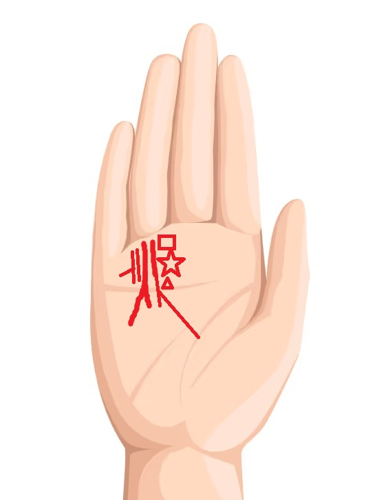
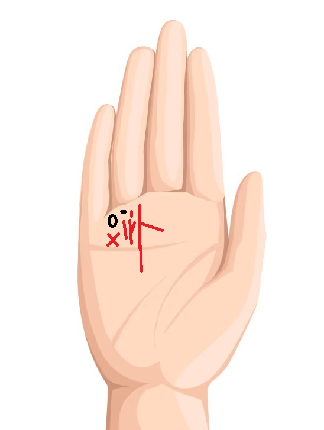
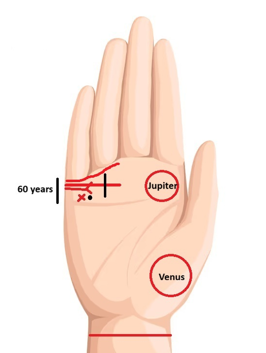

# জ্যোতিষ নোটস (Vedic Astrology Notes)

---

## সূচিপত্র (Table of Contents)

**[পর্ব A — মৌলিক ভিত্তি](#part-a)**

- [১. ১২ রাশি (Signs)](#s1)
- [২. রাশির প্রকৃতি (চর, স্থির, দ্বিস্বভাব) ও তাদের বৈশিষ্ট্য](#s2)
- [৩. জ্যোতিষের ৪টি মৌলিক তত্ত্ব (Elements / Tatwa)](#s3)
- [৪. ২৭ নক্ষত্র সংক্ষিপ্ত বিবরণ](#s4)
- [৫. বৈদিক জ্যোতিষে ১২ ভাব (House) এবং তাদের শুভ-অশুভ ফল](#s5)

**[পর্ব B — গ্রহ](#part-b)**

- [৬. ৯ গ্রহের উচ্চ (Exalted), নীচ (Debilitated), নিজ (Own) ও মূলত্রিকোণ রাশি](#s6)
- [৭. ৯ গ্রহের মৈত্রী (Friendship) টেবিল](#s7)
- [৮. ভালো ও দুর্বল গ্রহ সমন্বয়](#s8)
- [৯. গ্রহের অবস্থা (Avastha) — বাল্য, কুমার, যুবা, বৃদ্ধ, মৃত](#s9)
- [১০. গ্রহের দৃষ্টি (Graha Drishti)](#s10)
- [১১. বক্রী (Retrograde) ও অস্ত/দগ্ধ (Combust) গ্রহ কী?](#s11)
- [১২. ষড়বলা (Shadbala) কী?](#s12)
- [১৩. গ্রহ সংযোগ ও সম্ভাব্য স্বাস্থ্য প্রবণতা](#s13)
- [১৩.১ আত্মকারক (Atmakaraka) গ্রহ, আমাত্যকারক (Amatyakaraka) গ্রহ ও অতিবিশিষ্টকারক (Ati Vishesh Karaka) গ্রহ](#s13.1)

**[পর্ব C — নক্ষত্র ও পঞ্চাঙ্গ](#part-c)**

- [১৪. চরণ (Pada / Charan) কী?](#s14)
- [১৫. গণ (Gana)](#s15)
- [১৬. বর্ণ (Varna)](#s16)
- [১৭. তিথি (Tithi)](#s17)
- [১৭.১ তারা চক্র (Tara Chakra)](#s17.1)
- [১৮. যোগ (Yoga)](#s18)
- [১৯. ১১টি করণ (Karana) ও সম্ভাব্য পেশা/ব্যবসা](#s19)

**[পর্ব D — দশা, দোষ ও ভাবফল](#part-d)**

- [২০. দশার স্তরসমূহ](#s20)
- [২১. প্রধান দোষ (Dosha)](#s21)
- [২২. সর্বাষ্টকবর্গ (Sarvashtakavarga) অনুযায়ী ১২ ভাব কী নির্দেশ করে](#s22)
- [২৩. লগ্নেশ (Lagnesh) ১২টি ঘরে থাকলে ফল](#s23)
- [২৪. ৫ম ভাবের অধিপতি (Panchamesh / 5th Lord) ১২টি ঘরে](#s24)
- [২৫. ৯ম ভাবের অধিপতি (Bhagyesh / 9th Lord) ১২টি ঘরে](#s25)
- [২৬. উপগ্রহ (Upagraha) কোন ঘরে কী ফল দেয়?](#s26)
- [২৭. গুরুত্বপূর্ণ যোগ ও দোষ (বিস্তারিত)](#s27)
- [২৮. পেশাভিত্তিক যোগ](#s28)
- [২৯. 💰 ধন-সম্পদ বিচার (কতটা অর্থ সঞ্চয় ও সম্পদ হবে)](#s29)
- [৩০. ✈️ বিদেশে স্থায়ী বসবাস / ফরেন সেটেলমেন্ট যোগ](#s30)
- [৩০.1. পদোন্নতি (Promotion) যোগ ](#s30.1)
- [৩০.2. 🏥 Medical Service / Healthcare Profession Yog](#s30.2)
- [৩০.3. ব্যভিচার যোগ](#s30.3)

**[পর্ব E — রত্ন (Gemstones)](#part-e)**

- [৩১. পেশা অনুযায়ী রত্ন নির্বাচন](#s31)
- [৩২. স্বাস্থ্য অনুযায়ী রত্ন নির্বাচন (জ্যোতিষীয় বিশ্বাস অনুযায়ী)](#s32)
- [৩৩. এই রত্ন/ক্রিস্টাল কেন পরা হয়?](#s33)
- [৩৪. সমস্যা অনুযায়ী রত্ন (জ্যোতিষীয় বিশ্বাস অনুযায়ী)](#s34)
- [৩৫. মূলাঙ্ক (Mulank) অনুযায়ী প্রচলিত রত্ন](#s35)
- [৩৬. লগ্ন অনুযায়ী প্রধান রত্ন](#s36)
- [৩৭. বিপরীতধর্মী রত্ন](#s37)
- [৩৮. তিল, চিহ্ন, রেখা ও পর্বত অনুযায়ী রত্ন](#s38)

**[পর্ব F — অন্যান্য প্রতিকার ও বাস্তু](#part-f)**

- [৩৯. বৈদিক জ্যোতিষে ১ থেকে ১৪ মুখী রুদ্রাক্ষ ও তাদের প্রচলিত ব্যবহার](#s39)
- [৪০. বৈদিক জ্যোতিষে বিভিন্ন গাছের মূল (মূলা)](#s40)
- [৪১. বাস্তু (Vastu) অনুযায়ী ভালো ও খারাপ সমন্বয় এবং সম্ভাব্য প্রভাব](#s41)
- [৪২. রত্ন, রুদ্রাক্ষ ও মূল ছাড়া সাধারণত প্রচলিত প্রতিকার (উপায়)](#s42)

**[পর্ব G — বিবাহ](#part-g)**

- [৪৩. বিবাহ ও দাম্পত্য সুখ বিচার](#s43)
- [৪৪. অষ্টকবর্গ (Ashtakavarga)](#s44)
- [৪৫. জন্মবার অনুযায়ী স্বভাব ও জীবনপ্রবণতা](#s45)
---

# পর্ব A — মৌলিক ভিত্তি

---

## ১. ১২ রাশি (Signs)

### ১. মেষ (Aries)
- **স্বভাব:**  সাহসী, দ্রুত সিদ্ধান্তকারী, নেতৃত্বপ্রবণ, আধিপত্যপ্রবণ, আত্মসম্মানবোধ প্রবল,মানসিক দৃঢ়তা ও প্রতিশোধপরায়ণ মনোভাব থাকতে পারে,বয়সে বড় ব্যক্তির প্রতি আকর্ষণ দেখা যেতে পারে
- **বুদ্ধি:**  তৎক্ষণাৎ সিদ্ধান্ত, বাস্তবমুখী, স্বাধীনতাপ্রিয় ও অত্যন্ত পরিশ্রমী,স্বার্থপর,নিজের ইচ্ছাকে বেশি গুরুত্ব দেয়
- **শারীরিক গঠন:**  অ্যাথলেটিক, তেজস্বী
- **পেশা:**  সেনাবাহিনী, পুলিশ, ইঞ্জিনিয়ার, সার্জন, খেলোয়াড়,চিকিৎসাবিজ্ঞান, পশুচিকিৎসা ও প্রযুক্তিগত বিষয়ে আগ্রহ
- **ব্যবসা:** লোহা, মেশিনারি, কনস্ট্রাকশন
- **বিবাহ:** আধিপত্য প্রবণতা থাকলে দ্বন্দ্ব
- **ভাগ্য:** পরিশ্রমের মাধ্যমে উন্নতি
- **মিত্র রাশি:** মিথুন, কন্যা, মীন
- **শত্রু রাশি:** কর্কট, বৃশ্চিক
 
### ২. বৃষ (Taurus)
- **স্বভাব:** ভদ্র, স্থির, ধৈর্যশীল, ভোগপ্রিয়,পরিবারমুখী ও আরামপ্রিয়,প্রেমে possessive স্বভাব, মমতা ও ভালোবাসা প্রবল,বিপরীত লিঙ্গের প্রতি আকর্ষণ,প্রতিশোধের চিন্তা থাকতে পারে,সাধারণত স্বার্থপর নয়
- **বুদ্ধি:** বাস্তব ও আর্থিক চিন্তা,ধৈর্য ও মানসিক শক্তি বেশি,সৃজনশীল মানসিকতা ও ন্যায়বোধসম্পন্ন,মায়া
- **গঠন:** শক্তিশালী শরীর
- **পেশা:** ব্যাংকিং, সংগীত, কৃষি, ফাইন্যান্স
- **ব্যবসা:** গয়না, ফ্যাশন, খাদ্য
- **বিবাহ:** স্থায়ী সম্পর্ক
- **ভাগ্য:** ধীরে ধীরে সম্পদ বৃদ্ধি
- **মিত্র রাশি:** কন্যা, মকর
- **শত্রু রাশি:** উল্লেখযোগ্য নয়
 
### ৩. মিথুন (Gemini)
- **স্বভাব:**  চটপটে, যোগাযোগে দক্ষ,জ্ঞানী কিন্তু প্রচারপ্রিয় নয়,চতুর ও বহুমুখী প্রতিভাবান,মানসিক দ্বন্দ্বে ভোগার প্রবণতা,অন্তরে শিশুসুলভ মন থাকে,প্রকৃতিপ্রেমী,প্রেমজীবনে সবসময় স্থির বা বিশ্বস্ত নাও হতে পারে
- **বুদ্ধি:** বিশ্লেষণাত্মক
- **পেশা:** IT, লেখক, শিক্ষক, সাংবাদিক,সাহিত্য, বিজ্ঞান, জ্যোতিষ,চিকিৎসায় আগ্রহ
- **ব্যবসা:** মার্কেটিং, মিডিয়া,শিল্প, অভিনয় ও সংগীতপ্রেমী
- **বিবাহ:** মানসিক মিল গুরুত্বপূর্ণ
- **ভাগ্য:** নেটওয়ার্কিং থেকে লাভ
- **মিত্র রাশি:** তুলা, কুম্ভ
- **শত্রু রাশি:** কন্যা, মকর
 
### ৪. কর্কট (Cancer)
- **স্বভাব:** বাইরে দৃঢ় ভেতরে আবেগপ্রবণ, যত্নশীল,প্রবল অন্তর্দৃষ্টি ও চিন্তাশক্তি,গোপনীয়তা রক্ষা করতে পছন্দ করে,সমালোচনা সহ্য করতে কষ্ট হয়,গোপন সম্পর্ক বা অবৈধ সম্পর্কের সম্ভাবনা থাকতে পারে,অর্থব্যয়ে সংযমী বা কৃপণ স্বভাব,হঠাৎ রেগে যাওয়ার প্রবণতা
- **বুদ্ধি:** অনুভূতিনির্ভর,বিলাসিতা ও নিরাপত্তার প্রতি আকর্ষণ
- **পেশা:** নার্সিং, হোটেল, শিক্ষা
- **ব্যবসা:** রিয়েল এস্টেট, জলসম্পর্কিত কাজ
- **বিবাহ:** পরিবারকেন্দ্রিক
- **ভাগ্য:** পরিবার থেকে সহায়তা
- **মিত্র রাশি:** বৃশ্চিক, মীন
- **শত্রু রাশি:** তুলা, ধনু, কুম্ভ
 
### ৫. সিংহ (Leo)
- **স্বভাব:** রাজসিক, আত্মবিশ্বাসী,অভিজাত ও মর্যাদাবোধসম্পন্ন,প্রবল আত্মসম্মান ও নেতৃত্বগুণ,জেদি হলেও দৃঢ় প্রতিজ্ঞ,রহস্য ও কৌশলপ্রিয়,গর্ববোধ ও মর্যাদাবোধ বেশি,কখনও অলসতা দেখা যায়,একগুঁয়ে স্বভাব,চালাক ও কৌশলী
- **বুদ্ধি:** নেতৃত্বমূলক,সৃজনশীল ও প্রেরণাদায়ক,সাহসিকতা
- **পেশা:** প্রশাসন, রাজনীতি, ম্যানেজমেন্ট
- **ব্যবসা:** ব্র্যান্ড, বিলাসপণ্য
- **বিবাহ:** সম্মান না পেলে সমস্যা
- **ভাগ্য:** খ্যাতি ও মর্যাদা
- **মিত্র রাশি:** বৃশ্চিক, মকর, মীন
- **শত্রু রাশি:** মেষ, বৃষ, কর্কট, কন্যা, তুলা
 
### ৬. কন্যা (Virgo)
- **স্বভাব:** বিশ্লেষক, নিখুঁততাপ্রিয়,আকর্ষণশক্তি ভালো,ভবিষ্যৎ নিয়ে উদ্বেগ প্রবল,আরামপ্রিয় ও কখনও ঈর্ষাপ্রবণ,অর্থের প্রতি আকর্ষণ বেশি,প্রকৃতিপ্রেমী
- **বুদ্ধি:** যৌক্তিক, বিশ্লেষণী ক্ষমতা শক্তিশালী,রোমাঞ্চপ্রিয়,আত্মঅভিমান প্রবল
- **পেশা:** সফটওয়্যার, অ্যাকাউন্ট্যান্ট, গবেষক,সংগীত, সাহিত্য ও কলার প্রতি আকর্ষণ
- **ব্যবসা:** ডাটা, পরামর্শ, স্বাস্থ্যসেবা
- **বিবাহ:** অতিরিক্ত সমালোচনার প্রবণতা
- **ভাগ্য:** দক্ষতা থেকে উন্নতি
- **মিত্র রাশি:** বৃষ, মকর
- **শত্রু রাশি:** মেষ, ধনু, কুম্ভ
 
### ৭. তুলা (Libra)
- **স্বভাব:** ভারসাম্যপূর্ণ, কূটনৈতিক,ন্যায়পরায়ণ ও বিচার-বিশ্লেষণক্ষম,মানুষের চরিত্র বুঝতে সক্ষম,গুপ্তবিদ্যার প্রতি আগ্রহ,প্রেম ও রোমান্সে আগ্রহী,আত্মকেন্দ্রিক প্রবণতা থাকতে পারে,আকর্ষণীয় ব্যক্তিত্ব,প্রেমে বিচ্ছেদ হলে হতাশা বা বিষণ্ণতা দেখা দিতে পারে
- **বুদ্ধি:** সামাজিক,স্পষ্টবাদী
- **পেশা:** আইন, HR, ডিজাইন
- **ব্যবসা:** ফ্যাশন, পার্টনারশিপ,শিল্পীসুলভ মনোভাব
- **বিবাহ:** সাধারণত শুভ
- **ভাগ্য:** সম্পর্ক থেকে উন্নতি
- **মিত্র রাশি:** মিথুন, বৃশ্চিক, কুম্ভ
- **শত্রু রাশি:** বৃষ, মকর, মীন
 
### ৮. বৃশ্চিক (Scorpio)
- **স্বভাব:** প্রচণ্ড আবেগপ্রবণ ও গভীর অনুভূতিশীল,সহজে কাউকে ক্ষমা করে না,আত্মমর্যাদা/অহংবোধ প্রবল,রহস্যময় ও অপ্রত্যাশিত আচরণ,সকলের পরামর্শ শোনে, কিন্তু সিদ্ধান্ত নিজে নেয়,প্রবল জেদ,যৌন আকর্ষণ ও আবেগ প্রবল,সম্পর্ক বা বিবাহে দেরি হতে পারে
- **বুদ্ধি:** অনুসন্ধানী,নিজের সিদ্ধান্তে চলতে পছন্দ করে
- **পেশা:** গোয়েন্দা, সার্জন, সাইবার সিকিউরিটি
- **ব্যবসা:** গবেষণা, কেমিক্যাল
- **বিবাহ:** Possessive হতে পারে
- **ভাগ্য:** সংকট জয় করে উন্নতি
- **মিত্র রাশি:** মিথুন, কর্কট
 - **শত্রু রাশি:** মেষ, কুম্ভ
 
### ৯. ধনু (Sagittarius)
- **স্বভাব:** আদর্শবাদী, ধর্মপ্রবণ,আধ্যাত্মিক,পরিশ্রমী ও দৃঢ়চেতা,অন্যায় সহ্য করতে পারে না,পরিবার ও সন্তানের জন্য ত্যাগ স্বীকারে প্রস্তুত,নিজের বিষয় গোপন রাখতে পছন্দ করে,অর্থ উপার্জনকে সবসময় প্রধান লক্ষ্য মনে করে না,সংসার জীবনে কিছু অশান্তি থাকতে পারে,বিবাহিত জীবনে সাধারণত দায়িত্বশীল ও নিবেদিত
- **বুদ্ধি:** দার্শনিক
- **পেশা:** শিক্ষক, কনসালট্যান্ট, ম্যানেজমেন্ট, IT Architect,সাহিত্য, আইন
- **ব্যবসা:** শিক্ষা, সফটওয়্যার, পরামর্শ
- **বিবাহ:** স্বাধীনতা পছন্দ
- **ভাগ্য:** বিদেশ ও জ্ঞান থেকে উন্নতি
- **মিত্র রাশি:** মেষ, সিংহ
 - **শত্রু রাশি:** বৃষ, কর্কট, মীন
 
### ১০. মকর (Capricorn)
- **স্বভাব:** শৃঙ্খলাবদ্ধ,দায়িত্বশীল ও পরিশ্রমী,ভ্রমণপ্রিয়,একাধিক আয়ের উৎস তৈরির প্রবণতা,বৈজ্ঞানিক দৃষ্টিভঙ্গি ও তীক্ষ্ণ বুদ্ধি,বাইরে শান্ত হলেও ভিতরে চঞ্চল,প্রতিশোধপরায়ণতা দেখা যেতে পারে,পরিপাটি ও টিপটপ থাকতে পছন্দ করে,ভ্রমণপিপাসু,একাধিক আয়ের উৎস তৈরির প্রবণতা,একাধিক সম্পর্কে জড়ানোর সম্ভাবনা কিছু ক্ষেত্রে দেখা যায়
- **বুদ্ধি:** বাস্তববাদী,নিখুঁতভাবে কাজ সম্পন্ন করতে চায়
- **পেশা:** প্রশাসন, প্রকৌশল
- **ব্যবসা:** নির্মাণ, খনিজ
- **বিবাহ:** দেরিতে স্থিতিশীল
- **ভাগ্য:** ধীরে ধীরে সাফল্য
- **মিত্র রাশি:** বৃষ, কন্যা
 - **শত্রু রাশি:** মেষ, মিথুন, সিংহ
 
### ১১. কুম্ভ (Aquarius)
- **স্বভাব:** উদ্ভাবনী,অন্তর্মুখী কিন্তু গভীর চিন্তাশীল,বন্ধুদের প্রতি নিবেদিত,রাজনৈতিক ও সামাজিক বিষয়ে সফল হতে পারে,নতুন পরিস্থিতির সঙ্গে দ্রুত মানিয়ে নিতে পারে,যৌন আকাঙ্ক্ষা প্রবল হতে পারে,অত্যন্ত জেদি,বন্ধুত্বে আন্তরিক ও নিবেদিত,বিবাহে বিলম্ব বা জটিলতা হতে পারে
- **বুদ্ধি:** বিজ্ঞানমনস্ক,আত্মসম্মানবোধ প্রবল,দূরদর্শী চিন্তাভাবনা
- **পেশা:** AI, Data Science, Technology,law
- **ব্যবসা:** স্টার্টআপ
- **বিবাহ:** বন্ধুত্বভিত্তিক সম্পর্ক
- **ভাগ্য:** নতুন ধারণা থেকে উন্নতি
- **মিত্র রাশি:** মিথুন, তুলা
- **শত্রু রাশি:** বৃষ, কর্কট
 
### ১২. মীন (Pisces)
- **স্বভাব:** কল্পনাপ্রবণ, আধ্যাত্মিক ও ধর্মীয় মনোভাব,দয়ালু ও উদার,বিলাসিতা পছন্দ করে,সিদ্ধান্তহীনতায় ভুগতে পারে,বিবাহিত জীবনে বিশ্বস্ত, কিন্তু প্রেমজীবনে বিভ্রান্তি দেখা যেতে পারে,অর্থ অপচয়ের প্রবণতা থাকতে পারে,পোশাক-পরিচ্ছদে শৌখিন,কম সামাজিক বা একাকী থাকতে পছন্দ করে
- **বুদ্ধি:** Intuitive
- **পেশা:** শিল্প, চিকিৎসা, আধ্যাত্মিকতা
- **ব্যবসা:** ক্রিয়েটিভ ও ওয়েলনেস
- **বিবাহ:** সংবেদনশীল
- **ভাগ্য:** আধ্যাত্মিক উন্নতি
- **মিত্র রাশি:** কর্কট, বৃশ্চিক
- **শত্রু রাশি:** মিথুন, সিংহ, তুলা

[↑ সূচিপত্রে ফিরুন](#top)

---

## ২. রাশির প্রকৃতি (চর, স্থির, দ্বিস্বভাব) ও তাদের বৈশিষ্ট্য

বৈদিক জ্যোতিষে ১২টি রাশিকে ৩ ভাগে ভাগ করা হয়: **চর রাশি (Movable)**, **স্থির রাশি (Fixed)**, **দ্বিস্বভাব রাশি (Dual/Mutable)**।

### ১. চর রাশি (চলমান প্রকৃতি)
- **রাশি:** মেষ, কর্কট, তুলা, মকর
- **স্বভাব:** ✅ পরিবর্তন পছন্দ করে · ✅ দ্রুত সিদ্ধান্ত নেয় · ✅ ভ্রমণপ্রিয় · ✅ নতুন কাজ শুরু করতে পছন্দ করে
- **দুর্বলতা:** ❌ স্থিরতা কম · ❌ চাকরি বা জায়গা বারবার পরিবর্তন
- **বুদ্ধি:** কার্যকরী, দ্রুত সিদ্ধান্তমূলক
- **পেশা:** ম্যানেজমেন্ট, প্রশাসন, রাজনীতি, সেলস, প্রকল্প ব্যবস্থাপনা
- **ব্যবসা:** Startup, Import Export, Logistics, Real Estate

### ২. স্থির রাশি (Fixed Signs)
- **রাশি:** বৃষ, সিংহ, বৃশ্চিক, কুম্ভ
- **স্বভাব:** ✅ ধৈর্যশীল · ✅ দৃঢ়প্রতিজ্ঞ · ✅ স্থায়িত্ব পছন্দ করে
- **দুর্বলতা:** ❌ জেদি · ❌ পরিবর্তন অপছন্দ
- **বুদ্ধি:** গভীর, দীর্ঘমেয়াদী
- **পেশা:** ব্যাংকিং, সরকারী চাকরি, গবেষণা, কর্পোরেট
- **ব্যবসা:** Factory, Manufacturing, Property, Mining

### ৩. দ্বিস্বভাব রাশি (Dual/Mutable)
- **রাশি:** মিথুন, কন্যা, ধনু, মীন
- **স্বভাব:** ✅ অভিযোজন ক্ষমতা বেশি · ✅ শেখার ক্ষমতা বেশি · ✅ একাধিক বিষয় নিয়ে কাজ করতে পারে
- **দুর্বলতা:** ❌ Confusion · ❌ Decision Delay
- **বুদ্ধি:** বিশ্লেষণী, জ্ঞানভিত্তিক
- **পেশা:** Software Engineer, Teacher, Consultant, Data Scientist, Researcher
- **ব্যবসা:** Education, IT, Consultancy, Digital Business

### 🔑 ট্রিক: রাশির প্রকৃতি ও বাধক ভাব

| রাশির প্রকৃতি | রাশি | বাধক ভাব | বাধকেশ (বাধক ভাবের অধিপতি) |
|---|---|---|---|
| চর রাশি (Movable) | মেষ (১), কর্কট (৪), তুলা (৭), মকর (১০) | ১১শ ভাব | ১১শ ভাবের অধিপতি |
| স্থির রাশি (Fixed) | বৃষ (২), সিংহ (৫), বৃশ্চিক (৮), কুম্ভ (১১) | ৯ম ভাব | ৯ম ভাবের অধিপতি |
| দ্বিস্বভাব রাশি (Dual) | মিথুন (৩), কন্যা (৬), ধনু (৯), মীন (১২) | ৭ম ভাব | ৭ম ভাবের অধিপতি |

[↑ সূচিপত্রে ফিরুন](#top)

---

## ৩. জ্যোতিষের ৪টি মৌলিক তত্ত্ব (Elements / Tatwa)

বৈদিক জ্যোতিষে ১২টি রাশি ৪টি তত্ত্বে বিভক্ত: 🔥 **অগ্নি (Fire)**, 🌍 **পৃথিবী (Earth)**, 🌬️ **বায়ু (Air)**, 🌊 **জল (Water)**।

প্রতিটি তত্ত্ব মানুষের চিন্তা, আচরণ, পেশা, বিবাহ, স্বাস্থ্য ও জীবনধারাকে প্রভাবিত করে বলে জ্যোতিষে ধরা হয়।

### 🔥 অগ্নি তত্ত্ব (Fire Signs)
- **রাশি:** মেষ, সিংহ, ধনু
- **মূল বৈশিষ্ট্য:** ✅ সাহসী · ✅ আত্মবিশ্বাসী · ✅ নেতৃত্বপ্রবণ · ✅ ঝুঁকি নিতে পছন্দ করে · ✅ Leadership and energetic
- **দুর্বলতা:** ❌ রাগী · ❌ অধৈর্য · ❌ অহং প্রবণ
- **বুদ্ধি:** ভিশনারি, বড় চিন্তা, দ্রুত সিদ্ধান্ত
- **পেশা:** IAS/IPS, সেনাবাহিনী, পুলিশ, CEO, রাজনীতি, শিক্ষক, কর্পোরেট নেতৃত্ব
- **ব্যবসা:** Startup, Real Estate, Construction, Consultancy
- **বিবাহ:** স্বাধীনতা চায়, কর্তৃত্ব করতে পছন্দ করে
- **স্বাস্থ্য:** জ্বর, উচ্চ রক্তচাপ, চোখ, মাথা
- **রত্ন:** মাণিক্য, মুঙ্গা, পুখরাজ

### 🌍 পৃথিবী তত্ত্ব (Earth Signs)
- **রাশি:** বৃষ, কন্যা, মকর
- **মূল বৈশিষ্ট্য:** ✅ বাস্তববাদী · ✅ ধৈর্যশীল · ✅ অর্থমুখী · ✅ পরিকল্পনাকারী · ✅ Stable and hardworking
- **দুর্বলতা:** ❌ জেদি · ❌ অতিরিক্ত বাস্তববাদী
- **বুদ্ধি:** বিশ্লেষণধর্মী, হিসাবী
- **পেশা:** ব্যাংকার, CA, Accountant, Civil Engineer, Project Manager
- **ব্যবসা:** Property, Agriculture, Manufacturing, Finance
- **বিবাহ:** স্থায়ী সম্পর্ক, পরিবারকেন্দ্রিক
- **স্বাস্থ্য:** ওজন বৃদ্ধি, হজম, হাড়
- **রত্ন:** পান্না, নীলম, হীরা

### 🌬️ বায়ু তত্ত্ব (Air Signs)
- **রাশি:** মিথুন, তুলা, কুম্ভ
- **মূল বৈশিষ্ট্য:** ✅ যোগাযোগ দক্ষ · ✅ উদ্ভাবনী · ✅ সামাজিক · ✅ Communicator and participator · ✅ Creative
- **দুর্বলতা:** ❌ অস্থির মন · ❌ সিদ্ধান্তহীনতা
- **বুদ্ধি:** আইডিয়া জেনারেশন, ইনোভেশন
- **পেশা:** Software Engineer, Data Scientist, Marketing, HR, UI/UX
- **ব্যবসা:** Digital Marketing, Media, Technology, E-commerce
- **বিবাহ:** বন্ধুত্বভিত্তিক সম্পর্ক, মানসিক সংযোগ খোঁজে
- **স্বাস্থ্য:** স্নায়ু, উদ্বেগ, অনিদ্রা
- **রত্ন:** পান্না, নীলম, গোমেদ

### 🌊 জল তত্ত্ব (Water Signs)
- **রাশি:** কর্কট, বৃশ্চিক, মীন
- **মূল বৈশিষ্ট্য:** ✅ আবেগপ্রবণ · ✅ অন্তর্দৃষ্টিসম্পন্ন · ✅ আধ্যাত্মিক · ✅ Attraction · ✅ Power of flexibility
- **দুর্বলতা:** ❌ অতিসংবেদনশীল · ❌ Mood Swing · ❌ Sensitive
- **বুদ্ধি:** Intuitive, Emotional Intelligence
- **পেশা:** Doctor, Counselor, Psychologist, Astrologer, Researcher, সাঁতারু,fishary,navy,politic,political science
- **ব্যবসা:** Healthcare, Spiritual, Tourism
- **বিবাহ:** গভীর আবেগময় সম্পর্ক, অত্যন্ত বিশ্বস্ত
- **স্বাস্থ্য:** জলীয় ভারসাম্য, মানসিক চাপ, হরমোন
- **রত্ন:** মুক্তো, পুখরাজ, লাহসুনিয়া

### তত্ত্বের পারস্পরিক সম্পর্ক

| তত্ত্বের সমন্বয় | সম্পর্ক |
|---|---|
| 🔥 অগ্নি + 🌬️ বায়ু | ✅ বন্ধু |
| 🌎 পৃথিবী + 🌊 জল | ✅ বন্ধু |
| 🔥 অগ্নি + 🌊 জল | ❌ শত্রু |
| 🌎 পৃথিবী + 🌬️ বায়ু | ❌ শত্রু |
| 🔥 অগ্নি + 🌎 পৃথিবী | ❌ শত্রু |
| 🌬️ বায়ু + 🌊 জল | ❌ শত্রু |

### 🌍 গ্রহের পঞ্চতত্ত্ব (Elements of Planets)

| তত্ত্ব | গ্রহ |
|---|---|
| 🔥 অগ্নি তত্ত্ব | রবি (সূর্য), মঙ্গল |
| 🌊 জল তত্ত্ব | চন্দ্র, শুক্র |
| 🌎 পৃথিবী তত্ত্ব | বুধ |
| 🌌 আকাশ তত্ত্ব | বৃহস্পতি |
| 🌬️ বায়ু তত্ত্ব | শনি,রাহু,কেতু  |

[↑ সূচিপত্রে ফিরুন](#top)

### পঞ্চতত্ত্বের আধিক্য ও ঘাটতি

| তত্ত্ব | অতিরিক্ত হলে | ঘাটতি হলে |
|---|---|---|
| 🔥 অগ্নি | রাগ, অহং, তাড়াহুড়ো, অধৈর্য | আত্মবিশ্বাসের অভাব |
| 🌍 পৃথিবী | জড়তা, রক্ষণশীলতা, বাস্তববাদী, পরিবর্তন অপছন্দ | অস্থিতিশীলতা |
| 💧 জল | আবেগপ্রবণতা, হতাশা, সেন্টিমেন্টাল, নির্ভরশীলতা | অনুভূতিহীনতা |
| 🌪️ বায়ু | উদ্বেগ, অস্থিরতা, অতিরিক্ত চিন্তা, অনিদ্রা, গ্যাস ও বাত | যোগাযোগে দুর্বলতা |
---

## ৪. ২৭ নক্ষত্র সংক্ষিপ্ত বিবরণ

| # | নক্ষত্র | অধিপতি গ্রহ | বৈশিষ্ট্য | পেশা |
|---|---|---|---|---|
| ১ | অশ্বিনী | ☋ কেতু | দ্রুত সিদ্ধান্ত, Speed + Healing | ডাক্তার, খেলোয়াড় |
| ২ | ভরণী | ♀️ শুক্র | শক্তিশালী ইচ্ছা | আইন, প্রশাসন |
| ৩ | কৃত্তিকা | ☀️ রবি | নেতৃত্ব | সেনা, পুলিশ |
| ৪ | রোহিণী | 🌙 চন্দ্র | আকর্ষণীয় ব্যক্তিত্ব | ফ্যাশন, কৃষি, শিল্প |
| ৫ | মৃগশিরা | ♂️ মঙ্গল | অনুসন্ধানী মন | IT, গবেষণা |
| ৬ | আর্দ্রা | ☊ রাহু | গভীর বিশ্লেষক | প্রযুক্তি, বিজ্ঞান |
| ৭ | পুনর্বসু | ♃ বৃহস্পতি | পুনর্গঠন ক্ষমতা | শিক্ষকতা |
| ৮ | পুষ্য | ♄ শনি | শুভ ও পোষণকারী | ম্যানেজমেন্ট, ধর্ম |
| ৯ | আশ্লেষা | ☿ বুধ | রহস্যময় | মনোবিজ্ঞান, গুপ্তবিদ্যা |
| ১০ | মঘা | ☋ কেতু | রাজকীয় | প্রশাসন, রাজনীতি |
| ১১ | পূর্বফাল্গুনী | ♀️ শুক্র | সৃজনশীল | মিডিয়া, বিনোদন |
| ১২ | উত্তরফাল্গুনী | ☀️ রবি | দায়িত্বশীল | সরকারি চাকরি |
| ১৩ | হস্ত | 🌙 চন্দ্র | দক্ষ হাত | সফটওয়্যার, কারিগরি |
| ১৪ | চিত্রা | ♂️ মঙ্গল | ডিজাইনপ্রবণ | আর্কিটেক্ট, UI/UX |
| ১৫ | স্বাতী | ☊ রাহু | স্বাধীন | ব্যবসা, বিদেশ বাণিজ্য |
| ১৬ | বিশাখা | ♃ বৃহস্পতি | লক্ষ্যভেদী | Sales, Marketing |
| ১৭ | অনুরাধা | ♄ শনি | বন্ধুত্বপূর্ণ | HR, Management |
| ১৮ | জ্যেষ্ঠা | ☿ বুধ | কর্তৃত্বশীল | প্রশাসন |
| ১৯ | মূলা | ☋ কেতু | মূল কারণ অনুসন্ধানী | Research, Data Science |
| ২০ | পূর্বাষাঢ়া | ♀️ শুক্র | আত্মবিশ্বাসী | Public Speaking |
| ২১ | উত্তরাষাঢ়া | ☀️ রবি | দীর্ঘমেয়াদি সাফল্য | IAS, প্রশাসন |
| ২২ | শ্রবণা | 🌙 চন্দ্র | শেখার ক্ষমতা বেশি | শিক্ষক, Consultant |
| ২৩ | ধনিষ্ঠা | ♂️ মঙ্গল | অর্থ ও খ্যাতি | Finance, Music |
| ২৪ | শতভিষা | ☊ রাহু | প্রযুক্তি ও গবেষণা | AI, Cyber Security, Doctor |
| ২৫ | পূর্বভাদ্রপদ | ♃ বৃহস্পতি | রহস্যময় | গবেষণা, আধ্যাত্মিকতা |
| ২৬ | উত্তরভাদ্রপদ | ♄ শনি | গভীর ও স্থির | শিক্ষা, বিচার |
| ২৭ | রেবতী | ☿ বুধ | শ্রমশীল, সহানুভূতিশীল | IT, Travel, Consultancy |

| নক্ষত্র       | গণ     | প্রকৃতি  | চরিত্র                                     | শুভ দিক |
| ------------- | ------ | -------- | ------------------------------------------ | ------- |
| অশ্বিনী       | দেব    | সৌম্য    | দ্রুত, উদ্যোগী, সাহায্যপ্রবণ               | দক্ষিণ  |
| ভরণী          | মনুষ্য | বিপদ     | দৃঢ়, ভোগপ্রবণ, কর্তৃত্বপরায়ণ             | পশ্চিম  |
| কৃত্তিকা      | রাক্ষস | সাংঘাতিক | তেজস্বী, কঠোর, স্পষ্টবাদী                  | উত্তর   |
| রোহিণী        | মনুষ্য | বিপদ     | আকর্ষণীয়, সৃজনশীল, ভোগপ্রবণ               | পূর্ব   |
| মৃগশিরা       | দেব    | সৌম্য    | অনুসন্ধিৎসু, চঞ্চল, জ্ঞানপিপাসু            | দক্ষিণ  |
| আর্দ্রা       | মনুষ্য | বিপদ     | আবেগপ্রবণ, গবেষক, সংগ্রামী                 | পশ্চিম  |
| পুনর্বসু      | দেব    | সৌম্য    | দয়ালু, ধার্মিক, আশাবাদী                   | উত্তর   |
| পুষ্যা        | দেব    | সৌম্য    | লালনকারী, শিক্ষকসুলভ, কল্যাণকারী           | পূর্ব   |
| আশ্লেষা       | রাক্ষস | সাংঘাতিক | রহস্যময়, কূটনৈতিক, গভীর চিন্তক            | দক্ষিণ  |
| মঘা           | রাক্ষস | সাংঘাতিক | গৌরবপ্রিয়, পূর্বপুরুষমুখী, নেতৃত্বদানকারী | পশ্চিম  |
| পূর্বফাল্গুনী | মনুষ্য | বিপদ     | আনন্দপ্রিয়, রোমান্টিক, সামাজিক            | উত্তর   |
| উত্তরফাল্গুনী | মনুষ্য | বিপদ     | দায়িত্বশীল, উদার, বাস্তববাদী              | পূর্ব   |
| হস্তা         | দেব    | সৌম্য    | দক্ষ, কর্মঠ, বুদ্ধিমান                     | দক্ষিণ  |
| চিত্রা        | রাক্ষস | সাংঘাতিক | শিল্পপ্রেমী, স্বতন্ত্র, আকর্ষণীয়          | পশ্চিম  |
| স্বাতী        | দেব    | সৌম্য    | স্বাধীনচেতা, ব্যবসাবান্ধব                  | উত্তর   |
| বিশাখা        | রাক্ষস | সাংঘাতিক | উচ্চাকাঙ্ক্ষী, লক্ষ্যনিষ্ঠ                 | পূর্ব   |
| অনুরাধা       | দেব    | সৌম্য    | বন্ধুবৎসল, শৃঙ্খলাপরায়ণ                   | দক্ষিণ  |
| জ্যেষ্ঠা      | রাক্ষস | সাংঘাতিক | প্রভাবশালী, রক্ষাকর্তা, গর্বিত             | পশ্চিম  |
| মূলা          | রাক্ষস | সাংঘাতিক | অনুসন্ধানী, মূল কারণ খোঁজে                 | উত্তর   |
| পূর্বাষাঢ়া   | মনুষ্য | বিপদ     | আত্মবিশ্বাসী, প্রতিযোগিতামুখী              | পূর্ব   |
| উত্তরাষাঢ়া   | মনুষ্য | বিপদ     | নীতিবান, অধ্যবসায়ী                        | দক্ষিণ  |
| শ্রবণা        | দেব    | সৌম্য    | শিক্ষাপ্রিয়, শ্রোতা, জ্ঞানী               | পশ্চিম  |
| ধনিষ্ঠা       | রাক্ষস | সাংঘাতিক | কর্মঠ, সংগীতপ্রিয়, ধনলাভকারী              | উত্তর   |
| শতভিষা        | রাক্ষস | সাংঘাতিক | গবেষক, রহস্যবিদ, নিরাময়কারী               | পূর্ব   |
| পূর্বভাদ্রপদ  | মনুষ্য | বিপদ     | আদর্শবাদী, গম্ভীর                          | দক্ষিণ  |
| উত্তরভাদ্রপদ  | মনুষ্য | বিপদ     | ধৈর্যশীল, আধ্যাত্মিক                       | পশ্চিম  |
| রেবতী         | দেব    | সৌম্য    | দয়ালু, রক্ষাকারী, ভ্রমণপ্রিয়             | উত্তর   |

[↑ সূচিপত্রে ফিরুন](#top)

---

## ৫. বৈদিক জ্যোতিষে ১২ ভাব (House) এবং তাদের শুভ-অশুভ ফল

জন্মকুণ্ডলীর ১২টি ভাব জীবনের ১২টি প্রধান ক্ষেত্রকে নির্দেশ করে। কোনো ভাব শক্তিশালী হলে সেই ক্ষেত্রের উন্নতি হয়, দুর্বল বা পীড়িত হলে চ্যালেঞ্জ দেখা দিতে পারে বলে জ্যোতিষে ধরা হয়।

### ১ম ভাব (লগ্ন ভাব)
- **নির্দেশ করে:**  রূপ, রং,বংশ, কুল, পারিবারিক পরিচয়, শারীরিক গঠন,শরীর, ব্যক্তিত্ব, স্বাস্থ্য,সিদ্ধান্ত গ্রহণের ক্ষমতা, আত্মবিশ্বাস, জীবনদৃষ্টি,জীবন শুরুর অবস্থা, ব্যক্তিত্ব ও স্বভাব, ইচ্ছাশক্তি (Will Power), মস্তিষ্ক, মাথা ও মুখসংক্রান্ত রোগ
- ✅ **শুভ হলে:** সুস্বাস্থ্য, আকর্ষণীয় ব্যক্তিত্ব, নেতৃত্বগুণ, আত্মবিশ্বাস
- ❌ **অশুভ হলে:** স্বাস্থ্য সমস্যা, আত্মবিশ্বাসের অভাব, জীবনে বারবার বাধা

### ২য় ভাব (ধন ভাব)
- **নির্দেশ করে:** চোখ, নাক, মুখ ,অর্থ, পরিবার, বাকশক্তি, সঞ্চয়,প্রতিবেশী পরিবেশ , খাদ্যাভ্যাস,পারিবারিক সম্পদ, বাকশক্তি ও বাণী, গলার স্বর , খাদ্যাভ্যাস, মৃত্যু-সংক্রান্ত মারক ভাব, গলার রোগ ও তোতলামি
- ✅ **শুভ হলে:** সম্পদ বৃদ্ধি, পরিবারে সুখ, সুন্দর কথা বলার ক্ষমতা
- ❌ **অশুভ হলে:** অর্থ ক্ষতি, পারিবারিক অশান্তি, ঋণ

### ৩য় ভাব (পরাক্রম ভাব)
- **নির্দেশ করে:** কান ,সাহস পরাক্রম, উদ্যোগ, ছোট ভাই-বোন, যোগাযোগ, মিডিয়া, দক্ষতা,ছোট ভ্রমণ, ডান কাঁধ, ছোট ভাই-বোনের সুখ, খেলাধুলা, যোগাযোগ, আয়ুকাল, সম্পর্ক, স্বাধীন ব্যবসা
- ✅ **শুভ হলে:** সাহসী, সফল যোগাযোগ, উদ্যোক্তা মনোভাব
- ❌ **অশুভ হলে:** আত্মবিশ্বাস কম, ভাই-বোনের সঙ্গে সমস্যা

### ৪র্থ ভাব (সুখ ভাব)
- **নির্দেশ করে:** মা,মাতৃসুখ ,পৈতৃক সম্পত্তি, বাড়ি, জমি, গাড়ি, সুখ-মানসিক শান্তি,যানবাহন, হৃদয়, স্থায়ী বসবাস (Settlement), জনতা, গণসমর্থন,হৃদয়, যকৃত (লিভার), মন, শ্বশুর,কৃষি 
- ✅ **শুভ হলে:** সম্পত্তি, সুন্দর বাড়ি, মায়ের সুখ
- ❌ **অশুভ হলে:** সম্পত্তি বিরোধ, মানসিক অশান্তি

### ৫ম ভাব (পুত্র ভাব)
- **নির্দেশ করে:** সন্তান, শিক্ষা, বুদ্ধি, প্রেম, পেট, পিঠ ,সৃজনশীলতা,যকৃত (লিভার), কিডনি, পিত্তথলি (Gall Bladder), পূর্বজন্মের পুণ্য ও কর্ম,স্থিতিশীলতা,কী করতে ভালো লাগে, স্বাভাবিক আগ্রহ,পেশামুখী কোর্স,অনিশ্চিত লাভ,রোমান্স,আকর্ষণ
- ✅ **শুভ হলে:** ভালো শিক্ষা, সন্তান সুখ, প্রেমে সাফল্য
- ❌ **অশুভ হলে:** পড়াশোনায় বাধা, প্রেমে ব্যর্থতা, সন্তান সংক্রান্ত সমস্যা

### ৬ষ্ঠ ভাব (রোগ ভাব)
- **নির্দেশ করে:** দীর্ঘস্থায়ী রোগ, ঋণ, শত্রু, প্রতিযোগিতা, চাকরি ও সেবা,দুর্ঘটনা,প্রতিযোগিতা, মামা ও কাকার পক্ষ, ডান পা,কর্মজীবনের দৈনন্দিন পরিবেশ ও চাকরির প্রকৃতি/কাজের দিক,মানসিক স্থিরতা,যৌন জীবন,মামলা-মোকদ্দমা
- ✅ **শুভ হলে:** শত্রু জয়, চাকরিতে সাফল্য, প্রতিযোগিতায় জয়
- ❌ **অশুভ হলে:** রোগ, ঋণ, মামলা

### ৭ম ভাব (বিবাহ ভাব)
- **নির্দেশ করে:** বিবাহ, জীবনসঙ্গী, ব্যবসায়িক অংশীদার,দৈনিক ব্যবসা ও ক্রয়-বিক্রয়,জনসমক্ষে ভাবমূর্তি (Public Image), পরকীয়া সম্পর্ক, মৃত্যু-সংক্রান্ত মারক ভাব,বিদেশ যাত্রা, কোমর, মূত্রাশয়, গুপ্তাঙ্গ, জাঠিমা
- ✅ **শুভ হলে:** সুখী বিবাহ, সফল পার্টনারশিপ
- ❌ **অশুভ হলে:** বিবাহে দেরি, বিচ্ছেদ, সম্পর্ক সমস্যা

### ৮ম ভাব (আয়ু ভাব)
- **নির্দেশ করে:** আয়ু, দুর্ঘটনা, গুপ্তবিদ্যা, হঠাৎ ঘটনা,আয়ু,বাধা-বিঘ্ন,উদ্বেগ, বৈবাহিক জীবনের স্থায়িত্ব, গোপন সম্পদ, গোপন রোগ, বাম পা,গোপন বিষয়,গবেষণা,শ্বশুরবাড়ি 
- ✅ **শুভ হলে:** গবেষণা, রহস্যবিদ্যা, বীমা ও উত্তরাধিকার লাভ
- ❌ **অশুভ হলে:** দুর্ঘটনা, অপারেশন, মানসিক চাপ

### ৯ম ভাব (ভাগ্য ভাব)
- **নির্দেশ করে:** ভাগ্য, ধর্ম, গুরু,পিতা, বিদেশ ভ্রমণ,বিদেশ যাত্রা, তীর্থযাত্রা,উচ্চশিক্ষা,শালা, জামাইবাবু 
- ✅ **শুভ হলে:** ভাগ্য সহায়তা, উচ্চ শিক্ষা, আধ্যাত্মিক উন্নতি
- ❌ **অশুভ হলে:** ভাগ্যের বাধা, পিতার সঙ্গে মতবিরোধ

### ১০ম ভাব (কর্ম ভাব)
- **নির্দেশ করে:** কর্মজীবন,জীবনযাত্রার মান, পেশা, সম্মান, পদ, বিবাহের সুখ,প্রতিপত্তি ও প্রতিষ্ঠা,পিতৃসুখ, শাশুড়ি, বুক ও হৃদয়
- ✅ **শুভ হলে:** উচ্চ চাকরি, খ্যাতি, নেতৃত্ব
- ❌ **অশুভ হলে:** চাকরি পরিবর্তন, ক্যারিয়ারে বাধা

### ১১তম ভাব (লাভ ভাব)
- **নির্দেশ করে:** লাভ, আয়, বন্ধু,ছোটখাটো রোগ, নেটওয়ার্ক,স্বীকৃতি (Recognition), লটারি ও আকস্মিক লাভ, বড় ভাই-বোনের সুখ, ইচ্ছাপূরণ,ডান পা,বাহন সুখ,বড় সংগঠন ও নেটওয়ার্ক
- ✅ **শুভ হলে:** প্রচুর আয়, সামাজিক সমর্থন, বড় নেটওয়ার্ক
- ❌ **অশুভ হলে:** আয় অনিয়মিত, বন্ধুর কারণে ক্ষতি

### ১২তম ভাব (ব্যয় ভাব)
- **নির্দেশ করে:** ব্যয়, বিদেশ,কারাবাস, আধ্যাত্মিকতা, হাসপাতাল, নিঃসঙ্গতা,আশ্রম, নিভৃত স্থান,চোখ,কাকা-কাকী
- ✅ **শুভ হলে:** বিদেশে সাফল্য, আধ্যাত্মিক উন্নতি, গবেষণা
- ❌ **অশুভ হলে:** অতিরিক্ত খরচ, একাকীত্ব, গোপন শত্রু

### কারক ভাব (Karak Bhava)

কোনো ভাবের কারক গ্রহ যদি সেই ভাবে অবস্থান করে, তাহলে সেই ভাবের সুখে কিছু ঘাটতি বা উদ্বেগ সৃষ্টি হতে পারে। একে **"কারক ভাব নাশায়েৎ"** বলে।

✅ কিন্তু একই কারক গ্রহ যদি সেই ভাবে **পূর্ণ দৃষ্টি** (দৃষ্টি প্রদান) করে, তাহলে সাধারণত সেই ভাবের শুভ ফল বৃদ্ধি করে এবং উপকার করে।

| ভাব | নাম | প্রধান কারক গ্রহ |
|---|---|---|
| ১ম ভাব | লগ্ন ভাব | ☀️ রবি |
| ২য় ভাব | ধন ভাব | ♃ বৃহস্পতি |
| ৩য় ভাব | পরাক্রম ভাব | ♂️ মঙ্গল |
| ৪র্থ ভাব | সুখ ভাব | 🌙 চন্দ্র, ♂️ মঙ্গল, ♀️ শুক্র |
| ৫ম ভাব | পুত্র ভাব | ♃ বৃহস্পতি |
| ৬ষ্ঠ ভাব | শত্রু ভাব | ♂️ মঙ্গল, ♄ শনি |
| ৭ম ভাব | দাম্পত্য ভাব | ♀️ শুক্র (পুরুষের জন্য), ♃ বৃহস্পতি (মহিলার জন্য) |
| ৮ম ভাব | আয়ু ভাব | ♄ শনি |
| ৯ম ভাব | ভাগ্য ভাব | ♃ বৃহস্পতি, ☀️ রবি |
| ১০ম ভাব | কর্ম ভাব | ☀️ রবি, ♃ বৃহস্পতি, ☿ বুধ |
| ১১শ ভাব | লাভ ভাব | ♃ বৃহস্পতি |
| ১২শ ভাব | ব্যয় ভাব | ♄ শনি |

[↑ সূচিপত্রে ফিরুন](#top)

---

# পর্ব B — গ্রহ

---

## ৬. ৯ গ্রহের উচ্চ (Exalted), নীচ (Debilitated), নিজ (Own) ও মূলত্রিকোণ রাশি

এটি বৈদিক জ্যোতিষের অন্যতম গুরুত্বপূর্ণ ভিত্তি।

মূলত্রিকোণ হলো কোনো গ্রহের এমন বিশেষ রাশি যেখানে গ্রহটি নিজের প্রকৃত স্বভাব, শক্তি ও কারকত্ব সবচেয়ে স্বাভাবিকভাবে প্রকাশ করতে পারে। এটি স্বক্ষেত্র (Own Sign) ও উচ্চরাশি (Exaltation)-র মাঝামাঝি একটি শক্তিশালী অবস্থান হিসেবে ধরা হয়।

| গ্রহ | উচ্চ রাশি | নীচ রাশি | নিজ রাশি | মূলত্রিকোণ |
|---|---|---|---|---|
| ☀️ সূর্য | মেষ | তুলা | সিংহ | সিংহ |
| 🌙 চন্দ্র | বৃষ | বৃশ্চিক | কর্কট | বৃষ |
| ♂️ মঙ্গল | মকর | কর্কট | মেষ, বৃশ্চিক | মেষ |
| ☿️ বুধ | কন্যা | মীন | মিথুন, কন্যা | কন্যা |
| ♃ বৃহস্পতি | কর্কট | মকর | ধনু, মীন | ধনু |
| ♀️ শুক্র | মীন | কন্যা | বৃষ, তুলা | তুলা |
| ♄ শনি | তুলা | মেষ | মকর, কুম্ভ | কুম্ভ |
| ☊ রাহু* | বৃষ (অনেক মত অনুযায়ী) | বৃশ্চিক | নির্দিষ্ট নিজ রাশি নেই | মিথুন (কিছু মত) |
| ☋ কেতু* | বৃশ্চিক | বৃষ | নির্দিষ্ট নিজ রাশি নেই | ধনু (কিছু মত) |

\* রাহু-কেতুর ক্ষেত্রে বিভিন্ন জ্যোতিষীর মত ভিন্ন।

### গ্রহের রাশি-ভিত্তিক শক্তি (আনুমানিক)

| অবস্থান | শক্তি |
|---|---|
| উচ্চ রাশি (Exalted) | ১০০% |
| মূলত্রিকোণ | ৯০% |
| নিজ রাশি (Own Sign) | ৮০% |

[↑ সূচিপত্রে ফিরুন](#top)

---

## ৭. ৯ গ্রহের মৈত্রী (Friendship) টেবিল

| গ্রহ | বন্ধু | সম (Neutral) | শত্রু |
|---|---|---|---|
| ☀️ সূর্য | চন্দ্র, মঙ্গল, বৃহস্পতি | বুধ | শুক্র, শনি |
| 🌙 চন্দ্র | সূর্য, বুধ | মঙ্গল, বৃহস্পতি, শুক্র, শনি | কেউ নয় |
| ♂️ মঙ্গল | সূর্য, চন্দ্র, বৃহস্পতি | শুক্র, শনি | বুধ |
| ☿️ বুধ | সূর্য, শুক্র | মঙ্গল, বৃহস্পতি, শনি | চন্দ্র |
| ♃ বৃহস্পতি | সূর্য, চন্দ্র, মঙ্গল | শনি | বুধ, শুক্র |
| ♀️ শুক্র | বুধ, শনি | মঙ্গল, বৃহস্পতি | সূর্য, চন্দ্র |
| ♄ শনি | বুধ, শুক্র | বৃহস্পতি | সূর্য, চন্দ্র, মঙ্গল |
| ☊ রাহু | বুধ, শুক্র, শনি | বৃহস্পতি | সূর্য, চন্দ্র, মঙ্গল |
| ☋ কেতু | মঙ্গল, বৃহস্পতি | শুক্র, শনি | সূর্য, চন্দ্র |

### তৎকালীন মৈত্রী (Tatkalin Maitri)

জন্মকুণ্ডলীতে দুই গ্রহ পরস্পরের থেকে নির্দিষ্ট ঘরে অবস্থান করলে সাময়িকভাবে বন্ধু বা শত্রু সম্পর্ক গঠন করে।

- **তৎকালীন বন্ধু (Temporary Friend):** কোনো গ্রহ থেকে গণনা করলে, তার আগের ৩ ঘর (১২শ, ১১শ, ১০ম) এবং পরের ৩ ঘর (২য়, ৩য়, ৪র্থ)-এ যে গ্রহগুলি অবস্থান করে।
- **তৎকালীন শত্রু (Temporary Enemy):** এর বাইরে অর্থাৎ একই ঘর (১ম) এবং ৫ম, ৬ষ্ঠ, ৭ম, ৮ম ও ৯ম ঘরে অবস্থানকারী গ্রহগুলি।

| ঘর (গ্রহ থেকে গণনা) | সম্পর্ক |
|---|---|
| ১০ম, ১১শ, ১২শ, ২য়, ৩য়, ৪র্থ | ✅ তৎকালীন বন্ধু |
| ১ম, ৫ম, ৬ষ্ঠ, ৭ম, ৮ম, ৯ম | ❌ তৎকালীন শত্রু |

[↑ সূচিপত্রে ফিরুন](#top)

---

## ৮. ভালো ও দুর্বল গ্রহ সমন্বয়

| গ্রহ | ✅ ভালো সমন্বয় | ❌ দুর্বল / চ্যালেঞ্জ |
|---|---|---|
| ☀️ সূর্য | মঙ্গল, বৃহস্পতি, চন্দ্র | শনি, রাহু, কেতু |
| 🌙 চন্দ্র | বৃহস্পতি (গজকেশরী), সূর্য, বুধ | রাহু, কেতু |
| ♂️ মঙ্গল | সূর্য, বৃহস্পতি, চন্দ্র | বুধ |
| ☿️ বুধ | শুক্র, সূর্য | চন্দ্র |
| ♃ বৃহস্পতি | সূর্য, মঙ্গল, চন্দ্র | শুক্র, বুধ |
| ♀️ শুক্র | বুধ, শনি | সূর্য, চন্দ্র |
| ♄ শনি | বুধ, শুক্র | সূর্য, চন্দ্র |
| ☊ রাহু | শুক্র, শনি, বুধ | সূর্য, চন্দ্র |
| ☋ কেতু | মঙ্গল, বৃহস্পতি | সূর্য, চন্দ্র |

[↑ সূচিপত্রে ফিরুন](#top)

---

## ৯. গ্রহের অবস্থা (Avastha) — বাল্য, কুমার, যুবা, বৃদ্ধ, মৃত

### বিজোড় রাশি
(মেষ, মিথুন, সিংহ, তুলা, ধনু, কুম্ভ)

| ডিগ্রি | অবস্থা |
|---|---|
| 0° – 6° | বাল (শিশু) |
| 6° – 12° | কুমার |
| 12° – 18° | যুবা |
| 18° – 24° | বৃদ্ধ |
| 24° – 30° | মৃত |

### জোড় রাশি
(বৃষ, কর্কট, কন্যা, বৃশ্চিক, মকর, মীন) — **উল্টো গণনা হয়।**

| ডিগ্রি | অবস্থা |
|---|---|
| 24° – 30° | বাল |
| 18° – 24° | কুমার |
| 12° – 18° | যুবা |
| 6° – 12° | বৃদ্ধ |
| 0° – 6° | মৃত |

### অবস্থা অনুযায়ী ফল

| অবস্থা | শক্তি | স্বভাব | ফল |
|---|---|---|---|
| 👶 বাল (Bala) | ২৫% | অভিজ্ঞতাহীন, বিকাশমান | ✅ সম্ভাবনা থাকে · ❌ ফল পুরোপুরি দেয় না |
| 🧒 কুমার (Kumara) | ৫০% | শেখার পর্যায়, উন্নয়নশীল | ✅ ভালো ফল শুরু করে |
| 🧑 যুবা (Yuva) | ১০০% | সবচেয়ে শক্তিশালী | ✅ পূর্ণ শক্তি · ✅ সর্বাধিক শুভ/অশুভ ফল |
| 👴 বৃদ্ধ (Vriddha) | ৫০% | ধীর, অভিজ্ঞ | ✅ ফল দেয় · ❌ দেরিতে দেয় |
| ⚰️ মৃত (Mrita) | ০–২৫% | দুর্বল, নিষ্ক্রিয় | ❌ ফল দিতে কষ্ট হয় |

সত্ত্বিক, রজসিক ও তামসিক গ্রহ
| গুণ                    | গ্রহ                            | প্রধান বৈশিষ্ট্য                                                            |
| ---------------------- | ------------------------------- | --------------------------------------------------------------------------- |
| **সত্ত্বিক (Sattvic)** | ♃ বৃহস্পতি, ☿ বুধ               | জ্ঞান, ধর্ম, ন্যায়পরায়ণতা, শিক্ষা, বিচক্ষণতা, পবিত্রতা, শান্ত স্বভাব      |
| **রজসিক (Rajasic)**    | ☀️ রবি, 🌙 চন্দ্র, ♀️ শুক্র     | কর্মশক্তি, উচ্চাকাঙ্ক্ষা, খ্যাতি, ভোগবিলাস, সৌন্দর্যবোধ, সামাজিকতা, নেতৃত্ব |
| **তামসিক (Tamasic)**   | ♂️ মঙ্গল, ♄ শনি, ☊ রাহু, ☋ কেতু | কঠোরতা, সংগ্রাম, জড়তা, বিদ্রোহ, রহস্য, বিচ্ছেদ, তপস্যা, গভীর গবেষণা        |

[↑ সূচিপত্রে ফিরুন](#top)

---

## ১০. গ্রহের দৃষ্টি (Graha Drishti)

বৈদিক জ্যোতিষে সব গ্রহ যে ঘরে বসে, সেখান থেকে **৭ম ভাবকে পূর্ণ দৃষ্টি** দেয়। তবে মঙ্গল, বৃহস্পতি ও শনি (এবং রাহু-কেতু) বিশেষ অতিরিক্ত দৃষ্টি দেয়।

| গ্রহ | দৃষ্টি (ভাব) |
|---|---|
| সূর্য | ৭ |
| চন্দ্র | ৭ |
| বুধ | ৭ |
| শুক্র | ৭ |
| মঙ্গল | ৪, ৭, ৮ |
| বৃহস্পতি | ৫, ৭, ৯ |
| শনি | ৩, ৭, ১০ |
| রাহু | ৫, ৭, ৯ |
| কেতু | ৫, ৭, ৯ |

[↑ সূচিপত্রে ফিরুন](#top)

---

## ১১. বক্রী (Retrograde) ও অস্ত/দগ্ধ (Combust) গ্রহ কী?

বৈদিক জ্যোতিষে গ্রহের শক্তি বিচার করতে রাশি, ভাব, দৃষ্টি, বক্রী (Vakri) এবং অস্ত (Asta/Combust) খুব গুরুত্বপূর্ণ।

### 🔄 বক্রী গ্রহ (Retrograde Planet)
পৃথিবী থেকে দেখলে কোনো গ্রহ উল্টো দিকে চলেছে বলে মনে হলে তাকে বক্রী (Vakri) বলা হয়।

**কোন গ্রহ বক্রী হয়?**
- ✅ মঙ্গল, বুধ, বৃহস্পতি, শুক্র, শনি
- ✅ রাহু ও কেতু সর্বদা বক্রগতি বলে ধরা হয়
- ❌ সূর্য ও চন্দ্র কখনও বক্রী হয় না

**বক্রী গ্রহের সাধারণ বৈশিষ্ট্য**
- **শুভ গ্রহ বক্রী হলে:** ফল গভীর হয় · দেরিতে ফল দেয় · অন্তর্দৃষ্টি বাড়ায় · অভিজ্ঞতার মাধ্যমে শিক্ষা দেয়
- **অশুভ গ্রহ বক্রী হলে:** জীবনে পুনরাবৃত্ত সমস্যা · কর্মফল দ্রুত অনুভব · মানসিক টানাপোড়েন

পৃথিবী থেকে দেখলে কোনো গ্রহ যখন তার স্বাভাবিক গতির বিপরীত দিকে চলতে দেখা যায়, তখন তাকে বক্রী (বক্রগতি সম্পন্ন) গ্রহ বলা হয়। প্রকৃতপক্ষে গ্রহটি উল্টো দিকে চলে না — পৃথিবীর তুলনায় গ্রহটির গতি ধীর হওয়া এবং উভয়ের অবস্থানগত পরিবর্তনের কারণে এমন ভ্রম সৃষ্টি হয়।

- **পূর্ববর্তী ভাবের ফল:** জ্যোতিষশাস্ত্রে একটি প্রচলিত মত অনুযায়ী, বক্রী গ্রহ যে ভাবে অবস্থান করে সেই ভাবের ফলের পাশাপাশি তার ঠিক পূর্ববর্তী ভাবের ফলও আংশিকভাবে প্রদান করে।
- **পূর্ববর্তী নক্ষত্রের ফল:** বক্রী গ্রহকে অনেক সময় তার অবস্থানরত নক্ষত্রের পাশাপাশি পূর্ববর্তী নক্ষত্রের ফলও আংশিকভাবে প্রদান করতে দেখা যায়।

- **বক্রী + অস্ত:** কোনো গ্রহ যদি একই সাথে বক্রী ও অস্ত (রবির নিকটে থাকায় দুর্বল) হয়, তাহলে অনেক জ্যোতিষ মতে সেই গ্রহ নিজের কারকত্ব কিছুটা হারালেও যে যে ভাবের অধিপতি হয়, সেই ভাবগুলির ফল বৃদ্ধি করতে পারে। চন্দ্রের ক্ষেত্রে এই নিয়ম সাধারণত প্রযোজ্য নয়।
- **নিজ রাশিতে বক্রী:** কোনো গ্রহ যদি নিজের রাশিতে অবস্থান করেও বক্রী হয়, তাহলে অনেক প্রাচীন জ্যোতিষীয় মতানুসারে সে নীচস্থ গ্রহের মতো কিছু ফল প্রদান করতে পারে। অর্থাৎ গ্রহটির শুভফল সম্পূর্ণভাবে প্রকাশিত হতে বিলম্ব, বাধা বা অন্তর্দ্বন্দ্ব দেখা দিতে পারে।

### গ্রহভেদে বক্রী ফল

| গ্রহ | বৈশিষ্ট্য | পেশা | চ্যালেঞ্জ |
|---|---|---|---|
| ☿️ বক্রী বুধ | আলাদা চিন্তাভাবনা, বিশ্লেষণ ক্ষমতা বেশি, পুরনো বিষয় পুনর্বিবেচনা | Software Engineer, Programmer, Data Analyst, Researcher | ভুল বোঝাবুঝি, Communication delay |
| ♃ বক্রী বৃহস্পতি | গভীর জ্ঞান, আধ্যাত্মিক প্রবণতা, নিজে শিখতে পছন্দ | শিক্ষক, গবেষক, Consultant | ভাগ্যের ফল দেরিতে |
| ♀️ বক্রী শুক্র | প্রেমে গভীরতা, সম্পর্ক নিয়ে বেশি চিন্তা | — | Breakup, Relationship reconsideration |
| ♂️ বক্রী মঙ্গল | ভেতরের রাগ, প্রবল ইচ্ছাশক্তি | Engineering, Military, Surgery | Accidents, Anger management |
| ♄ বক্রী শনি | কর্মফল গভীর, জীবনের বড় শিক্ষা | Engineering, Administration, Auditing | Delay, Extra responsibility |

### ☀️ অস্ত/দগ্ধ গ্রহ (Combust Planet)
যখন কোনো গ্রহ সূর্যের খুব কাছে চলে আসে, তখন তাকে অস্ত (Combust) বলে। জ্যোতিষ মতে সূর্যের তেজে সেই গ্রহের শক্তি কিছুটা আচ্ছাদিত হয়।

**অস্ত (Combust) গ্রহ — দূরত্ব, গুণ ও সম্ভাব্য প্রভাব**

| গ্রহ | সূর্য থেকে দূরত্ব (প্রায়) | গুণ (Quality) | অস্ত হলে সম্ভাব্য প্রভাব |পেশা | ফল |
|---|---|---|---|---|---|
| 🌙 চন্দ্র | ১২° এর মধ্যে | সাত্ত্বিক | মানসিক অস্থিরতা, চঞ্চল মন, আবেগ নিয়ন্ত্রণে সমস্যা |—|—|
| ☿ বুধ | ১৪° এর মধ্যে | রাজসিক | ভুল বোঝাবুঝি, যোগাযোগে সমস্যা, তর্কপ্রবণতা, অস্থির চিন্তা,Communication Issues, Overthinking | লেখালেখি, প্রোগ্রামিং, Data Analysis | বুদ্ধি থাকে, প্রকাশে সমস্যা হতে পারে |
| ♀️ শুক্র | ১০° এর মধ্যে | রাজসিক | প্রেম-ভালোবাসায় সমস্যা, সম্পর্কের জটিলতা, মূল্যবোধে বিভ্রান্তি | সৌন্দর্যবোধ থাকে, সম্পর্কে চ্যালেঞ্জ |
| ♂️ মঙ্গল | ১৭° এর মধ্যে | তামসিক | সাহস থাকলেও রাগ, ঝগড়া, হঠকারী সিদ্ধান্ত বৃদ্ধি,ভিতরের রাগ, শক্তি নিয়ন্ত্রণে সমস্যা  |— | প্রতিযোগিতামূলক মনোভাব বেশি |
| ♃ বৃহস্পতি | ১১° এর মধ্যে | সাত্ত্বিক | আত্মমূল্যবোধ কমে যাওয়া, ভাগ্য ও গুরুকৃপা অনুভবে বাধা, সিদ্ধান্তে দ্বিধা,ভাগ্যের ফল দেরিতে |— | জ্ঞান থাকে, Recognition দেরিতে |
| ♄ শনি | ১৫° এর মধ্যে | তামসিক | দায়িত্ববোধের চাপ, মানসিক অশান্তি, ধৈর্যের পরীক্ষা, জীবনে বিলম্ব,চাকরিতে চাপ, Boss-এর সঙ্গে সমস্যা | — | কঠোর পরিশ্রম বেশি |
| ☀️ রবি | প্রযোজ্য নয় | সাত্ত্বিক | আত্মবিশ্বাস, কর্তৃত্ব ও আত্মপ্রকাশের শক্তি হ্রাস পায় না; বরং অন্যান্য গ্রহকে অস্ত করে | — |— |
| ☊ রাহু | প্রযোজ্য নয় | তামসিক | সাধারণত অস্ত গণনা করা হয় না |—|—|
| ☋ কেতু | প্রযোজ্য নয় | তামসিক | সাধারণত অস্ত গণনা করা হয় না |—|—|

[↑ সূচিপত্রে ফিরুন](#top)

---

## ১২. ষড়বলা (Shadbala) কী?

ষড়বলা শব্দের অর্থ **"ছয় ধরনের বল"**। বৈদিক জ্যোতিষে কোনো গ্রহ কতটা শক্তিশালী বা দুর্বল, তা নির্ণয়ের সবচেয়ে গুরুত্বপূর্ণ পদ্ধতিগুলোর একটি হলো Shadbala System।

অনেক সময় একটি গ্রহ নিজ রাশিতে, উচ্চ রাশিতে বা ভালো ঘরে থাকলেও দুর্বল ফল দিতে পারে; আবার কোনো গ্রহ সাধারণ অবস্থায় থেকেও অসাধারণ ফল দিতে পারে। এই শক্তি মাপার জন্য ষড়বলা ব্যবহৃত হয়।

### ষড়বলার ৬টি অংশ

#### ১. স্থানবলা (Sthana Bala) — অবস্থানগত শক্তি
দেখা হয় গ্রহটি: উচ্চ রাশিতে কিনা · নিজ রাশিতে কিনা · মিত্র রাশিতে কিনা · নবাংশে শক্তিশালী কিনা।
- **সবচেয়ে শক্তিশালী:** ✅ উচ্চ রাশি · ✅ মূলত্রিকোণ · ✅ নিজ রাশি
- **দুর্বল:** ❌ নীচ রাশি

#### ২. দিকবলা (Dig Bala) — দিকগত শক্তি
প্রতিটি গ্রহ নির্দিষ্ট ঘরে সবচেয়ে শক্তিশালী হয়।

**ভাব অনুযায়ী দিগ্বল:**

| ভাব | যে গ্রহ দিগ্বল লাভ করে / শক্তিশালী হয় |
|---|---|
| ১ম ভাব (লগ্ন) | বুধ, বৃহস্পতি |
| ৪র্থ ভাব | চন্দ্র, শুক্র |
| ৭ম ভাব | শনি |
| ১০ম ভাব | রবি, মঙ্গল |

**উদাহরণ:** ধনু লগ্নে বৃহস্পতি ১ম ঘরে ⇒ পূর্ণ Digbala, খুব শক্তিশালী।

#### ৩. কালবলা (Kala Bala) — সময়গত শক্তি
জন্ম দিন, রাত, পক্ষ, ঋতু ইত্যাদির ওপর নির্ভর করে।
- **দিবাগ্রহ** (দিনে শক্তিশালী): ✅ সূর্য, বৃহস্পতি, শুক্র
- **রাত্রিগ্রহ** (রাতে শক্তিশালী): ✅ চন্দ্র, মঙ্গল, শনি

#### ৪. চেষ্টাবলা (Chesta Bala) — গতি থেকে শক্তি
দেখা হয় বক্রী কিনা, দ্রুতগামী কিনা।
- **সবচেয়ে শক্তিশালী:** ✅ বক্রী বৃহস্পতি · ✅ বক্রী শনি · ✅ বক্রী মঙ্গল
- অনেক সময় Retrograde গ্রহ বেশি ফল দেয়।

#### ৫. নৈসর্গিক বল (Naisargika Bala) — প্রাকৃতিক শক্তি
এটি জন্মকুণ্ডলী অনুযায়ী পরিবর্তিত হয় না। গ্রহগুলোর স্থায়ী শক্তির ক্রম (বেশি → কম):

১. সূর্য (সবচেয়ে বেশি) → ২. চন্দ্র → ৩. শুক্র → ৪. বৃহস্পতি → ৫. বুধ → ৬. মঙ্গল → ৭. শনি

#### ৬. দৃকবলা (Drik Bala) — দৃষ্টিগত শক্তি
কোন গ্রহ থেকে দৃষ্টি পাচ্ছে?
- **শুভ গ্রহের দৃষ্টি** (শক্তি বাড়ায়): ✅ বৃহস্পতি · ✅ শুক্র · ✅ শক্তিশালী বুধ · ✅ পূর্ণ চন্দ্র
- **পাপ গ্রহের দৃষ্টি** (শক্তি কমাতে পারে): ❌ শনি · ❌ মঙ্গল · ❌ রাহু · ❌ কেতু

### শুভ ও পাপ গ্রহের শ্রেণিবিভাগ

| বিভাগ | গ্রহ | বিশেষ শর্ত |
|---|---|---|
| ✅ স্বভাবগত শুভ গ্রহ (Natural Benefic) | বুধ, বৃহস্পতি, শুক্র | সাধারণভাবে শুভ ফল প্রদান করে |
| ✅ চন্দ্র (শুভ) | চন্দ্র | শুক্লপক্ষের প্রতিপদ থেকে কৃষ্ণপক্ষের অষ্টমী পর্যন্ত শুভ ধরা হয় |
| ❌ স্বভাবগত পাপ গ্রহ (Natural Malefic) | শনি, মঙ্গল, রাহু, কেতু | স্বাভাবিকভাবে কষ্ট, বাধা ও সংগ্রামের কারক |
| ❌ চন্দ্র (পাপ) | চন্দ্র | কৃষ্ণপক্ষের অষ্টমী থেকে শুক্লপক্ষের অষ্টমী পর্যন্ত দুর্বল/পাপ প্রভাবশালী ধরা হয় |
| ⚡ ক্রূর গ্রহ (Krura Graha) | রবি (সূর্য) | না শুভ, না পাপ; ক্রূর বা কঠোর ফলদাতা গ্রহ |

[↑ সূচিপত্রে ফিরুন](#top)

---

## ১৩. গ্রহ সংযোগ ও সম্ভাব্য স্বাস্থ্য প্রবণতা

| সংযোগ | ✅ ইতিবাচক | ❌ নেতিবাচক | 🏥 স্বাস্থ্য প্রবণতা |
|---|---|---|---|
| ☀️ সূর্য + 🌙 চন্দ্র | আত্মবিশ্বাস, জনপ্রিয়তা | ইগো, মানসিক ওঠানামা | মাইগ্রেন, চোখের চাপ, উচ্চ রক্তচাপ, মানসিক অস্থিরতা |
| ☀️ সূর্য + ♂️ মঙ্গল | নেতৃত্ব, সাহস | রাগ, সংঘর্ষ | জ্বর, রক্তচাপ, দুর্ঘটনা, পোড়া বা কাটা আঘাত, মাথাব্যথা |
| ☀️ সূর্য + ☿️ বুধ | বুদ্ধি, IT, ব্যবসা | অতিচিন্তা | স্নায়বিক চাপ, ত্বকের এলার্জি, থাইরয়েড ভারসাম্যহীনতা, অনিদ্রা |
| ☀️ সূর্য + ♃ বৃহস্পতি | রাজযোগ, জ্ঞান | অহংকার | লিভার সমস্যা, ওজন বৃদ্ধি, ডায়াবেটিস প্রবণতা |
| ☀️ সূর্য + ♀️ শুক্র | শিল্প, গ্ল্যামার | সম্পর্ক জটিলতা | কিডনি, হরমোন, চোখ, প্রজনন স্বাস্থ্য |
| ☀️ সূর্য + ♄ শনি | প্রশাসনিক ক্ষমতা | কর্মচাপ | হাড়ের ব্যথা, হৃদরোগ, জয়েন্ট সমস্যা, স্নায়বিক ক্লান্তি |
| ☀️ সূর্য + ☊ রাহু | প্রযুক্তি, বিদেশ | পরিচয় সংকট | মানসিক উদ্বেগ, রক্তচাপ, বিষক্রিয়া, মাইগ্রেন |
| ☀️ সূর্য + ☋ কেতু | আধ্যাত্মিকতা | বিচ্ছিন্নতা | অজানা রোগ, স্নায়বিক দুর্বলতা, ইমিউনিটি সমস্যা |
| 🌙 চন্দ্র + ♂️ মঙ্গল | ব্যবসা, সম্পত্তি | Emotional anger | রক্তচাপ, রাগজনিত সমস্যা, পাচনতন্ত্রের জ্বালা |
| 🌙 চন্দ্র + ☿️ বুধ | সফটওয়্যার, যোগাযোগ | Mood Swing | Anxiety, Insomnia, Nervous disorder |
| 🌙 চন্দ্র + ♃ বৃহস্পতি | গজকেশরী যোগ | অতিভোজন | ওজন বৃদ্ধি, সুগার, হজম সমস্যা |
| 🌙 চন্দ্র + ♀️ শুক্র | প্রেম, সৃজনশীলতা | আবেগপ্রবণতা | হরমোন সমস্যা, PCOS (নারীদের ক্ষেত্রে), কিডনি |
| 🌙 চন্দ্র + ♄ শনি | ধৈর্য | Depression | বিষণ্নতা, একাকীত্ব, Chronic Anxiety, ঘুমের সমস্যা |
| 🌙 চন্দ্র + ☊ রাহু | বিদেশ | Confusion | Panic attack, Phobia, মানসিক অস্থিরতা, Addiction tendency |
| 🌙 চন্দ্র + ☋ কেতু | ধ্যান, গবেষণা | বিচ্ছিন্নতা | Dissociation, Low confidence, Sleep disorder |
| ♂️ মঙ্গল + ☿️ বুধ | Engineering, Coding | Argumentative | স্নায়বিক উত্তেজনা, দুর্ঘটনা, হাত/কাঁধ সমস্যা |
| ♂️ মঙ্গল + ♃ বৃহস্পতি | Guru-Mangal Yoga | জেদ | লিভার, রক্তচাপ, ওজন বৃদ্ধি |
| ♂️ মঙ্গল + ♀️ শুক্র | আকর্ষণ,artist | Passion imbalance | যৌনাঙ্গ সমস্যা, ত্বক, Hormonal imbalance |
| ♂️ মঙ্গল + ♄ শনি | Hard work | Frustration | সার্জারি, দুর্ঘটনা, Arthritis, Muscle injury |
| ♂️ মঙ্গল + ☊ রাহু | Huge drive | Angarak Yoga | দুর্ঘটনা, আগুনে আঘাত, অস্ত্রোপচার |
| ♂️ মঙ্গল + ☋ কেতু | Investigation | Self-harm tendency | আঘাত, অস্ত্রোপচার, রক্ত সমস্যা |
| ☿️ বুধ + ♃ বৃহস্পতি | শিক্ষা | Conflicting logic | স্থূলতা, হজম, Nervous digestion issues |
| ☿️ বুধ + ♀️ শুক্র | Design, UI/UX | বিলাসিতা | ত্বক, শর্করা, Hormonal issues |
| ☿️ বুধ + ♄ শনি | Coding, Analytics | Overthinking | Anxiety, Cervical pain, Nerve weakness |
| ☿️ বুধ + ☊ রাহু | AI, Technology | Mental manipulation | OCD tendency, Anxiety, Sleep disruption |
| ☿️ বুধ + ☋ কেতু | Research | Social isolation | Neurological disorder, Memory issue |
| ♃ বৃহস্পতি + ♀️ শুক্র | Wealth, Arts | Excess pleasure | Diabetes, Obesity, Fatty liver |
| ♃ বৃহস্পতি + ♄ শনি | Long-term success | Slow results | Obesity, Joint pain, Chronic disease |
| ♃ বৃহস্পতি + ☊ রাহু | Unconventional wisdom | Guru Chandal Yoga | Liver disorder, Addiction tendency, Weight issues |
| ♃ বৃহস্পতি + ☋ কেতু | Spiritual master | Isolation | Vitamin deficiency, Nervous weakness |
| ♀️ শুক্র + ♄ শনি | Corporate success | Love delay | Reproductive issues, Kidney weakness, Skin disorders |
| ♀️ শুক্র + ☊ রাহু | Glamour,creative | Relationship complications | Addiction, STD risk, Hormonal imbalance |
| ♀️ শুক্র + ☋ কেতু | Creative genius | Relationship detachment | Low libido, Hormonal imbalance |
| ♄ শনি + ☊ রাহু | Foreign settlement | Pressure | Chronic disease, Depression, Arthritis, Nerve pain |
| ♄ শনি + ☋ কেতু | Deep research | Isolation | Depression, Autoimmune tendencies, Chronic fatigue |

### বর্গোত্তম গ্রহ (Vargottama Graha)

সংজ্ঞা:
 যখন কোনো গ্রহ জন্মকুণ্ডলীর (D1/Rashi Chart) যে রাশিতে থাকে, নবাংশ (D9/Navamsa Chart)-এও একই রাশিতে থাকে, তখন সেই গ্রহকে বর্গোত্তম (Vargottama) বলে।

উদাহরণ
D1-এ সূর্য → মেষ
D9-এ সূর্য → মেষ

✅ সূর্য বর্গোত্তম

বর্গোত্তম গ্রহের ফল
✅ গ্রহের শুভ ফল বৃদ্ধি পায়
✅ গ্রহের কারকত্ব শক্তিশালী হয়
✅ জীবনে স্থায়ী সাফল্য দেয়
✅ মহাদশা/অন্তর্দশায় ভালো ফল দেয়
✅ দুর্বল রাশিতেও কিছুটা শক্তি প্রদান করে
কোন গ্রহ বর্গোত্তম হলে কী হয়?
| গ্রহ     | সম্ভাব্য ফল                       |
| -------- | --------------------------------- |
| সূর্য    | নেতৃত্ব, প্রশাসনিক ক্ষমতা, সম্মান |
| চন্দ্র   | মানসিক স্থিরতা, জনপ্রিয়তা        |
| মঙ্গল    | সাহস, জমি, ইঞ্জিনিয়ারিং          |
| বুধ      | বুদ্ধি, ব্যবসা, IT                |
| বৃহস্পতি | জ্ঞান, শিক্ষা, আধ্যাত্মিকতা       |
| শুক্র    | অর্থ, সৌন্দর্য, দাম্পত্য          |
| শনি      | কর্মজীবনে স্থায়ী উন্নতি          |
| রাহু     | প্রযুক্তি, বিদেশ, গবেষণা          |
| কেতু     | আধ্যাত্মিকতা, তন্ত্র, গবেষণা      |

### বর্গোত্তম লগ্ন (Vargottama Lagna)

সংজ্ঞা:
 জন্মকুণ্ডলীর লগ্ন (Ascendant) এবং নবাংশের লগ্ন যদি একই রাশি হয়, তাহলে তাকে বর্গোত্তম লগ্ন বলে।

উদাহরণ
D1 Lagna → সিংহ
D9 Lagna → সিংহ
বর্গোত্তম লগ্নের ফল
✅ শক্তিশালী ব্যক্তিত্ব
✅ জীবনে স্থিরতা
✅ ভাগ্যের উন্নতি
✅ স্বাস্থ্য তুলনামূলক ভালো
✅ নিজের প্রচেষ্টায় উন্নতি
✅ সামাজিক সম্মান বৃদ্ধি
বিশেষ নিয়ম
| অবস্থা                 | ফল                                           |
| ---------------------- | -------------------------------------------- |
| উচ্চ + বর্গোত্তম       | অত্যন্ত শক্তিশালী                            |
| নিজ রাশি + বর্গোত্তম   | রাজযোগের মতো ফল দিতে পারে                    |
| মূলত্রিকোণ + বর্গোত্তম | স্থায়ী শুভ ফল                               |
| নীচ + বর্গোত্তম        | নীচতা কিছুটা কমে, কিন্তু পুরোপুরি দূর হয় না |

[↑ সূচিপত্রে ফিরুন](#top)

---

### ১৩.১ আত্মকারক (Atmakaraka) গ্রহ

আত্মকারক হলো জন্মকুণ্ডলীতে (জৈমিনি মতে) যে গ্রহ **সর্বাধিক ডিগ্রি** অর্জন করে। এটি আত্মার উদ্দেশ্য, জীবনের মূল শিক্ষা, শক্তি ও কর্মফল নির্দেশ করে।

| আত্মকারক গ্রহ | মূল বৈশিষ্ট্য ও জীবনের শিক্ষা |
|---|---|
| ☀️ সূর্য | নেতৃত্ব, আত্মসম্মান, কর্তৃত্ব, খ্যাতি অর্জন। অহং ত্যাগ ও ন্যায়সঙ্গত নেতৃত্ব শেখাই জীবনের প্রধান শিক্ষা। |
| 🌙 চন্দ্র | আবেগ, সহানুভূতি, সেবা ও মানসিক স্থিতি। আবেগ নিয়ন্ত্রণ ও মানসিক ভারসাম্য অর্জন গুরুত্বপূর্ণ। |
| ♂️ মঙ্গল | সাহস, সংগ্রাম, প্রতিযোগিতা, উদ্যোগ। রাগ নিয়ন্ত্রণ ও শক্তির সঠিক ব্যবহার শেখা প্রয়োজন। |
| ☿ বুধ | বুদ্ধি, শিক্ষা, যোগাযোগ, ব্যবসা। জ্ঞান অর্জন ও তা বাস্তবে প্রয়োগ করা জীবনের লক্ষ্য। |
| ♃ বৃহস্পতি | জ্ঞান, নৈতিকতা, ধর্ম, শিক্ষকতা। আদর্শ জীবন, পরামর্শদান ও আধ্যাত্মিক উন্নতি গুরুত্বপূর্ণ। |
| ♀️ শুক্র | প্রেম, সম্পর্ক, শিল্প, সৌন্দর্য, ভোগবিলাস। সম্পর্কের ভারসাম্য ও প্রকৃত ভালোবাসার মূল্য শেখা প্রয়োজন। |
| ♄ শনি | কর্মফল, দায়িত্ব, ধৈর্য, পরিশ্রম। জীবনে বিলম্ব ও সংগ্রামের মাধ্যমে পরিণত হওয়া। |
| ☊ রাহু | অসাধারণ উচ্চাকাঙ্ক্ষা, বিদেশ, প্রযুক্তি, অপ্রচলিত পথ। আসক্তি ও মায়া থেকে শিক্ষা নেওয়া প্রয়োজন। |
| ☋ কেতু | আধ্যাত্মিকতা, গবেষণা, নিরাসক্তি, রহস্যবিদ্যা। আত্ম-অনুসন্ধান ও মোক্ষের পথে অগ্রসর হওয়া। |

### ১৩.১ আমাত্যকারক (Amatyakaraka) গ্রহ

আমাত্যকারক হলো **দ্বিতীয় সর্বোচ্চ ডিগ্রিযুক্ত** গ্রহ। এটি কর্মজীবন, পেশা, জীবিকা ও দক্ষতা নির্দেশ করে।

| আমাত্যকারক গ্রহ | সম্ভাব্য পেশা ও দক্ষতা |
|---|---|
| ☀️ সূর্য | প্রশাসন, সরকার, নেতৃত্ব, ব্যবস্থাপনা |
| 🌙 চন্দ্র | জনসংযোগ, হোটেল, খাদ্য, পর্যটন, সেবা |
| ♂️ মঙ্গল | ইঞ্জিনিয়ারিং, সেনাবাহিনী, পুলিশ, নির্মাণ |
| ☿ বুধ | ব্যবসা, হিসাবরক্ষণ, আইটি, মিডিয়া, যোগাযোগ |
| ♃ বৃহস্পতি | শিক্ষকতা, আইন, ব্যাংকিং, উপদেষ্টা |
| ♀️ শুক্র | শিল্প, ফ্যাশন, বিনোদন, ডিজাইন, সৌন্দর্য শিল্প |
| ♄ শনি | প্রকৌশল, কারখানা, শ্রম ব্যবস্থাপনা, রিয়েল এস্টেট |
| ☊ রাহু | বিদেশি কোম্পানি, প্রযুক্তি, রাজনীতি, ডিজিটাল ক্ষেত্র |
| ☋ কেতু | গবেষণা, জ্যোতিষ, আধ্যাত্মিকতা, সাইবার সিকিউরিটি |

### ১৩.১ অতিবিশিষ্টকারক (Ati Vishesh Karaka) গ্রহ

জৈমিনি জ্যোতিষে আত্মকারক, আমাত্যকারকের মতোই অন্যান্য চর কারক (Chara Karaka) গ্রহও নির্ণয় করা হয়। অনেক জ্যোতিষী আত্মকারক ও আমাত্যকারকের পর যে গ্রহটি আসে (ভ্রাতৃকারক) তাকে অনানুষ্ঠানিকভাবে **"অতিবিশিষ্টকারক"** বা বিশেষ প্রভাবশালী কারক হিসেবে বিবেচনা করেন। তবে এটি কোনও সর্বজনস্বীকৃত কারক নয়; বিভিন্ন পদ্ধতিতে ব্যাখ্যা ভিন্ন হতে পারে।

**যদি কোনো গ্রহ অতিবিশিষ্ট বা বিশেষ প্রভাবশালী হয়:**

| গ্রহ | প্রধান বৈশিষ্ট্য |
|---|---|
| ☀️ সূর্য | নেতৃত্ব, সম্মান, আত্মবিশ্বাস, কর্তৃত্ব, প্রশাসনিক দক্ষতা |
| 🌙 চন্দ্র | আবেগ, জনসংযোগ, জনপ্রিয়তা, কল্পনাশক্তি, সেবামনোভাব |
| ♂️ মঙ্গল | সাহস, প্রতিযোগিতা, উদ্যোগ, কর্মশক্তি, ঝুঁকি গ্রহণ |
| ☿ বুধ | বুদ্ধি, যোগাযোগ, ব্যবসা, বিশ্লেষণ ক্ষমতা, শেখার আগ্রহ |
| ♃ বৃহস্পতি | জ্ঞান, নীতি, ধর্ম, উপদেশদান, উচ্চশিক্ষা |
| ♀️ শুক্র | প্রেম, শিল্প, সৌন্দর্য, বিলাসিতা, সামাজিক আকর্ষণ |
| ♄ শনি | দায়িত্ব, পরিশ্রম, ধৈর্য, বাস্তবতা, সংগঠন ক্ষমতা |
| ☊ রাহু | উচ্চাকাঙ্ক্ষা, প্রযুক্তি, বিদেশ, অপ্রচলিত চিন্তা, দ্রুত উত্থান |
| ☋ কেতু | আধ্যাত্মিকতা, গবেষণা, রহস্যবিদ্যা, অন্তর্মুখিতা, মোক্ষ |

[↑ সূচিপত্রে ফিরুন](#top)
---

# পর্ব C — নক্ষত্র ও পঞ্চাঙ্গ

---

## ১৪. চরণ (Pada / Charan) কী?

বৈদিক জ্যোতিষে প্রতিটি নক্ষত্র ১৩°২০′। প্রতিটি নক্ষত্র আবার ৪টি সমান অংশে বিভক্ত, যাকে **চরণ (Pada/Charan)** বলা হয়।

- **১ নক্ষত্র = ৪ চরণ**
- **২৭ নক্ষত্র × ৪ চরণ = ১০৮ চরণ**

চরণ ব্যক্তির স্বভাব, শিক্ষা, কর্মপদ্ধতি, বিবাহ, আধ্যাত্মিকতা ও জীবনের দিকনির্দেশ সম্পর্কে সূক্ষ্ম ইঙ্গিত দেয় বলে জ্যোতিষে ধরা হয়।

### ৪টি চরণের মূল অর্থ

| চরণ | বৈশিষ্ট্য | পেশা | ব্যবসা |
|---|---|---|---|
| **১ম চরণ (ধর্ম পদ)** | আদর্শবাদী, জ্ঞানপিপাসু, নেতৃত্বপ্রবণ | শিক্ষক, গুরু, প্রশাসন, গবেষক | শিক্ষা, প্রকাশনা, কনসালটেন্সি |
| **২য় চরণ (অর্থ পদ)** | অর্থমুখী, বাস্তববাদী, ব্যবসাবুদ্ধি | ব্যাংকার, ফাইন্যান্স, অ্যাকাউন্ট্যান্ট | ট্রেডিং, বিনিয়োগ, সম্পত্তি |
| **৩য় চরণ (কাম পদ)** | যোগাযোগ দক্ষতা, সম্পর্ক গঠন, সৃজনশীল | মার্কেটিং, মিডিয়া, UI/UX | বিজ্ঞাপন, সোশ্যাল মিডিয়া, কনটেন্ট |
| **৪র্থ চরণ (মোক্ষ পদ)** | আধ্যাত্মিক, গবেষণামুখী, অন্তর্মুখী | গবেষক, ডাক্তার, মনোবিজ্ঞানী | Wellness, Astrology, Spiritual Services |

[↑ সূচিপত্রে ফিরুন](#top)

---

## ১৫. গণ (Gana)

২৭টি নক্ষত্রকে ৩টি গণে ভাগ করা হয়।

### দেব গণ (Deva Gana)
- **স্বভাব:** শান্ত, ভদ্র, ধর্মীয়, পরোপকারী
- **বুদ্ধি:** নৈতিক, আদর্শবাদী
- **পেশা:** শিক্ষক, ডাক্তার, উপদেষ্টা, সরকারি কর্মকর্তা, গুরু
- **বিবাহ:** সাধারণত শান্তিপূর্ণ, সম্পর্ক টিকিয়ে রাখতে পারে
- **নক্ষত্র:** আশ্বিনী, মৃগশিরা, পুনর্বসু, পুষ্য, হস্ত, স্বাতী, অনুরাধা, শ্রবণা, রেবতী

### মনুষ্য গণ (Manushya Gana)
- **স্বভাব:** বাস্তববাদী, সামাজিক, ভারসাম্যপূর্ণ
- **বুদ্ধি:** ব্যবহারিক
- **পেশা:** ব্যবসায়ী, IT, ব্যাংকার, ম্যানেজার
- **বিবাহ:** বাস্তবধর্মী, পারিবারিক
- **নক্ষত্র:** ভরণী, রোহিণী, আর্দ্রা, পূর্বফাল্গুনী, উত্তরফাল্গুনী, পূর্বাষাঢ়া, উত্তরাষাঢ়া, পূর্বভাদ্রপদ, উত্তরভাদ্রপদ

### রাক্ষস গণ (Rakshasa Gana)
- **স্বভাব:** শক্তিশালী, স্বাধীন, বিদ্রোহী, গবেষণাপ্রবণ
- **বুদ্ধি:** গভীর বিশ্লেষণী
- **পেশা:** বিজ্ঞানী, সাইবার সিকিউরিটি, গোয়েন্দা, গবেষক, সার্জন
- **বিবাহ:** অহং সমস্যা হতে পারে, স্বাধীনতা বেশি চায়
- **নক্ষত্র:** কৃত্তিকা, আশ্লেষা, মঘা, চিত্রা, বিশাখা, জ্যেষ্ঠা, মূলা, ধনিষ্ঠা, শতভিষা

[↑ সূচিপত্রে ফিরুন](#top)

---

## ১৬. বর্ণ (Varna)

| বর্ণ | রাশি | গুণ | পেশা |
|---|---|---|---|
| **ব্রাহ্মণ** | কর্কট, বৃশ্চিক, মীন | জ্ঞান, শিক্ষা, আধ্যাত্মিকতা | শিক্ষক, অধ্যাপক, জ্যোতিষী, উপদেষ্টা |
| **ক্ষত্রিয়** | মেষ, সিংহ, ধনু | নেতৃত্ব, সাহস | সেনা, পুলিশ, প্রশাসন, রাজনীতি |
| **বৈশ্য** | বৃষ, কন্যা, মকর | অর্থনীতি, ব্যবসা | ব্যবসায়ী, ব্যাংকার, হিসাবরক্ষক |
| **শূদ্র** | মিথুন, তুলা, কুম্ভ | সেবা, প্রযুক্তি, যোগাযোগ | IT, মার্কেটিং, ডিজাইন, মিডিয়া |

[↑ সূচিপত্রে ফিরুন](#top)

---

## ১৭. তিথি (Tithi)

| তিথি | সংখ্যা | ফল | পেশা |
|---|---|---|---|
| **নন্দা** | ১, ৬, ১১ | সুখ, আনন্দ, অর্থ | বিনোদন, হসপিটালিটি |
| **ভদ্রা** | ২, ৭, ১২ | স্থায়িত্ব, সম্পর্ক | HR, শিক্ষকতা |
| **জয়া** | ৩, ৮, ১৩ | প্রতিযোগিতায় জয়, সাহস | পুলিশ, সেনাবাহিনী, ক্রীড়া |
| **রিক্ত** | ৪, ৯, ১৪ | গবেষণা, বিশ্লেষণ | সাইবার সিকিউরিটি, গবেষক, বিজ্ঞানী |
| **পূর্ণা** | ৫, ১০, ১৫ | সম্পূর্ণতা, নেতৃত্ব | ম্যানেজার, ব্যবসায়ী, প্রশাসন |

[↑ সূচিপত্রে ফিরুন](#top)

---
---

## ১৭.১. তারা চক্র (Tara Chakra)

| তারা                                      | অবস্থান | নক্ষত্র সংখ্যা | ফল                                        |
| ----------------------------------------- | ------- | -------------- | ----------------------------------------- |
| **১. জন্ম তারা (Janma Tara)**             | ১ম      | **১, ১০, ১৯**  | মানসিক অবস্থা, স্বাস্থ্য, ব্যক্তিগত বিষয়,স্বভাব |
| **২. সম্পৎ তারা (Sampat Tara)**           | ২য়     | **২, ১১, ২০**  | অর্থলাভ, উন্নতি, লাভ ,বৈষয়িক বিষয়ে                     |
| **৩. বিপৎ তারা (Vipat Tara)**             | ৩য়     | **৩, ১২, ২১**  | বাধা, দুর্ঘটনা, ক্ষতি, ঝুঁকি              |
| **৪. ক্ষেম তারা (Kshema Tara)**           | ৪র্থ    | **৪, ১৩, ২২**  | সুখ, শান্তি, নিরাপত্তা ,সর্ববিষয়ে ভালো                 |
| **৫. প্রত্যারি তারা (Pratyari Tara)**     | ৫ম      | **৫, ১৪, ২৩**  | বিরোধ, মামলা, প্রতিবন্ধকতা                |
| **৬. সাধক তারা (Sadhaka Tara)**           | ৬ষ্ঠ    | **৬, ১৫, ২৪**  | প্রচেষ্টায় সফলতা, অর্জন                  |
| **৭. নৈধন/বধ তারা (Naidhana/Vadha Tara)** | ৭ম      | **৭, ১৬, ২৫**  | বড় ক্ষতি, অশুভ, ব্যর্থতা ,ঈশ্বরচিন্তা উত্তম                |
| **৮. মিত্র তারা (Mitra Tara)**            | ৮ম      | **৮, ১৭, ২৬**  | সহযোগিতা, শুভ ফল                          |
| **৯. পরম মিত্র তারা (Parama Mitra Tara)** | ৯ম      | **৯, ১৮, ২৭**  | সর্বোত্তম শুভ ফল, সাফল্য                  |

শুভ ও অশুভ তারা
| তারা      | প্রকৃতি      |
| --------- | ------------ |
| জন্ম      | মিশ্র        |
| সম্পৎ     | শুভ          |
| বিপৎ      | অশুভ         |
| ক্ষেম     | শুভ          |
| প্রত্যারি | অশুভ         |
| সাধক      | শুভ          |
| নৈধন/বধ   | অত্যন্ত অশুভ |
| মিত্র     | শুভ          |
| পরম মিত্র | অত্যন্ত শুভ  |
---

## ১৮. যোগ (Yoga)

মোট ২৭টি যোগ রয়েছে। এখানে গুরুত্বপূর্ণ কয়েকটি:

| যোগ | গুণ | পেশা |
|---|---|---|
| বিষ্কুম্ভ | নেতৃত্ব, আত্মবিশ্বাস | প্রশাসন, রাজনীতি |
| প্রীতি | জনপ্রিয়তা, সম্পর্ক দক্ষতা | HR, Sales, Marketing |
| আয়ুষ্মান | দীর্ঘায়ু, স্বাস্থ্য | চিকিৎসা, স্বাস্থ্যসেবা |
| সৌভাগ্য | ভাগ্য, সম্পদ | ব্যবসা, ব্যাংকিং |
| শোভন | শিল্পপ্রতিভা | মিডিয়া, ফ্যাশন, সঙ্গীত |
| সুকর্মা | কর্মদক্ষতা | IT, Management, Engineering |
| ধৃতি | স্থৈর্য | প্রশাসন, আইন |
| সিদ্ধি | সাফল্য | উদ্যোক্তা, গবেষণা |
| শুভ | সমৃদ্ধি | শিক্ষকতা, পরামর্শ |
| ব্রহ্ম | উচ্চ জ্ঞান | অধ্যাপক, গবেষক, জ্যোতিষী |
| ইন্দ্র | ক্ষমতা, খ্যাতি | CEO, রাজনীতি, উচ্চ প্রশাসন |

[↑ সূচিপত্রে ফিরুন](#top)

---

## ১৯. ১১টি করণ (Karana) ও সম্ভাব্য পেশা/ব্যবসা

(বৈদিক জ্যোতিষের ঐতিহ্যগত ব্যাখ্যা) একটি তিথির **অর্ধেক অংশকে করণ** বলা হয়। মোট ১১টি করণ আছে।

### চর করণ

#### ১. বব (Bava)
- **স্বভাব:** স্থির, সামাজিক, দায়িত্বশীল
- **পেশা:** শিক্ষক, প্রশাসনিক কর্মকর্তা, সরকারি চাকরি, HR
- **ব্যবসা:** শিক্ষা প্রতিষ্ঠান, বই প্রকাশনা, রিয়েল এস্টেট

#### ২. বলব (Balava)
- **স্বভাব:** বুদ্ধিমান, শেখার আগ্রহ, অভিযোজন ক্ষমতা
- **পেশা:** সফটওয়্যার ডেভেলপার, শিক্ষক, হিসাবরক্ষক
- **ব্যবসা:** IT কোম্পানি, কোচিং সেন্টার, কনসালটেন্সি

#### ৩. কৌলব (Kaulava)
- **স্বভাব:** সম্পর্ক গড়তে দক্ষ, বন্ধুবৎসল
- **পেশা:** Sales, Marketing, Public Relations
- **ব্যবসা:** ট্রাভেল, Import Export, Event Management

#### ৪. তৈতিল (Taitila)
- **স্বভাব:** পরিকল্পনাকারী, কারিগরি মন
- **পেশা:** ইঞ্জিনিয়ার, Architect, Designer
- **ব্যবসা:** Construction, Manufacturing, Furniture

#### ৫. গর (Garaja)
- **স্বভাব:** ধৈর্যশীল, কর্মঠ
- **পেশা:** কৃষি কর্মকর্তা, ব্যাংকার, সরকারি কর্মচারী
- **ব্যবসা:** কৃষি, খাদ্য শিল্প, গুদামজাতকরণ

#### ৬. বণিজ (Vanija)
- **স্বভাব:** ব্যবসাবুদ্ধি, লাভমুখী
- **পেশা:** ব্যবসায়ী, Trader, Finance Professional
- **ব্যবসা:** শেয়ার বাজার, খুচরা ও পাইকারি ব্যবসা, E-commerce

#### ৭. বিষ্টি / ভদ্র (Vishti / Bhadra)
- **স্বভাব:** কঠোর, সংগ্রামী, ঝুঁকি গ্রহণকারী
- **পেশা:** পুলিশ, সেনাবাহিনী, আইনজীবী
- **ব্যবসা:** নিরাপত্তা সেবা, তদন্ত সংস্থা, Risk Management

### স্থির করণ

#### ৮. শকুনি (Shakuni)
- **স্বভাব:** কৌশলী, বিশ্লেষক
- **পেশা:** গবেষক, গোয়েন্দা, Data Analyst
- **ব্যবসা:** Cyber Security, Intelligence Services, Analytics

#### ৯. চতুষ্পাদ (Chatushpada)
- **স্বভাব:** প্রাণীপ্রেমী, বাস্তববাদী
- **পেশা:** পশু চিকিৎসক, কৃষিবিদ
- **ব্যবসা:** Dairy Farm, Poultry, Veterinary Services

#### ১০. নাগ (Naga)
- **স্বভাব:** রহস্যময়, গভীর চিন্তক, গবেষণাপ্রিয়
- **পেশা:** Scientist, Researcher, Occult Research
- **ব্যবসা:** Mining, Petroleum, Pharmaceuticals

#### ১১. কিমস্তুঘ্ন (Kimstughna)
- **স্বভাব:** মানবসেবামূলক, সহানুভূতিশীল
- **পেশা:** ডাক্তার, সমাজকর্মী, Counselor
- **ব্যবসা:** NGO, Hospital, Wellness Center

[↑ সূচিপত্রে ফিরুন](#top)

---

# পর্ব D — দশা, দোষ ও ভাবফল

---

## ২০. দশার স্তরসমূহ

### ১. মহাদশা (Mahadasha)
এটি প্রধান সময়কাল। (মোট ১২০ বছর)

| গ্রহ | বছর |
|---|---|
| কেতু | ৭ |
| শুক্র | ২০ |
| সূর্য | ৬ |
| চন্দ্র | ১০ |
| মঙ্গল | ৭ |
| রাহু | ১৮ |
| বৃহস্পতি | ১৬ |
| শনি | ১৯ |
| বুধ | ১৭ |

**উদাহরণ — রাহু মহাদশা চললে:** পুরো সময়ের প্রধান থিম হবে রাহু। সম্ভাব্য ফল: বিদেশ, প্রযুক্তি, আকস্মিক পরিবর্তন, MNC, Digital Career।

### ২. অন্তর্দশা (Antardasha)
মহাদশার ভেতরের উপ-পর্ব।

**উদাহরণ:** রাহু মহাদশা → বৃহস্পতি অন্তর্দশা
ফল: বিদেশ + শিক্ষা · বিদেশ + বিবাহ · বিদেশ + চাকরি

### ৩. প্রত্যন্তর দশা (Pratyantar Dasha)
অন্তর্দশার ভেতরের আরও ছোট পর্ব।

**উদাহরণ:** রাহু → বৃহস্পতি → বুধ
ফল: Programming, Software Job, Certification, Interview Success

### ৪. সূক্ষ্ম দশা (Sookshma Dasha)
আরও ক্ষুদ্র স্তর।

### ৫. প্রাণ দশা (Prana Dasha)
সবচেয়ে ক্ষুদ্র স্তর। কখনও কয়েক দিন বা সপ্তাহের ঘটনা বিশ্লেষণে ব্যবহৃত হয়।

[↑ সূচিপত্রে ফিরুন](#top)

---

## ২১. প্রধান দোষ (Dosha)

### ১. মাঙ্গলিক দোষ (Manglik Dosha)
মঙ্গল অবস্থান: ১, ৪, ৭, ৮, ১২

✅ ভালো দিক: শক্তিশালী ইচ্ছাশক্তি

❌ সমস্যা: বিবাহ বিলম্ব, সম্পর্কের সংঘর্ষ

প্রতিকার (জ্যোতিষ মতে): প্রবাল, হনুমান উপাসনা, মঙ্গল মন্ত্র

### ২. বুধনাশ যোগ (Budh Nash Yog)
☿️ বুধ রাহু/কেতু দ্বারা গুরুতর পীড়িত

❌ স্মৃতিশক্তি দুর্বল

❌ পড়াশোনা ও যোগাযোগে সমস্যা

❌ ব্যবসায় ভুল সিদ্ধান্ত

✅ আধ্যাত্মিক বা অপ্রচলিত জ্ঞানে আগ্রহ
### ৩. শ্রাপিত যোগ (Shrapit Yog)
♄ শনি + ☊ রাহু

❌ কর্মজীবনে বারবার বাধা

❌ বিলম্ব, হতাশা, মানসিক চাপ

❌ পারিবারিক কষ্ট

✅ কঠোর পরিশ্রমের মাধ্যমে বড় সাফল্য

### ৪. কামুক দোষ (শুক্র + রাহু)
♀️ শুক্র + ☊ রাহু

❌ অতিরিক্ত ভোগবিলাস

❌ প্রেম ও বিবাহে জটিলতা

❌ আসক্তি বা অবৈধ সম্পর্কে জড়ানোর প্রবণতা

✅ গ্ল্যামার, মিডিয়া, ফ্যাশন ও বিনোদন জগতে খ্যাতি

### ৫. পিতৃ দোষ (Pitri Dosha)
☀️ সূর্য + ☊ রাহু / ☋ কেতু

অথবা ৯ম ভাব পীড়িত
❌ পৈতৃক সম্পত্তিতে সমস্যা

❌ পিতা বা গুরুজনের সঙ্গে মতভেদ

❌ উন্নতিতে অদৃশ্য বাধা

✅ পূর্বপুরুষের আশীর্বাদ পেলে দ্রুত উন্নতি

### ৬. কেমদ্রুম যোগ (Kemdrum Yog)
🌙 চন্দ্র একা ও চন্দ্রের দুই পাশে কোনো গ্রহ না থাকা

❌ একাকীত্ব

❌ মানসিক অস্থিরতা

❌ অর্থের ওঠানামা

✅ আত্মনির্ভর ও আধ্যাত্মিক উন্নতি

### ৭. গুরু চণ্ডাল যোগ (Guru Chandal Yog)
♃ বৃহস্পতি + ☊ রাহু/কেতু

❌ ভুল গুরু বা ভুল উপদেশ/সিদ্ধান্ত

❌ ধর্ম ও নৈতিকতা থেকে বিচ্যুতি

❌ বিবাহ ও সন্তানের বিষয়ে বাধা

✅ গবেষণা, রহস্যবিদ্যা ও উচ্চ জ্ঞানে সাফল্য

### ৮. বিষ যোগ (Vish Yog)
🌙 চন্দ্র + ♄ শনি

❌ ডিপ্রেশন, উদ্বেগ

❌ অতিরিক্ত চিন্তা

❌ মানসিক ভারসাম্যহীনতা

✅ ধৈর্য ও বাস্তববাদী মনোভাব

### ৯. অঙ্গারক যোগ (Angarak Yog)
♂️ মঙ্গল + ☊ রাহু

❌ রাগ, দুর্ঘটনা

❌ আইনি সমস্যা

❌ ঝগড়া ও সংঘর্ষ

✅ সেনাবাহিনী, পুলিশ, খেলাধুলায় সাফল্য

### ১০. গ্রহণ যোগ (Grahan Yog)
☀️ সূর্য + রাহু/কেতু
অথবা 🌙 চন্দ্র + রাহু/কেতু

❌ মানসিক চাপ,পরিচয় সংকট

❌ আত্মবিশ্বাসের অভাব

❌ সরকারি কাজে বিলম্ব

✅ রহস্যবিদ্যা ও গবেষণায় সাফল্য

### ১১. দরিদ্র যোগ (Daridra Yog)
২য়, ১১তম বা ধনভাব গুরুতর পীড়িত

❌ অর্থ সঞ্চয়ে সমস্যা

❌ ঋণ বৃদ্ধি

❌ আর্থিক অস্থিরতা

### ১২. কালসর্গ দোষ (Kaal Sarp Dosha)
সব গ্রহ রাহু-কেতুর মাঝখানে। বিশ্বাস অনুযায়ী:

❌ মানসিক চাপ, জীবনে ওঠানামা

✅ অসাধারণ সাফল্যও দিতে পারে

### ১৩. সন্ন্যাস যোগ
☋ কেতু + ♃ বৃহস্পতি

❌ সংসারে অনাগ্রহ

✅ আধ্যাত্মিক উন্নতি

✅ তন্ত্র, যোগ, সাধনায় আগ্রহ

### ১৪. লক্ষ্মী যোগ
♃ বৃহস্পতি + ♀️ শুক্র শুভ অবস্থায়

✅ ধন-সম্পদ

✅ সৌভাগ্য

✅ সামাজিক সম্মান

### ১৫. গজকেশরী যোগ
🌙 চন্দ্র + ♃ বৃহস্পতি কেন্দ্র সম্পর্ক

✅ বুদ্ধি, সম্মান, খ্যাতি

✅ উচ্চশিক্ষা ও নেতৃত্ব

✅ আর্থিক উন্নতি
### ১৬. বুধাদিত্য যোগ (Budhaditya Yoga)
☀️ সূর্য + ☿️ বুধ একই রাশিতে/ভাবে

✅ তীক্ষ্ণ বুদ্ধি, নেতৃত্বগুণ

✅ প্রশাসনিক দক্ষতা, IAS/WBCS/Management-এ সাফল্য

✅ বক্তৃতা ও যোগাযোগ দক্ষতা

❌ দুর্বল হলে অহংকার ও আত্মকেন্দ্রিকতা

### ১৭. কেন্দ্রাধিপতি দোষ (Kendradhipati Dosha)
যখন কোনো স্বাভাবিক শুভ গ্রহ (Natural Benefic) অর্থাৎ

♃ বৃহস্পতি
♀️ শুক্র
☿ বুধ (অপাপিত অবস্থায়)
🌙 চন্দ্র (শুক্লপক্ষের শক্তিশালী চন্দ্র)

কেবলমাত্র কেন্দ্র ভাব (১, ৪, ৭, ১০)-এর অধিপতি হয়, তখন তার শুভত্ব কিছুটা হ্রাস পায়। একে কেন্দ্রাধিপতি দোষ বলা হয়।

কী ফল দেয়?

✅ শুভ গ্রহ হওয়া সত্ত্বেও প্রত্যাশিত শুভ ফল পুরোপুরি দেয় না।

✅ ফল পেতে দেরি হয়।

✅ বিবাহ, কর্মজীবন বা সুখের ক্ষেত্রে ওঠানামা হতে পারে।

✅ গ্রহটি কখনও কখনও নিরপেক্ষ বা মিশ্র ফল দেয়।

### ১৭. মালব্য যোগ (Malavya Yoga)
♀️ শুক্র কেন্দ্রস্থানে (১, ৪, ৭, ১০) এবং নিজ রাশি (বৃষ/তুলা) বা উচ্চ রাশি (মীন)-তে

✅ ধন-সম্পদ, বিলাসিতা

✅ সুন্দর চেহারা ও আকর্ষণশক্তি

✅ যানবাহন, বাড়ি ও ভোগ-বিলাস

✅ শিল্প, সঙ্গীত, অভিনয়, হোটেল ব্যবসায় সাফল্য

❌ অতিরিক্ত ভোগবিলাসের প্রবণতা
### ১৮. শশ যোগ (Shasha Yoga)

♄ শনি কেন্দ্রস্থানে (১, ৪, ৭, ১০) এবং নিজ রাশি (মকর/কুম্ভ) বা উচ্চ রাশি (তুলা)-তে

✅ প্রশাসনিক ক্ষমতা

✅ রাজনীতি, শিল্প, নির্মাণ, খনি, রেলওয়ে ক্ষেত্রে সাফল্য

✅ দীর্ঘস্থায়ী সম্পদ ও প্রতিষ্ঠা

✅ কঠোর পরিশ্রমে উচ্চ পদলাভ

❌ একাকীত্ব, বিলম্ব ও দায়িত্ব বৃদ্ধি

### ১৯. ভদ্র যোগ (Bhadra Yoga)
☿️ বুধ কেন্দ্রস্থানে (১, ৪, ৭, ১০) এবং নিজ রাশি (মিথুন/কন্যা) বা উচ্চ রাশি (কন্যা)-তে

✅ তীক্ষ্ণ বুদ্ধি ও স্মৃতিশক্তি
✅ ব্যবসা, হিসাবরক্ষণ, IT ও যোগাযোগ ক্ষেত্রে সাফল্য
✅ লেখক, শিক্ষক, ব্যাংকার, সফটওয়্যার ইঞ্জিনিয়ার হিসেবে উন্নতি
✅ বক্তৃতা ও বিশ্লেষণ ক্ষমতা বৃদ্ধি
❌ অতিরিক্ত যুক্তিবাদী ও সমালোচনামূলক স্বভাব
### ২০. হংস যোগ (Hamsa Yoga)
♃ বৃহস্পতি কেন্দ্রস্থানে (১, ৪, ৭, ১০) এবং নিজ রাশি (ধনু/মীন) বা উচ্চ রাশি (কর্কট)-এ
✅ জ্ঞান, প্রজ্ঞা ও ধর্মীয় মনোভাব
✅ শিক্ষক, বিচারক, উপদেষ্টা, জ্যোতিষী হিসেবে সাফল্য
✅ ধন, সম্মান ও সুখ
✅ সৎ ও নৈতিক চরিত্র
❌ অতিরিক্ত আদর্শবাদী হতে পারে
### ২১. রুচক যোগ (Ruchaka Yoga)
♂️ মঙ্গল কেন্দ্রস্থানে (১, ৪, ৭, ১০) এবং নিজ রাশি (মেষ/বৃশ্চিক) বা উচ্চ রাশি (মকর)-এ
✅ সাহস, নেতৃত্ব ও আত্মবিশ্বাস
✅ সেনাবাহিনী, পুলিশ, খেলাধুলা, ইঞ্জিনিয়ারিংয়ে সাফল্য
✅ জমি, সম্পত্তি ও নির্মাণ ব্যবসায় লাভ
✅ শক্তিশালী ব্যক্তিত্ব
❌ রাগ ও তাড়াহুড়োর প্রবণতা

### ২২.বিধবা দোষ (প্রচলিত ধারণা)
৭ম ও ৮ম ভাবের গুরুতর পীড়া।

### ২৩.শকট যোগ দোষ
চন্দ্র ও বৃহস্পতির প্রতিকূল সম্পর্ক। ফল: আর্থিক ওঠানামা

### ২৪. শনি দোষ
সাড়ে সাতি: চন্দ্রের আগে, উপর ও পরে শনি। মোট: ৭.৫ বছর
ঢাইয়া: ২.৫ বছর

### ২৫. গণ্ডমূল দোষ
নক্ষত্র: অশ্বিনী, আশ্লেষা, মঘা, জ্যেষ্ঠা, মূলা, রেবতী — বিশেষ পাদে জন্ম হলে আলোচনা করা হয়।

[↑ সূচিপত্রে ফিরুন](#top)

---

## ২২. সর্বাষ্টকবর্গ (Sarvashtakavarga) অনুযায়ী ১২ ভাব কী নির্দেশ করে

### সাধারণ স্কোর ধারণা (SAV)

| স্কোর | মান |
|---|---|
| 25 এর নিচে | দুর্বল |
| 25 – 30 | গড় |
| 30 – 35 | ভালো |
| 35 – 40 | খুব ভালো |
| 40+ | অসাধারণ শক্তিশালী |

### ভাব অনুযায়ী ফল

| ভাব | নির্দেশ করে | ✅ 40+ হলে | ❌ 25 এর নিচে হলে |
|---|---|---|---|
| **১ম (লগ্ন)** | শরীর, স্বাস্থ্য, ব্যক্তিত্ব, আত্মবিশ্বাস, জীবনশক্তি | শক্তিশালী ব্যক্তিত্ব, সুস্বাস্থ্য, নেতৃত্ব, দীর্ঘায়ু | স্বাস্থ্য সমস্যা, আত্মবিশ্বাসের অভাব, জীবনে বাধা |
| **২য় (ধন)** | ব্যাংক ব্যালেন্স, সঞ্চয়, পরিবার, বাকশক্তি, খাদ্য | প্রচুর সঞ্চয়, ভালো ব্যাংক ব্যালেন্স, পারিবারিক সম্পদ, সুন্দর বাকশক্তি | অর্থ আটকে যায়, সঞ্চয় কম, পারিবারিক কলহ |
| **৩য় (পরাক্রম)** | সাহস, ছোট ভাইবোন, Communication, Skills | Entrepreneur, Content Creator, Marketing, Self-made Success | সাহস কম, ভাইবোন সমস্যা |
| **৪র্থ (সুখ)** | বাড়ি, জমি, গাড়ি, মা, Mental Peace | একাধিক বাড়ি, গাড়ি, জমি, সুখী পরিবার | সম্পত্তি সমস্যা, মানসিক অশান্তি |
| **৫ম (পুত্র/বুদ্ধি)** | Romance, Love Affair, Children, Intelligence, Education, Programming Logic, Share Market | High IQ, Programming Skill, Research, সন্তান সুখ, Love Success, Competitive Exam Success | সন্তান বিলম্ব, প্রেমে ব্যর্থতা, পড়াশোনায় বাধা |
| **৬ষ্ঠ (রোগ/সেবা)** | Job, Service, Competition, Enemy, Loan, Disease | Government Job, Competitive Exam Success, Enemy Defeat, চাকরিতে স্থায়িত্ব | চাকরি সমস্যা, রোগ, ঋণ |
| **৭ম (বিবাহ)** | Life Partner, Marriage, Business Partnership, Public Relations | সুখী বিবাহ, Successful Partnership, Popularity | বিবাহে দেরি, বিচ্ছেদ, সম্পর্ক সমস্যা |
| **৮ম (আয়ু)** | Longevity, Research, Occult, Hidden Wealth, Insurance | Research Genius, Astrology, Cyber Security, Hidden Wealth | দুর্ঘটনা, সার্জারি, হঠাৎ ক্ষতি |
| **৯ম (ভাগ্য)** | Luck, Fortune, Father, Higher Education, Foreign Travel, Dharma | ভাগ্য, বিদেশ, Higher Education, গুরুর আশীর্বাদ | ভাগ্যের বাধা, বিদেশে সমস্যা |
| **১০ম (কর্ম)** | Career, Profession, Status, Promotion, Authority | বড় ক্যারিয়ার, Leadership, MNC চাকরি, CEO/Manager, Government Position | চাকরি পরিবর্তন, Career Instability |
| **১১তম (লাভ)** | Gain, Profit, Income, Network Circle, Fulfillment of Desire | প্রচুর Income, Business Profit, Multiple Income Source, Network | আয় কম, লাভ আটকে যায় |
| **১২তম (ব্যয়)** | Expense, Loss, Foreign Settlement, Hospital, Spirituality, Isolation | Foreign Settlement, MNC Career, Spiritual Growth, Research | অপ্রয়োজনীয় ব্যয়, বিদেশে বাধা |

[↑ সূচিপত্রে ফিরুন](#top)

---

## ২৩. লগ্নেশ (Lagnesh) ১২টি ঘরে থাকলে ফল

**লগ্নেশ = ১ম ভাবের অধিপতি গ্রহ।** জন্মকুণ্ডলীতে লগ্নেশ সবচেয়ে গুরুত্বপূর্ণ গ্রহ। লগ্নেশ যে ঘরে যায়, জীবনের শক্তি ও মনোযোগ সেই ঘরের বিষয়ে বেশি কাজ করে।

| ঘর | মান | ✅ ফল | পেশা | সমস্যা |
|---|---|---|---|---|
| **১ম** | খুব শুভ ⭐⭐⭐⭐⭐ | শক্তিশালী ব্যক্তিত্ব, সুস্বাস্থ্য, আত্মবিশ্বাস, নেতৃত্ব | উদ্যোক্তা, ম্যানেজার, রাজনীতি, প্রশাসন | অহংবোধ হতে পারে |
| **২য়** | শুভ ⭐⭐⭐⭐ | অর্থ উপার্জন, সঞ্চয়, পারিবারিক সুখ | ব্যাংকার, CA, Finance, ব্যবসায়ী | অর্থকেন্দ্রিক মনোভাব |
| **৩য়** | শুভ ⭐⭐⭐⭐ | সাহস, যোগাযোগ দক্ষতা, Self-made success | Sales, Marketing, Content Creator, Software Consultant | ভাইবোনের সঙ্গে মতভেদ |
| **৪র্থ** | শুভ ⭐⭐⭐⭐⭐ | গাড়ি, বাড়ি, মাতৃসুখ, মানসিক শান্তি | Real Estate, Architecture, Education | অতিরিক্ত আবেগপ্রবণতা |
| **৫ম** | অত্যন্ত শুভ ⭐⭐⭐⭐⭐ | উচ্চশিক্ষা, বুদ্ধিমত্তা, সন্তান সুখ, সৃজনশীলতা | Software Engineer, AI Engineer, Teacher, Researcher | প্রেম নিয়ে বেশি চিন্তা |
| **৬ষ্ঠ** | মিশ্র ⭐⭐⭐ | প্রতিযোগিতায় জয়, চাকরি, শত্রু জয় | ডাক্তার, আইনজীবী, সরকারি চাকরি | ❌ ঋণ, স্বাস্থ্য সমস্যা, মামলা |
| **৭ম** | শুভ ⭐⭐⭐⭐ | বিবাহ, ব্যবসায়িক পার্টনারশিপ | Business, Marketing, Public Relations | সঙ্গীর উপর নির্ভরশীলতা |
| **৮ম** | কঠিন ⭐⭐ | গবেষণা, গুপ্তবিদ্যা, বীমা | Cyber Security, Investigator, Scientist, Astrologer | ❌ মানসিক চাপ, হঠাৎ পরিবর্তন, স্বাস্থ্য সমস্যা |
| **৯ম** | সবচেয়ে শুভ ⭐⭐⭐⭐⭐ | ভাগ্য, বিদেশ, উচ্চশিক্ষা, ধর্ম | Professor, Consultant, Architect, Trainer (ব্যবসা: Education, Consulting) | আদর্শবাদ বেশি |
| **১০ম** | রাজযোগসদৃশ ⭐⭐⭐⭐⭐ | ক্যারিয়ার সাফল্য, পদোন্নতি, খ্যাতি, কর্তৃত্ব | CEO, IAS, IT Manager, Enterprise Architect | কাজের চাপ |
| **১১তম** | ধন ও লাভ ⭐⭐⭐⭐⭐ | বড় আয়, Network, Social Circle | Business, Startup, Trading | লোভ |
| **১২তম** | মিশ্র ⭐⭐⭐ | বিদেশ, MNC, গবেষণা, আধ্যাত্মিকতা | Software Engineer Abroad, Research Scientist, Hospital, NGO | ❌ বেশি খরচ, একাকীত্ব, দূরে বসবাস |

[↑ সূচিপত্রে ফিরুন](#top)

---

## ২৪. ৫ম ভাবের অধিপতি (Panchamesh / 5th Lord) ১২টি ঘরে

**৫ম ভাব নির্দেশ করে:** বুদ্ধি, শিক্ষা, সন্তান, প্রেম, Creativity, Software Logic, Speculation/Share Market।

| ঘর | মান | ✅ ফল | ❌ সমস্যা | পেশা |
|---|---|---|---|---|
| **১ম** | ⭐⭐⭐⭐⭐ | খুব বুদ্ধিমান, শিক্ষিত, সৃজনশীল, ভালো decision maker | — | Software Engineer, Professor, Consultant |
| **২য়** | — | জ্ঞান থেকে অর্থ উপার্জন, সন্তান থেকে লাভ | — | Finance, Teacher, Stock Market |
| **৩য়** | — | Content Creation, Coding, Communication | — | Writer, Programmer, YouTuber, Marketing |
| **৪র্থ** | — | উচ্চশিক্ষা, সম্পত্তি | — | Education, Real Estate, Architecture |
| **৫ম** (নিজ ভাব) | ⭐⭐⭐⭐⭐ | অত্যন্ত মেধাবী, Academic Topper, সন্তানের শুভফল | — | Scientist, Data Scientist, Researcher |
| **৬ষ্ঠ** | — | Competitive Exams | প্রেমে সমস্যা | Doctor, Lawyer, Government Job |
| **৭ম** | — | Love Marriage যোগ, Business Partnership | — | Marketing, Public Relations |
| **৮ম** | — | Deep Research | সন্তান বিলম্ব, শিক্ষায় বাধা | Cyber Security, AI Research, Astrologer |
| **৯ম** | ⭐⭐⭐⭐⭐ ত্রিকোণ রাজযোগ | উচ্চশিক্ষা, বিদেশ, ভাগ্য | — | Professor, Consultant, Architect |
| **১০ম** | ⭐⭐⭐⭐⭐ | Career Success (বুদ্ধি → কর্মে ব্যবহার) | — | Software Architect, Manager, Founder |
| **১১তম** | ⭐⭐⭐⭐⭐ | Share Market লাভ, Network লাভ, সন্তান থেকে লাভ | — | — |
| **১২তম** | — | বিদেশে শিক্ষা, বিদেশে চাকরি | প্রেমে দূরত্ব | MNC, Research, Software Abroad |

[↑ সূচিপত্রে ফিরুন](#top)

---

## ২৫. ৯ম ভাবের অধিপতি (Bhagyesh / 9th Lord) ১২টি ঘরে

**৯ম ভাব নির্দেশ করে:** ভাগ্য, ধর্ম, উচ্চশিক্ষা, বিদেশ, গুরু, Fortune।

| ঘর | মান | ✅ ফল | ❌ সমস্যা | পেশা |
|---|---|---|---|---|
| **১ম** | ⭐⭐⭐⭐⭐ | ভাগ্যবান, সম্মানিত, ধর্মপ্রবণ | — | Teacher, Consultant, Leader |
| **২য়** | — | পারিবারিক ভাগ্য, অর্থ বৃদ্ধি | — | Banking, Finance |
| **৩য়** | — | Self-made Success, বিদেশ ভ্রমণ | — | Media, Communication, Digital Business |
| **৪র্থ** | — | জমি, বাড়ি, Vehicle; মাতার মাধ্যমে ভাগ্য | — | — |
| **৫ম** | ⭐⭐⭐⭐⭐ ধর্ম-ত্রিকোণ রাজযোগ | উচ্চ IQ, বিদেশে শিক্ষা, Scholar | — | AI, Research, Professor |
| **৬ষ্ঠ** | — | Service Sector, Government Examination | ভাগ্যের ফল দেরিতে | — |
| **৭ম** | — | বিদেশি জীবনসঙ্গী, ব্যবসায় ভাগ্য | — | — |
| **৮ম** | — | Occult, Astrology, Hidden Knowledge | পিতার কষ্ট, ভাগ্যে ওঠানামা | — |
| **৯ম** (নিজ ভাব) | ⭐⭐⭐⭐⭐ | অত্যন্ত শুভ — বিদেশ, Fortune, ধর্ম, গুরুর আশীর্বাদ | — | — |
| **১০ম** | ⭐⭐⭐⭐⭐ ধর্ম-কর্ম রাজযোগ (সবচেয়ে শক্তিশালী অবস্থানগুলোর একটি) | Career Growth, Promotion, Leadership | — | IAS/IPS, CEO, Software Architect, Senior Manager |
| **১১তম** | ⭐⭐⭐⭐⭐ | বড় লাভ, বড় নেটওয়ার্ক, বিদেশ থেকে আয় | — | — |
| **১২তম** | — | Foreign Settlement, Spirituality, Long Distance Travel | — | MNC, Research, International Consulting |

[↑ সূচিপত্রে ফিরুন](#top)

---

## ২৬. উপগ্রহ (Upagraha) কোন ঘরে কী ফল দেয়?

> দ্রষ্টব্য: এগুলো বৈদিক জ্যোতিষের প্রাচীন মতবাদ। আধুনিক অনেক জ্যোতিষী শুধুমাত্র গুলিক (Gulika/Mandi) ব্যবহার করেন, আবার অনেকে ধূম, ব্যতীপাত, উপকেতু ইত্যাদিও ব্যবহার করেন।

### 🪐 গুলিক (Gulika / Mandi)
সবচেয়ে গুরুত্বপূর্ণ উপগ্রহ।

| ঘর | ✅ ফল | ❌ সমস্যা |
|---|---|---|
| ১ম | গভীর চিন্তক, গবেষণামনস্ক | বিষণ্নতা, একাকীত্ব, স্বাস্থ্য সমস্যা |
| ২য় | গোপন সম্পদ | টাকার ওঠানামা, পারিবারিক দূরত্ব, কথা নিয়ে সমস্যা |
| ৩য় | সাহস, Cyber Security, Investigation | ভাইবোনের সঙ্গে সমস্যা |
| ৪র্থ | Real Estate Research | মানসিক অশান্তি, মাতার কষ্ট |
| ৫ম | AI Research, Deep Coding, Astrology | প্রেমে হতাশা, সন্তান বিলম্ব |
| ৬ষ্ঠ | শত্রু জয়, Competitive Success | দীর্ঘস্থায়ী রোগ |
| ৭ম | Mature Partner | Marriage Delay, সম্পর্কে দূরত্ব |
| ৮ম ⭐⭐⭐⭐⭐ | গুপ্তবিদ্যা, জ্যোতিষ, Forensics, Malware Analysis | Accident, Surgery |
| ৯ম | Spiritual Research | ধর্মীয় বিভ্রান্তি, পিতার কষ্ট |
| ১০ম | Career Through Hard Work, Corporate Success | Promotion Delay |
| ১১তম | Late but Huge Gains | বন্ধুদের দ্বারা ক্ষতি |
| ১২তম | Foreign Settlement, Spirituality | Isolation, Sleep Issues |

### 🌫️ ধূম (Dhooma)
বিভ্রান্তি, গোপনতা, ধোঁয়াশা।

| ঘর | ✅ ফল | ❌ সমস্যা |
|---|---|---|
| ১ম | গুপ্ত জ্ঞান | ভুল সিদ্ধান্ত, Identity Confusion |
| ২য় | — | অর্থ নিয়ে বিভ্রান্তি, পারিবারিক গোপন সমস্যা |
| ৩য় | গোয়েন্দাগিরি | ভুল যোগাযোগ |
| ৪র্থ | Psychological Research | Mental Stress |
| ৫ম | Research Mind | প্রেমে প্রতারণা, সন্তান নিয়ে উদ্বেগ |
| ৬ষ্ঠ | Hidden Enemy Detection | অজানা রোগ |
| ৭ম | — | সম্পর্কে ভুল বোঝাবুঝি, Secret Relationship |
| ৮ম ⭐⭐⭐⭐⭐ | Occult, Tantra, Investigation, Cyber Crime Research | Accident |
| ৯ম | — | ভুল গুরু, ভিন্নধর্মী বিশ্বাস |
| ১০ম | Intelligence Services | Career Confusion |
| ১১তম | Online Income | Fake Friends |
| ১২তম | Secret Foreign Work | Hidden Expenses |

### ☄️ উপকেতু (Upaketu)
ক্ষুদ্র কেতু হিসেবে ধরা হয়।

| ঘর | ✅ ফল | ❌ সমস্যা |
|---|---|---|
| ১ম | আধ্যাত্মিকতা | সামাজিক দূরত্ব |
| ২য় | মিতভাষী | পারিবারিক বিচ্ছিন্নতা |
| ৩য় | Deep Research, Coding | — |
| ৪র্থ | Meditation | Home Dissatisfaction |
| ৫ম ⭐⭐⭐⭐⭐ | AI, Data Science, Research, Astrology | Love Detachment |
| ৬ষ্ঠ | Disease Diagnosis | Anxiety |
| ৭ম | — | Marriage Delay, Partner Distance |
| ৮ম ⭐⭐⭐⭐⭐ | Mysticism, Occult, Forensics, Cyber Security | — |
| ৯ম | Spiritual Teacher | Traditional Religion থেকে দূরে |
| ১০ম | Research Career, Scientist | — |
| ১১তম | Unusual Income | — |
| ১২তম | Moksha, Foreign Ashram, Spiritual Success | — |

### ⚡ ব্যতীপাত (Vyatipata)
হঠাৎ ঘটনা ও জীবন পরিবর্তন।

- **শুভ ঘর:** ✅ ৩য়, ৬ষ্ঠ, ১০ম, ১১তম
  ফল: Crisis Management, Risk Taking, Entrepreneurship
- **কঠিন ঘর:**
  - ১ম → ❌ Accident
  - ৫ম → ❌ Love Failure
  - ৭ম → ❌ Separation
  - ৮ম → ❌ Sudden Loss
  - ১২তম → ❌ Hospitalization

### 🌈 ইন্দ্রচাপ (Indrachapa)
- **৫ম ঘর:** ✅ Creativity, Design, UI/UX
- **১০ম ঘর:** ✅ Film Industry, Media, Advertising
- **১১তম ঘর:** ✅ Fame, Social Media Success
- **৭ম ঘর:** ✅ Attractive Partner · ❌ Unrealistic Expectations

### ⏳ যমঘণ্টক (Yamaghantaka)
- **৬ষ্ঠ ঘর:** ✅ Enemy Destruction
- **৮ম ঘর:** ✅ Crisis Manager · ❌ Accident Possibility
- **১০ম ঘর:** ✅ Police, Military, Security
- **১ম/৭ম:** ❌ Relationship Stress

[↑ সূচিপত্রে ফিরুন](#top)

---

## ২৭. গুরুত্বপূর্ণ যোগ ও দোষ (বিস্তারিত)

> দ্রষ্টব্য: নিচের সংজ্ঞা ও ফলগুলো জ্যোতিষের প্রচলিত মত অনুযায়ী। বিভিন্ন জ্যোতিষী ভিন্ন মত দিতে পারেন। (আগে বর্ণিত সংক্ষিপ্ত দোষ-তালিকার জন্য ২১ নং সেকশন দেখুন।)

### ১. দরিদ্র যোগ (Daridra Yog)
**সংজ্ঞা:** সূর্য (রবি) ও শুক্র একত্রে অবস্থান করলে বা ঘনিষ্ঠভাবে যুক্ত হলে অনেক জ্যোতিষ মতে দরিদ্র যোগ সৃষ্টি হতে পারে।

**সম্ভাব্য ফল:**
- অর্থ সঞ্চয়ে বাধা
- বিলাসিতার কারণে আর্থিক ক্ষতি
- রোগ প্রতিরোধ ক্ষমতা (Immunity) দুর্বল হতে পারে
- জীবনে উত্থান-পতন বেশি হয়

### ২. কালসর্গ দোষ (Kalsarpa Dosh) — সূর্যভিত্তিক মত
**সংজ্ঞা:** সূর্য যদি রাহু, কেতু, শুক্র বা শনির সঙ্গে যুক্ত (যুতি) হয় অথবা তাদের পূর্ণ দৃষ্টিতে থাকে, তবে কালসর্গজাতীয় অশুভ প্রভাব বৃদ্ধি পেতে পারে।

**সম্ভাব্য ফল:**
- জীবনে বাধা ও বিলম্ব
- মানসিক অস্থিরতা
- কর্মজীবনে সংগ্রাম
- হঠাৎ উত্থান ও পতন

### ৩. অমাবস্যা দোষ (Amavasya Dosh)
**সংজ্ঞা:** সূর্য ও চন্দ্র একই রাশিতে খুব কাছাকাছি অবস্থান করলে অমাবস্যা দোষ সৃষ্টি হয়।

**সম্ভাব্য ফল:**
- মানসিক দ্বিধা
- আত্মবিশ্বাসের অভাব
- পিতৃ ও মাতৃসুখে ঘাটতি

### ৪. গজকেশরী যোগ (Gajakesari Yog)
**সংজ্ঞা:** চন্দ্র থেকে ১ম, ৪র্থ, ৭ম বা ১০ম ভাবে বৃহস্পতি অবস্থান করলে গজকেশরী যোগ হয়। বৃহস্পতি ৬ষ্ঠ, ৮ম বা ১২শ ভাবে না থাকা উত্তম।

**সম্ভাব্য ফল:**
- রাজতুল্য ঐশ্বর্য
- উচ্চ আসন লাভ
- সম্মান ও খ্যাতি
- প্রজ্ঞা ও সৌভাগ্য

### ৫. রাজহংস যোগ (Rajhans Yog)
**সংজ্ঞা:** বৃহস্পতি নিজ রাশি (ধনু, মীন) বা উচ্চরাশি (কর্কট)-এ থেকে কেন্দ্রস্থানে থাকলে সৃষ্টি হয়। মেষ, সিংহ, তুলা বা ধনু রাশিতে শুভ গ্রহের শক্তিশালী অবস্থানও বিশেষ শুভফল দিতে পারে।

**সম্ভাব্য ফল:**
- মনের ইচ্ছা পূরণ
- ধনসম্পদ লাভ
- আধ্যাত্মিক উন্নতি
- সমাজে সম্মান

### ৬. পাপকর্তরী যোগ (Papkartari Yog)
**সংজ্ঞা:** কোনো ভাব বা লগ্নের দুই পাশে পাপগ্রহ অবস্থান করলে পাপকর্তরী যোগ সৃষ্টি হয়।

**সম্ভাব্য ফল:**
- কাজে বাধা
- মানসিক চাপ
- উন্নতিতে বিলম্ব

### ৭. নীচভঙ্গ রাজযোগ (Neech Bhanga Raj Yog)
**সংজ্ঞা:** কোনো গ্রহ নীচরাশিতে অবস্থান করলেও বিশেষ নিয়মে তার নীচত্ব ভঙ্গ হলে নীচভঙ্গ রাজযোগ তৈরি হয়।

**নীচভঙ্গের সাধারণ নিয়ম:**
- নীচ রাশির অধিপতি কেন্দ্রস্থানে (১, ৪, ৭, ১০) থাকলে
- নীচস্থ গ্রহের উচ্চ রাশির অধিপতি কেন্দ্রস্থানে থাকলে
- নীচস্থ গ্রহ নিজেই কেন্দ্রস্থানে অবস্থান করলে
- নীচস্থ গ্রহ ও রাশিপতির মধ্যে শুভ সম্পর্ক থাকলে

**সম্ভাব্য ফল:**
- প্রথম জীবনে বাধা ও সংগ্রাম
- পরবর্তীতে রাজযোগসদৃশ উন্নতি
- সম্মান ও প্রতিষ্ঠা

### ৮. জড় দোষ (Jor Dosh)
**সংজ্ঞা:** বুধ ও কেতুর যুতি হলে জড় দোষ সৃষ্টি হয়।

**সম্ভাব্য ফল:**
- সিদ্ধান্তহীনতা
- স্মৃতিশক্তির সমস্যা
- যোগাযোগে ভুল বোঝাবুঝি

### ৯. অঙ্গারক যোগ (Angarak Yog)
*(সাধারণ মতে মঙ্গল ও রাহুর যুতিতে সৃষ্টি হয় বলে ধরা হয়।)*

**রাশিভেদে প্রভাব:**
- **চর রাশিতে** (মেষ, কর্কট, তুলা, মকর) হলে প্রভাব বেশি বিপজ্জনক।
- **স্থির রাশিতে** (বৃষ, সিংহ, বৃশ্চিক, কুম্ভ) হলে তুলনামূলক কম ক্ষতিকর।

**সম্ভাব্য ফল:**
- রাগ বৃদ্ধি
- দুর্ঘটনার আশঙ্কা
- হঠকারী সিদ্ধান্ত

### ১০. মাঙ্গলিক দোষ (Manglik Dosha) — অতিরিক্ত বিচার
**প্রবল মাঙ্গলিক হওয়ার লক্ষণ:**
- শনির দৃষ্টি মঙ্গলের উপর পড়লে
- শনি-মঙ্গল যুতি হলে
- লগ্ন, চন্দ্র ও শুক্র — তিনটি থেকেই মাঙ্গলিক হলে তাকে **প্রবল মাঙ্গলিক** বলে

**সম্ভাব্য ফল:**
- বিবাহে বিলম্ব
- দাম্পত্য কলহ
- রাগ ও মতবিরোধ

### ১১. শকট যোগ দোষ
**সংজ্ঞা:** সব গ্রহ যদি মূলত লগ্ন ও সপ্তম ভাবের মধ্যে সীমাবদ্ধ থাকে, তবে শকটজাতীয় অস্থিরতা দেখা যেতে পারে।

**সম্ভাব্য ফল:**
- একাধিক যানবাহন
- বিবাহিত জীবনে ওঠানামা
- আর্থিক উত্থান-পতন

### ১২. লক্ষ্মী যোগ
**সংজ্ঞা (যেকোনো সংযোগ):**
- ২য় ভাবের অধিপতি ৫ম ভাবে
- ৫ম ভাবের অধিপতি ১১শ ভাবে
- ১১শ ভাবের অধিপতি ২য় ভাবে

**সম্ভাব্য ফল:**
- ধনসম্পদ বৃদ্ধি
- পারিবারিক সুখ
- আর্থিক সমৃদ্ধি

### ১৩. মালা যোগ (Mala Yog)
**সংজ্ঞা:** লগ্ন থেকে ৬ষ্ঠ ভাব পর্যন্ত ধারাবাহিকভাবে (১ম, ২য়, ৩য়, ৪র্থ, ৫ম ও ৬ষ্ঠ ভাব) প্রতিটি ভাবে কমপক্ষে একটি করে গ্রহ অবস্থান করলে মালা যোগ গঠিত হয়। গ্রহগুলি মালার দানার মতো একের পর এক সাজানো থাকায় একে "মালা যোগ" বলা হয়।

**সম্ভাব্য ফল:**
- রাজসিক জীবন
- সম্মান ও প্রতিপত্তি
- সুখ-সমৃদ্ধি

### ১৪. কেমদ্রুম যোগ (Kemdrum Yog) — ভঙ্গের নিয়ম
- চন্দ্রের ২য় ও ১২শ ভাবে সূর্য, রাহু বা কেতু থাকলেও অনেক জ্যোতিষ মতে কেমদ্রুম ভঙ্গ হয় না।
- চন্দ্র থেকে ৪র্থ বা ১০ম ভাবে সূর্য, রাহু, কেতু ছাড়া অন্য কোনো গ্রহ থাকলে কেমদ্রুম যোগ ভঙ্গ হতে পারে।

### ১৫. গণ্ডমূল দোষ (ফল)
**সম্ভাব্য ফল:**
- মানসিক টেনশন
- একাকীত্ব
- কাজে বাধা
- আর্থিক অনিশ্চয়তা

### ১৬. পারিজাত যোগ (Parijat Yog)
**সংজ্ঞা:** লগ্নেশ যে রাশিতে অবস্থান করে, সেই রাশির অধিপতি যদি নিজের রাশি, মূলত্রিকোণ বা উচ্চরাশিতে অবস্থান করে, তবে পারিজাত যোগ গঠিত হয়।

**উদাহরণ:** লগ্নেশ বুধ সিংহ রাশিতে আছে। সিংহ রাশির অধিপতি সূর্য যদি সিংহ বা মেষে (উচ্চরাশি) থাকে — তাহলে পারিজাত যোগ সৃষ্টি হবে।

**সম্ভাব্য ফল:**
- সম্মান ও প্রতিপত্তি
- সামাজিক মর্যাদা বৃদ্ধি
- ধন ও প্রতিষ্ঠা

### ১৭. রাজযোগ (Raj Yog)
**সংজ্ঞা:** কেন্দ্র ভাব (১, ৪, ৭, ১০) ও ত্রিকোণ ভাব (১, ৫, ৯)-এর অধিপতিদের মধ্যে যুতি (Conjunction), দৃষ্টি (Aspect) বা রাশি বিনিময় (Exchange) হলে রাজযোগ সৃষ্টি হয়।

**সম্ভাব্য ফল:**
- ✅ উচ্চ পদ ও মর্যাদা লাভ
- ✅ কর্মজীবনে দ্রুত উন্নতি
- ✅ সরকারি বা প্রশাসনিক ক্ষেত্রে সাফল্য
- ✅ সমাজে সম্মান ও খ্যাতি
- ✅ ধন-সম্পত্তি বৃদ্ধি
- ✅ নেতৃত্বের ক্ষমতা
- ✅ প্রভাবশালী ব্যক্তিদের সহযোগিতা লাভ
- ✅ গাড়ি, বাড়ি ও বিলাসিতা লাভ
- ✅ ভাগ্যের সহায়তায় উন্নতি
- ✅ জীবনে প্রতিষ্ঠা ও পরিচিতি অর্জন

### ১৮. ধন যোগ (Dhan Yog)
**সংজ্ঞা:** লগ্ন (১ম), ধন (২য়), পঞ্চম (৫ম), ভাগ্য (৯ম) ও লাভ (১১শ) ভাবের অধিপতিদের মধ্যে যুতি (Conjunction), দৃষ্টি (Aspect) বা রাশি বিনিময় (Exchange) হলে শক্তিশালী ধন যোগ সৃষ্টি হয়।

**সম্ভাব্য ফল:**
- ✅ ধন-সম্পদ বৃদ্ধি
- ✅ অর্থ সঞ্চয়ের ক্ষমতা বৃদ্ধি
- ✅ একাধিক আয়ের উৎস
- ✅ ব্যবসা বা চাকরিতে আর্থিক উন্নতি
- ✅ জমি, বাড়ি ও সম্পত্তি লাভ
- ✅ আকস্মিক ধনলাভের সম্ভাবনা
- ✅ সামাজিক মর্যাদা বৃদ্ধি
- ✅ আর্থিক নিরাপত্তা ও সমৃদ্ধি
- ✅ পরিবারে ঐশ্বর্য বৃদ্ধি
- ✅ ইচ্ছাপূরণ ও ভোগ-বিলাস লাভ

### ১৯. মৃত্যু যোগ (Mrityu Yog)

> ⚠️ এটি জ্যোতিষীয় বিশ্বাসভিত্তিক আলোচনা। আয়ু বা মৃত্যু সম্পর্কে কোনো জ্যোতিষীয় ভবিষ্যদ্বাণী নির্ভরযোগ্য নয় — ভয় না পেয়ে স্বাস্থ্যের যত্ন নিন ও প্রয়োজনে চিকিৎসকের পরামর্শ নিন।

- ✅ **D1 (রাশি) ও চন্দ্রলগ্ন উভয় থেকেই:** লগ্নপতি (১ম পতি) দুর্বল হয়; ৮ম পতি (আয়ুপতি) দুর্বল বা পীড়িত হয়।
- ✅ **লগ্নপতি ও ৮ম পতি** স্থির রাশিতে (বৃষ, সিংহ, বৃশ্চিক, কুম্ভ) অবস্থান করে এবং গুরুতরভাবে পাপগ্রহ দ্বারা আক্রান্ত হয়।
- ✅ **উপচয় ভাব (৩, ৬, ১০, ১১)-এ** একাধিক পাপগ্রহ (শনি, মঙ্গল, রাহু, কেতু) অবস্থান করে এবং লগ্ন বা ৮ম ভাবকে আক্রমণ করে।
- ✅ **৮ম ভাব বা ৮ম পতি** রাহু, কেতু, শনি, মঙ্গলের দ্বারা আক্রান্ত হয়; নীচস্থ, অস্ত বা পাপকর্তরী যোগে পড়ে।
- ✅ **লগ্নপতি + ৮ম পতি** ৬ষ্ঠ, ৮ম বা ১২শ ভাবে যুতি করে।

[↑ সূচিপত্রে ফিরুন](#top)

---

## ২৮. পেশাভিত্তিক যোগ

### ১. সরকারি / স্থায়ী চাকরির যোগ
**সংজ্ঞা:** জন্মকুণ্ডলীতে ২য় ভাবের অধিপতি, ৬ষ্ঠ ভাবের অধিপতি, ১০ম ভাব, ১১শ ভাব, সূর্য (রবি) ও বৃহস্পতির মধ্যে শুভ সম্পর্ক থাকলে সরকারি বা স্থায়ী চাকরির যোগ তৈরি হয়।

**বিশেষ লক্ষণ:**
- শনি বা বৃহস্পতি নিজ রাশি বা উচ্চরাশিতে অবস্থান করলে
- ৬ষ্ঠ ও ৮ম ভাবপতির ক্ষেত্র বিনিময় (Parivartana Yoga) হলেই সহজে সরকারি চাকরি হয়
- লগ্নেশ শক্তিশালী হলে
- ১০ম ভাবের অধিপতি (কর্মেশ) শক্তিশালী হলে
- সূর্য শক্তিশালী ও শুভ অবস্থায় থাকলে

**হস্তরেখায় লক্ষণ:**
- সূর্য পর্বতে (রবি মাউন্টে) সোজা ও স্পষ্ট রেখা
- ভাগ্যরেখা সূর্যরেখার সঙ্গে যুক্ত বা স্পর্শ করলে
- সূর্যরেখায় অতিরিক্ত কাটাকাটি বা ক্রস চিহ্ন না থাকলে
- চাকরি বা প্রতিষ্ঠার চিহ্ন (তিল/বিশেষ রেখা) থাকলে

**সম্ভাব্য ফল:**
- সরকারি চাকরি
- স্থায়ী চাকরি
- পদোন্নতি ও সম্মান
- দীর্ঘমেয়াদি কর্মজীবনের স্থিতিশীলতা

### ২. ইঞ্জিনিয়ার যোগ (Engineer Yog)
**সংজ্ঞা:** ১০ম ভাবের অধিপতি (কর্মেশ) অথবা ৬ষ্ঠ ভাবের অধিপতি যদি বুধের সঙ্গে সম্পর্কযুক্ত হয় কিংবা বুধ/কর্মেশ পৃথিবী তত্ত্বের রাশিতে (বৃষ, কন্যা, মকর) অবস্থান করে, তবে ইঞ্জিনিয়ারিং প্রবণতা দেখা যায়।

**বিশেষ লক্ষণ:**
- বুধ শক্তিশালী
- ১০ম ভাব বা ১০ম পতি বুধের প্রভাবে থাকে
- পৃথিবী তত্ত্বের রাশির প্রাধান্য থাকে

### ৩. খেলোয়াড় (Sports Person) হওয়ার যোগ
**সংজ্ঞা:** ৩য় ভাব (পরাক্রম), ৬ষ্ঠ ভাব (প্রতিযোগিতা) এবং ১১শ ভাব (জয় ও সাফল্য)-এর মধ্যে সম্পর্ক থাকলে খেলাধুলা, ক্রীড়া প্রতিযোগিতা ও স্পোর্টস ক্যারিয়ারে সাফল্যের যোগ তৈরি হয়।

**প্রধান যোগ:**
- ✅ ৩য় পতি ৬ষ্ঠ ভাবে
- ✅ ৬ষ্ঠ পতি ৩য় ভাবে
- ✅ ৩য় ও ৬ষ্ঠ পতির যুতি
- ✅ ৩য় পতি ১১শ ভাবে
- ✅ ১১শ পতি ৩য় ভাবে
- ✅ ৬ষ্ঠ পতি ১১শ ভাবে
- ✅ ১১শ পতি ৬ষ্ঠ ভাবে
- ✅ ৩য়, ৬ষ্ঠ ও ১১শ ভাবের পারস্পরিক সম্পর্ক
- ✅ মঙ্গল শক্তিশালী
- ✅ মঙ্গলের সঙ্গে ৩য় বা ৬ষ্ঠ ভাবের সম্পর্ক
- ✅ ১০ম ভাব (পেশা)-এর সঙ্গে ৩য়/৬ষ্ঠ/১১শ ভাবের সম্পর্ক

**গ্রহের ভূমিকা:**

| গ্রহ | ভূমিকা |
|---|---|
| মঙ্গল | শক্তি, সাহস, প্রতিযোগিতা |
| সূর্য | নেতৃত্ব, খ্যাতি |
| বুধ | দ্রুত প্রতিক্রিয়া, কৌশল |
| রাহু | আন্তর্জাতিক খ্যাতি, অসাধারণ দক্ষতা |
| শনি | কঠোর পরিশ্রম, সহনশীলতা |

[↑ সূচিপত্রে ফিরুন](#top)

---

## ২৯. 💰 ধন-সম্পদ বিচার (কতটা অর্থ সঞ্চয় ও সম্পদ হবে)

### ১. দ্বিতীয়পতি (২য় ভাবের অধিপতি) শক্তিশালী হলে
দ্বিতীয়পতি যদি মিত্র রাশিতে অবস্থান করে এবং ২য় বা ১১শ ভাবে থাকে, তাহলে ধন সঞ্চয়, আয় বৃদ্ধি ও পারিবারিক সম্পদ লাভের সম্ভাবনা বৃদ্ধি পায়।

### ২. দ্বিতীয়পতি দুর্বল হলে
দ্বিতীয়পতি যদি ৮ম বা ১২শ ভাবে অবস্থান করে, অথবা নীচ রাশিতে থাকে, তাহলে অর্থ সঞ্চয়ে সমস্যা দেখা দেয়।

### ৩. দ্বিতীয় ভাবে শনি বা বৃহস্পতি
২য় ভাবে শনি বা বৃহস্পতি অবস্থান করলে এবং শুভ গ্রহের দৃষ্টি পেলে প্রচুর ধন-সম্পদ অর্জনের সম্ভাবনা থাকে।

### ৪. একাদশ ভাব (লাভ ভাব) শক্তিশালী হলে
১১শ ভাব বা ১১শ ভাবের অধিপতি শক্তিশালী হলে নিয়মিত লাভ, একাধিক আয়ের উৎস ও অর্থাগম ঘটে।

##  চাকরি কবে হবে? (সংক্ষিপ্ত নোট)

### চাকরির মূল ভাব: ২ + ৬ + ১০ + ১১

| ভাব | নির্দেশ করে |
|---|---|
| ২য় ভাব | Salary / Income |
| ৬ষ্ঠ ভাব | Service / Employment |
| ১০ম ভাব | Profession / Career |
| ১১শ ভাব | Joining / Gain / Fulfillment |

### জন্মকুণ্ডলীতে কী দেখবেন

| বিচার | লক্ষণ |
|---|---|
| ✅ ২-৬-১০-১১ ভাবের সংযোগ | ২য়, ৬ষ্ঠ, ১০ম, ১১শ পতি যুক্ত বা পরস্পর দৃষ্ট |
| ✅ নক্ষত্রে অবস্থান | গ্রহ ২-৬-১০-১১ পতির নক্ষত্রে অবস্থান |
| ✅ কর্মেশ | ১০ম পতি শক্তিশালী |

### দশা ও নক্ষত্র সূত্র

| সূত্র | নিয়ম | ফল |
|---|---|---|
| মহাদশা / অন্তর্দশা | ২য় পতি, ৬ষ্ঠ পতি, ১০ম পতি বা ১১শ পতির মহাদশা/অন্তর্দশা | চাকরির সুযোগ বৃদ্ধি পায় |
| নক্ষত্র সূত্র | মহাদশা বা অন্তর্দশার গ্রহ ২য়, ৬ষ্ঠ, ১০ম বা ১১শ পতির নক্ষত্রে থাকলে | চাকরির যোগ সক্রিয় হয় |

### গোচর (Transit) বিচার

| গ্রহ | গোচর অবস্থান | ফল |
|---|---|---|
| ♃ বৃহস্পতি | ২য়, ৬ষ্ঠ, ১০ম বা ১১শ ভাব — অথবা ২য়, ৬ষ্ঠ, ১০ম, ১১শ পতিকে দৃষ্টি | চাকরির সুযোগ, অফার, প্রমোশন |
| ♄ শনি | ৬ষ্ঠ ভাব | চাকরি লাভ |
| ♄ শনি | ১০ম ভাব | কর্মজীবন শুরু / পরিবর্তন |
| ♄ শনি | ১১শ ভাব | চাকরিতে যোগদান ও লাভ |
| ♄ শনি | ১০ম পতি বা ৬ষ্ঠ পতির উপর গোচর | কর্মফল প্রকাশ |

[↑ সূচিপত্রে ফিরুন](#top)

---

## ৩০. ✈️ বিদেশে স্থায়ী বসবাস / ফরেন সেটেলমেন্ট যোগ

**সংজ্ঞা:** জন্মকুণ্ডলীতে লগ্নপতি (১ম), ৩য় পতি, ৯ম পতি ও ১২শ পতির মধ্যে সম্পর্ক থাকলে বিদেশ যাত্রা, বিদেশে চাকরি বা স্থায়ীভাবে বসবাসের সম্ভাবনা বৃদ্ধি পায়।

**শক্তিশালী ফরেন সেটেলমেন্ট যোগ:**
- ✅ ১ম পতি (লগ্নেশ) + ১২শ পতি সম্পর্কযুক্ত
- ✅ ৯ম পতি + ১২শ পতি সম্পর্কযুক্ত
- ✅ ৩য় পতি + ৯ম পতি + ১২শ পতি সংযোগ
- ✅ লগ্নেশ ১২শ ভাবে অবস্থান
- ✅ ১২শ পতি ৯ম বা ১০ম ভাবে অবস্থান
- ✅ রাহু ৯ম, ১০ম বা ১২শ ভাবে অবস্থান
- ✅ চন্দ্র বা লগ্ন জলরাশিতে (কর্কট, বৃশ্চিক, মীন) এবং ১২শ ভাব শক্তিশালী
- ✅ ৪র্থ ভাব (জন্মভূমি) ও ১২শ ভাব (বিদেশ)-এর মধ্যে সম্পর্ক

[↑ সূচিপত্রে ফিরুন](#top)

---
---

## ৩০.1.পদোন্নতি (Promotion) যোগ 

- ✅ ৫ম পতি (পূর্বপুণ্য), ৬ষ্ঠ পতি (চাকরি ও প্রতিযোগিতা) এবং ১২শ পতি (পদ পরিবর্তন, বর্তমান অবস্থার সমাপ্তি) যদি পরস্পরের সঙ্গে যুক্ত হয় (যুতি, দৃষ্টি বা পরিবর্তন যোগ) এবং উপচয় ভাব (৩, ৬, ১০, ১১)-এর সঙ্গে সম্পর্ক গড়ে, তবে পদোন্নতি, দায়িত্ব বৃদ্ধি বা ভালো চাকরির সুযোগ দেখা দিতে পারে।
- ✅ ৬ষ্ঠ পতি + ১০ম পতি + ১১শ পতির সম্পর্ক পদোন্নতির অন্যতম প্রধান যোগ বলে ধরা হয়।
- ✅ ৫ম পতি ও ১০ম পতির সম্পর্ক পূর্বপুণ্যের ফলে কর্মক্ষেত্রে উন্নতি ও সম্মান দেয়।
- ✅ ১২শ পতি কখনও বর্তমান পদ ছেড়ে উচ্চতর পদে যাওয়ার সুযোগও নির্দেশ করতে পারে।
- ❌ তবে ৬ষ্ঠ পতি যদি ২য় বা ৮ম ভাব/ভাবপতির সঙ্গে অশুভভাবে যুক্ত হয়,
- ❌ ৫ম, ৬ষ্ঠ বা ১২শ ভাবপতির নক্ষত্র যদি বিপৎ, প্রত্যারি বা বাধ তারা,সংঘাতিক বা বিনাশ(নৈধন) তারায় পড়ে তাহলে:

ইনক্রিমেন্ট বা পদোন্নতিতে বিলম্ব
প্রশাসনিক জটিলতা
বেতন বৃদ্ধিতে বাধা
কর্মক্ষেত্রে বিরোধ
পদোন্নতি আটকে যাওয়া

---

---

## ৩০.2.🏥 Medical Service / Healthcare Profession Yog (প্রচলিত জ্যোতিষীয় বিচারসূত্র)

✅ ৬ষ্ঠ ভাব (রোগ), ৮ম ভাব (চিকিৎসা ও গবেষণা), ১২শ ভাব (হাসপাতাল) এবং ১০ম ভাব (পেশা) পরস্পরের সঙ্গে সম্পর্কিত হলে চিকিৎসা বা স্বাস্থ্যসেবা ক্ষেত্রে কাজের সম্ভাবনা বৃদ্ধি পায়।

✅ ৫ম/১০ম/১১শ ভাবপতি যদি ৬ষ্ঠ ভাবপতি সঙ্গে যুক্ত হয় (যুতি, দৃষ্টি বা পরিবর্তন যোগ), তবে চিকিৎসা, ফার্মাসি, নার্সিং, ডায়াগনস্টিক, জনস্বাস্থ্য বা স্বাস্থ্য প্রশাসনে কর্মক্ষেত্র তৈরি হতে পারে।

✅ বৃহস্পতি (চিকিৎসা জ্ঞান) + কেতু (গবেষণা) সম্পর্ক চিকিৎসাবিজ্ঞান, বিকল্প চিকিৎসা বা বিশেষজ্ঞ জ্ঞানের ইঙ্গিত দিতে পারে।

✅ শনি + কেতু → দীর্ঘমেয়াদি রোগ, রোগ বিশ্লেষণ, ল্যাব, গবেষণা, প্যাথলজি সংক্রান্ত কাজের প্রবণতা দিতে পারে।

✅ শুক্র + কেতু → স্ত্রীরোগ, ত্বক, কসমেটিক চিকিৎসা বা স্বাস্থ্যসেবা ক্ষেত্রে আগ্রহ দিতে পারে।

✅ সূর্য + কেতু → চিকিৎসা, ডায়াগনস্টিক, সার্জিক্যাল বা গবেষণামূলক কাজে আগ্রহ দিতে পারে, বিশেষত বৃহস্পতি বা মঙ্গলের প্রভাব থাকলে।

✅ জল রাশি (কর্কট, বৃশ্চিক, মীন) অথবা পৃথিবী রাশি (বৃষ, কন্যা, মকর)-তে উপরোক্ত যোগগুলি থাকলে রোগী সেবা ও চিকিৎসা ক্ষেত্রে আগ্রহ বৃদ্ধি পেতে পারে।

✅ বৃহস্পতি বা মঙ্গলের দৃষ্টি চিকিৎসা পেশার সম্ভাবনাকে আরও জোরদার করতে পারে।

✅ অশ্বিনী, ভরণী, কৃত্তিকা, আর্দ্রা, পুনর্বসু, অনুরাধা, শতভিষা, উত্তরভাদ্রপদ নক্ষত্রগুলিকে অনেক জ্যোতিষ চিকিৎসা, নিরাময়, গবেষণা ও সেবা-সম্পর্কিত প্রবৃত্তির সঙ্গে যুক্ত করেন।

সংখ্যাতত্ত্ব (Numerology) সংক্রান্ত প্রচলিত মত

🔹 ৩ (বৃহস্পতি) → শিক্ষা, জ্ঞান, চিকিৎসা নির্দেশ করতে পারে।

🔹 ৭ (কেতু) → গবেষণা, আধ্যাত্মিকতা, বিশ্লেষণ, গভীর অনুসন্ধান নির্দেশ করতে পারে।

---

---

## ৩০.3.ব্যভিচার যোগ

✅ বুধ + শুক্র (বিশেষত বায়ু রাশিতে: মিথুন, তুলা, কুম্ভ)
 → আকর্ষণীয় ব্যক্তিত্ব, ফ্লার্টিং, একাধিক যোগাযোগ, সম্পর্কের প্রতি কৌতূহল।

✅ বুধ + শুক্র + রাহু (বায়ু রাশি)
 → অসাধারণ আকর্ষণ, গোপন সম্পর্ক, সামাজিক বা অনলাইন সম্পর্কের সম্ভাবনা, প্রচলিত নিয়ম ভাঙার প্রবণতা।

✅ মঙ্গল + শুক্র + রাহু
 → প্রবল কামনা, আবেগ, শারীরিক আকর্ষণ, সম্পর্কে ঝুঁকি নেওয়ার প্রবণতা।

✅ মঙ্গল + শুক্র + রাহু + বৃহস্পতি জল রাশিতে (কর্কট, বৃশ্চিক, মীন)
 → প্রবল আবেগ, রোমান্টিক জটিলতা, সম্পর্কের বিস্তার বা একাধিক আবেগঘন সম্পর্কের সম্ভাবনা।

বিচারকে শক্তিশালী করে

🔹 ৫ম ভাব (প্রেম), ৭ম ভাব (বিবাহ), ৮ম ভাব (যৌনতা), ১২শ ভাব (গোপন সম্পর্ক) পরস্পরের সঙ্গে যুক্ত হলে।

🔹 শুক্র বা ৭ম ভাবপতি রাহু দ্বারা আক্রান্ত হলে।

🔹 ৫ম ও ৭ম ভাবপতির সংযোগের সাথে রাহুর প্রভাব থাকলে।

---

# পর্ব E — রত্ন (Gemstones)

---

## ৩১. পেশা অনুযায়ী রত্ন নির্বাচন

### মাণিক্য (Ruby — সূর্য)
IAS,প্রশাসক (Administrator), সেনাবাহিনী কর্মকর্তা,রত্ন ব্যবসায়ী, সরকারি কর্মচারী, রাজনীতিবিদ, বেসরকারি প্রতিষ্ঠানের ম্যানেজার ও উচ্চপদস্থ কর্মকর্তা, স্বর্ণকার, প্যাকেজিং ব্যবসায়ী, অস্থিরোগ বিশেষজ্ঞ, চিকিৎসক, কৃষক (বিশেষত গম ব্যবসায়ী), ঠিকাদার, হৃদরোগ বিশেষজ্ঞ,প্লাইউড, কাঠ

### মুক্তো (Pearl — চন্দ্র)
দুধ সরবরাহকারী (Milk Supplier), পানি সরবরাহকারী (Water Supplier), হোটেল ম্যানেজমেন্ট,রূপা ব্যবসায়ী, মনোরোগ বিশেষজ্ঞ, মনোবিজ্ঞান সম্পর্কিত পেশাজীবী, পানি বা জলসম্পর্কিত ব্যবসায়ী, ট্রাভেল ও পর্যটন শিল্পে কর্মরত ব্যক্তি, প্লাস্টিক শিল্পের কর্মী, নার্সিং হোমে কর্মরত ব্যক্তি, স্ত্রীরোগ বিশেষজ্ঞ, চাল ও ধান ব্যবসায়ী, পর্যটক ও ভ্রমণপ্রিয় ব্যক্তি, ল্যাবরেটরি, রাসায়নিক পরীক্ষা-নিরীক্ষা,মাছের ব্যবসা,খাদ্য, ফুল, ফল যবসা

### মুঙ্গা / প্রবাল (Coral — মঙ্গল)
Civil, Mechanical, Electrical ইঞ্জিনিয়ার,Police, Railway,সেনাবাহিনী, গোয়েন্দা (Detective), ড্রাইভার,রাঁধুনি/শেফ (Cook/Chef), নিরাপত্তা সেবা, ফার্মাসি মালিক, জমি ও সম্পত্তি ক্রয়-বিক্রয় ব্যবসায়ী, বিদ্যুৎ বিভাগের কর্মচারী, ইলেকট্রিক মিস্ত্রি, আইনজীবী, আদালত সংশ্লিষ্ট পেশাজীবী, হোটেলের রাঁধুনি, সেলুন ও হেয়ার কাটিং ব্যবসায়ী, ব্লাড ব্যাংক কর্মী, সার্জন, অস্ত্র ও প্রতিরক্ষা শিল্পের সঙ্গে যুক্ত ব্যক্তি,প্রশাসক, ফায়ার ব্রিগেড, নির্মাণ, যন্ত্র, পেট্রোল, স্টিল, যানবাহন

### পান্না (Emerald — বুধ)
মুদিখানা ব্যবসায়ী, ব্রোকার (Broker), সেলসম্যান, মেডিসিন/ওষুধ ব্যবসায়ী, ফার্মাসিস্ট,মার্কেটিং ও ট্রেডিং পেশা,বীমা শিল্প, বীমা এজেন্ট, হিসাবরক্ষক (Accountant), দালালি ব্যবসা, লেখক, সম্পাদক, প্রকাশনা বিভাগ, শিক্ষকতা, ব্যাংক কর্মচারী, কুরিয়ার ব্যবসা, আমদানি-রপ্তানি ব্যবসা, পৌরসভার কর্মচারী,উকিল/ওকালতি, বইয়ের দোকান, প্রকাশনা, জেরক্স ও প্রিন্টিং ব্যবসা, শেয়ার মার্কেট, কন্ডাক্টর, ব্রোকারেজ,Post Office,Cost Accountant

### পুখরাজ (Yellow Sapphire — বৃহস্পতি)
IAS,তান্ত্রিক, জ্যোতিষী,উপদেষ্টা (Consultant), ব্যাংক কর্মকর্তা, শিক্ষক, শিক্ষা প্রতিষ্ঠানের সঙ্গে যুক্ত ব্যক্তি, অধ্যাপক, লেকচারার, বিচারক, জ্যোতিষী, প্রকাশক, ম্যানেজমেন্ট পেশাজীবী, কনসালট্যান্ট, ধর্মীয় শিক্ষক ও গুরু,অর্থ লেনদেন, মানি ট্রান্সফার, এজেন্সি ব্যবসা, পোশাকের দোকান, মুদিখানা, দশকর্মা ভাণ্ডার,Judiciary / Law,রত্ন,ব্যাংকিং

### হীরা (Diamond — শুক্র)
IT Professional,গায়ক (Singer), হোটেল ম্যানেজমেন্ট,ফুল- মিষ্টির দোকান,ক্যাটারিং ব্যবসা,ইলেকট্রনিক্স শিল্প, চলচ্চিত্র নির্মাতা, টিভি ও নাট্যশিল্পী, সঙ্গীতশিল্পী ও গায়ক, কম্পিউটার অপারেটর, ফটোগ্রাফার, জুয়েলারি ব্যবসায়ী, পাঁচতারা হোটেল কর্মী, সার্ভিস ইন্ডাস্ট্রি, বিজ্ঞাপন সংস্থা, বিউটি পার্লার, মডেলিং, ফুল ব্যবসায়ী, ফ্যাশন শিল্প, স্থপতি (Architect), সৌন্দর্য প্রসাধন শিল্প,চিত্রশিল্পী, পেট্রোল পাম্প, জ্বালানি ও বিলাসবহুল পণ্যের ব্যবসা বা চাকরি, উদ্ভিদবিদ্যা,Humanities

### নীলম (Blue Sapphire — শনি)
লোহা, স্টিল, জুতো ,রাবার শিল্প, দন্ত চিকিৎসক, পরিচ্ছন্নতাকর্মী, কৃষি কর্মী,গুদাম ব্যবস্থাপনা,সার ব্যবসা (Fertilizer Business), পেট্রোলিয়াম শিল্প, খনি শিল্প, খনিজ প্রকৌশলী, সিমেন্ট কোম্পানির কর্মচারী, শ্রমিক ও ঠিকাদার, লোহা ও ধাতু ব্যবসায়ী, খাদ্যতেল ব্যবসায়ী,LIC, কয়লাখনি (কোল ইন্ডিয়া), রেলওয়ে, LIC এজেন্ট, লোহা-ইস্পাতের ব্যবসা, শ্মশান বা অন্ত্যেষ্টিক্রিয়া সংক্রান্ত কাজ

### রাহু
পেট্রোল, গ্যাস, মদ, লটারি, ইলেকট্রনিক্স, টেলিকম
### কেতু
আধ্যাত্মিক দ্রব্য, গবেষণা, রহস্যবিদ্যা, বিরল পাথর

### সফটওয়্যার/আইটি ক্ষেত্রের সঙ্গে সম্পর্ক
জ্যোতিষীয় দৃষ্টিতে **কেতু** অনেক সময় যুক্ত: গবেষণা, সাইবার সিকিউরিটি, AI/ML, ডেটা অ্যানালিটিক্স, রহস্যভিত্তিক বা গভীর প্রযুক্তিগত কাজ

[↑ সূচিপত্রে ফিরুন](#top)

---

## ৩২. স্বাস্থ্য অনুযায়ী রত্ন নির্বাচন (জ্যোতিষীয় বিশ্বাস অনুযায়ী)

> ⚠️ **দ্রষ্টব্য:** নিচের তালিকা জ্যোতিষশাস্ত্রের প্রচলিত ধারণার উপর ভিত্তি করে। এগুলো চিকিৎসাবিজ্ঞান দ্বারা প্রমাণিত নয় এবং কোনো রোগের চিকিৎসার বিকল্প নয়।

| রত্ন | সাধারণত যে বিষয়ে যুক্ত করা হয় |
|---|---|
| **মাণিক্য** (Ruby — সূর্য) | হৃদযন্ত্রের দুর্বলতা, রক্ত সঞ্চালনের সমস্যা, কম আত্মবিশ্বাস, শারীরিক দুর্বলতা, চোখের সমস্যা (বিশেষত ডান চোখ), হাড়ের শক্তি ও প্রাণশক্তি বৃদ্ধি,পিত্তজনিত সমস্যা,মাথা ও কপালের ব্যথা,দুর্বলতা ও অবসাদ,আমাশয়,হাইড্রোসিল |
| **মুক্তো** (Pearl — চন্দ্র) | মানসিক চাপ, উদ্বেগ ও অস্থিরতা, অনিদ্রা, অতিরিক্ত রাগ, মনোসংযোগের অভাব, জলীয় ভারসাম্য সংক্রান্ত সমস্যা, মানসিক শান্তি,সর্দি-কাশি,হাঁপানি,দাঁতের সমস্যা,লিভারের কিছু সমস্যা,বিষাক্ত প্রাণীর ভয় বা ক্ষতির আশঙ্কা থেকে সুরক্ষা,ভ্রমণজনিত দুর্ঘটনা,কুকর্মে লিপ্ততা |
| **মুঙ্গা / লাল প্রবাল** (Red Coral — মঙ্গল) | রক্তস্বল্পতা, শারীরিক দুর্বলতা, কম সাহস বা আত্মবিশ্বাস, মাংসপেশীর দুর্বলতা, অস্ত্রোপচারের পর পুনরুদ্ধার, দুর্ঘটনাপ্রবণতা, রোগ প্রতিরোধক্ষমতা বৃদ্ধি,আমাশয়,মূত্রাশয়ের সমস্যা,ব্রণ ও ফোড়া, গলব্লাডারের সমস্যা, টাইফয়েড, ক্রোধ বৃদ্ধি, নিষ্ঠুরতা |
| **পান্না** (Emerald — বুধ) | মাথাব্যথা,স্নায়বিক দুর্বলতা, স্মৃতিশক্তির সমস্যা, কথাবার্তার সমস্যা, ত্বকের কিছু সমস্যা, অ্যালার্জি, একাগ্রতার অভাব, শিক্ষাগত মনোযোগ ,তোতলামি|
| **পুখরাজ** (Yellow Sapphire — বৃহস্পতি) |অনিদ্রা,মাথা ও ঘাড়ের ব্যথা,ফুসফুসজনিত দুর্বলতা,চুল পড়া, লিভারের সমস্যা, হজমের সমস্যা, স্থূলতা, ডায়াবেটিস প্রবণতা, জ্ঞান ও স্মৃতিশক্তি বৃদ্ধি, সামগ্রিক স্বাস্থ্য উন্নতি, সন্তান সম্পর্কিত শুভফল |
| **হীরা** (Diamond — শুক্র) | প্রজনন স্বাস্থ্য, কিডনি সমস্যা, ত্বকের সৌন্দর্য, যৌবন ও আকর্ষণশক্তি, হরমোনজনিত ভারসাম্য, দাম্পত্য সুখ,মূত্রসংক্রান্ত কিছু সমস্যা |
| **নীলম** (Blue Sapphire — শনি) | বাত বা গাঁটের ব্যথা, স্নায়বিক ব্যথা, দীর্ঘস্থায়ী রোগ, পায়ের সমস্যা, হাড় ও দাঁতের সমস্যা, কর্মশক্তি ও সহনশীলতা,টাইফয়েড, লিভারের কিছু রোগ |
| **গোমেদ** (Hessonite — রাহু) | ভয় ও বিভ্রান্তি, মানসিক অস্থিরতা, আসক্তি প্রবণতা, অজানা রোগ, উদ্বেগ, অতিরিক্ত চিন্তা,পেটের সমস্যা,উচ্চ রক্তচাপ, চোখ ও হাড়ের কিছু সমস্যা |
| **লাহসুনিয়া** (Cat's Eye — কেতু) | অজানা বা নির্ণয় কঠিন সমস্যা, স্নায়বিক অস্থিরতা, হঠাৎ দুর্ঘটনা থেকে রক্ষা, আধ্যাত্মিক মনোযোগ, মনোসংযোগ বৃদ্ধি, গবেষণামূলক বা গভীর চিন্তাশক্তি,ধূমপান বা নেশাজনিত সমস্যা,জরায়ু সংক্রান্ত কিছু অসুবিধা,বিষক্রিয়া বা সাপের কামড়ের ভয় থেকে মানসিক সুরক্ষা,উচ্চ স্থান থেকে পতনের আশঙ্কা |

### মানিক্য (Ruby / রবি রত্ন) — অতিরিক্ত নোট

> সূত্র নোটে এই তালিকার কোনো ব্যাখ্যা ছিল না; রবি/মানিক্যের সঙ্গে সংযুক্ত নেতিবাচক প্রবণতা হিসেবে সংকলিত।

**স্বভাবগত প্রবণতা**
- সন্দেহপ্রবণ স্বভাব
- কুটিলতা ও অহংকার
- হঠকারিতা
- আত্মকেন্দ্রিক মনোভাব
- ক্রোধ ও অধৈর্য বৃদ্ধি

**স্বাস্থ্য প্রবণতা**
- অর্শ (পাইলস)
- উন্মাদ বা মানসিক অস্থিরতা
- আমাশয়
- স্নায়ুজনিত (নার্ভের) সমস্যা
- মাথাব্যথা ও চোখের সমস্যা
- উচ্চ রক্তচাপের প্রবণতা

[↑ সূচিপত্রে ফিরুন](#top)

---

## ৩৩. এই রত্ন/ক্রিস্টাল কেন পরা হয়?

| পাথর | গ্রহ/শক্তি | সাধারণ ব্যবহার | স্বাস্থ্য/মানসিক বিশ্বাস |
|---|---|---|---|
| 💜 Amethyst | শনি + কেতু | ধ্যান, আধ্যাত্মিকতা | উদ্বেগ, অনিদ্রা, অতিচিন্তা |
| 👁️ Green Cat's Eye | কেতু | গবেষণা, রহস্যবিদ্যা | স্নায়বিক ভয়, হঠাৎ সমস্যা |
| 🟢 Peridot | বুধ | ব্যবসা, যোগাযোগ | লিভার, হজম, আত্মবিশ্বাস |
| 🍀 Green Aventurine | বুধ | চাকরি, সুযোগ | স্ট্রেস কমানো, হৃদয়চক্র |
| 🟡 Citrine | বৃহস্পতি | অর্থ, ব্যবসা | হতাশা, আত্মবিশ্বাস |
| 🌈 Opal | শুক্র | প্রেম, বিবাহ, সৌন্দর্য | হরমোন, সৃজনশীলতা |
| 🔵 Lapis Lazuli | বৃহস্পতি + শনি | জ্ঞান, উচ্চ শিক্ষা | মনোযোগ, সিদ্ধান্ত |
| 🐯 Tiger Eye | সূর্য + মঙ্গল | সাহস, নেতৃত্ব | ভয়, আত্মবিশ্বাসের অভাব |
| 🌹 Rose Quartz | শুক্র | প্রেম, সম্পর্ক | মানসিক আঘাত, Breakup Recovery |
| 🤍 White Topaz | শুক্র | বিবাহ, সম্পর্ক | মানসিক শান্তি |
| ⚫ Black Tourmaline | রাহু + শনি | Negative Protection | মানসিক নিরাপত্তা |
| 🌙 Moonstone | চন্দ্র | আবেগ, বিবাহ | অনিদ্রা, উদ্বেগ, Mood Swing |
| 🟨 Pyrite | সূর্য + মঙ্গল | অর্থ, ব্যবসা | কর্মশক্তি, Motivation |
| 🟡 Yellow Hakik | বৃহস্পতি | ভাগ্য, শিক্ষা | মানসিক স্থিরতা |
| ⭐ Star Ruby | সূর্য | নেতৃত্ব, রাজযোগ | হৃদয়বল, আত্মবিশ্বাস |

[↑ সূচিপত্রে ফিরুন](#top)

---

## ৩৪. সমস্যা অনুযায়ী রত্ন (জ্যোতিষীয় বিশ্বাস অনুযায়ী)

> ⚠️ **গুরুত্বপূর্ণ:** এটি বৈদিক জ্যোতিষের প্রচলিত রত্ন-ধারণা। মানসিক স্বাস্থ্য, বিষণ্নতা, আত্মহত্যার চিন্তা, অসুস্থতা বা বৈবাহিক সমস্যা থাকলে অবশ্যই বাস্তব চিকিৎসা, কাউন্সেলিং ও আইনগত সহায়তাকে অগ্রাধিকার দিতে হবে।

### 💍 বিবাহ ও সম্পর্ক

| সমস্যা | রত্ন |
|---|---|
| 💍 বিবাহে বিলম্ব | পুখরাজ (বৃহস্পতি), হীরা (শুক্র)/Opal, Rose Quartz, কিছু ক্ষেত্রে মুঙ্গা (মঙ্গল) |
| 💑 সুখী দাম্পত্য জীবন | হীরা, পুখরাজ, Rose Quartz/White Topaz, মুক্তো/Moonstone |
| ❤️ প্রেমে ব্যর্থতা / Breakup-এর পর মানসিক কষ্ট | মুক্তো, পুখরাজ, Rose Quartz, হীরা/Pink Opal |
| 🤝 স্বামী-স্ত্রীর মধ্যে বন্ধন বৃদ্ধি | হীরা, মুক্তো, পুখরাজ |
| 😡 অহংকার (Ego) সমস্যা | মুক্তো/Moonstone, Amethyst, Rose Quartz, পুখরাজ |
| 🔥 অতিরিক্ত রাগ | মুক্তো, Amethyst, পান্না |

### 🧠 মানসিক ও আবেগজনিত বিষয়

| সমস্যা | রত্ন |
|---|---|
| 🧠 ডিপ্রেশন / হতাশা | মুক্তো, পুখরাজ |
| 🌙 অনিদ্রা | মুক্তো |
| 😟 উদ্বেগ (Anxiety)/Panic | মুক্তো/Moonstone, Amethyst, Green Aventurine, গোমেদ (বিশেষ ক্ষেত্রে) |
| 😨 ভয় ও নিরাপত্তাহীনতা | লাহসুনিয়া, মুক্তো |
| 🎯 মনোযোগের অভাব | পান্না, লাহসুনিয়া |
| 📚 স্মৃতিশক্তি কম | পান্না, পুখরাজ |

### 🚨 আত্মহত্যার চিন্তা (Suicidal Thoughts) ও গুরুতর হতাশা

> **এই ধরনের পরিস্থিতি একটি মানসিক স্বাস্থ্য জরুরি অবস্থা। রত্ন নয়, অবিলম্বে:**
> - পরিবারকে জানান
> - মনোরোগ বিশেষজ্ঞের সাহায্য নিন
> - কাউন্সেলিং করান
>
> জ্যোতিষে কেউ কেউ মুক্তো বা পুখরাজের কথা বললেও এগুলো কোনো চিকিৎসা নয়।
>
> ভারতে বিনামূল্যে ২৪×৭ সহায়তা: **Tele-MANAS — 14416**। তাৎক্ষণিক বিপদে স্থানীয় জরুরি সেবায় যোগাযোগ করুন।

### 💎 ক্রিস্টাল অনুযায়ী সমস্যা

| সমস্যা | ক্রিস্টাল |
|---|---|
| 👶 Children Issues | Yellow Hakik, Citrine, Moonstone |
| 🕵️ Hidden Enemy | Green Cat's Eye, Black Tourmaline, Tiger Eye |
| ⚠️ Accident Prone | Tiger Eye, Green Cat's Eye, Black Tourmaline |
| 🧿 Evil Eye / Negative Energy | Black Tourmaline, Cat's Eye, Tiger Eye |
| 📈 Business Growth | Citrine, Pyrite, Tiger Eye, Yellow Hakik |
| 💰 Wealth Attraction | Citrine, Pyrite, Yellow Hakik |
| 🧠 Study & Intelligence | Lapis Lazuli, Peridot, Amethyst |
| 💻 Software Engineer / AI / Data Science | Peridot, Lapis Lazuli, Amethyst, Green Cat's Eye |
| 🧘 Spiritual Growth | Amethyst, Cat's Eye, Moonstone |
| 😞 Depression / হতাশা | Amethyst, Moonstone, Citrine, Rose Quartz *(উপরের সতর্কতা দেখুন)* |

### 🩸 দুর্ঘটনা ও শারীরিক ঝুঁকি

| সমস্যা | রত্ন |
|---|---|
| 🚗 দুর্ঘটনাপ্রবণ ব্যক্তি | মুঙ্গা, লাহসুনিয়া |
| 🩸 রক্তস্বল্পতা | মুঙ্গা |
| 🦴 হাড়ের সমস্যা | নীলম, মাণিক্য |
| ❤️ হৃদরোগ প্রবণতা | মাণিক্য |
| ⚡ অপারেশন বা অস্ত্রোপচারের আশঙ্কা | মুঙ্গা |

### 👨‍👩‍👧 পরিবার ও সন্তানের বিষয়

| সমস্যা | রত্ন |
|---|---|
| 👶 সন্তান লাভে বিলম্ব | পুখরাজ, মুঙ্গা |
| 👨‍👩‍👧 সন্তানের সুখ | পুখরাজ, মুঙ্গা |
| 👪 পারিবারিক অশান্তি | মুক্তো, পুখরাজ |
| 👨‍👩‍👦 মা-বাবার সঙ্গে সম্পর্ক উন্নতি | মাণিক্য (পিতা), মুক্তো (মাতা) |

### 💰 অর্থ ও সম্পত্তি

| সমস্যা | রত্ন |
|---|---|
| 🏠 সম্পত্তি সংক্রান্ত বিরোধ | মুঙ্গা, নীলম (বিশেষ ক্ষেত্রে) |
| 💰 আর্থিক স্থিতিশীলতা | পুখরাজ, নীলম |
| 📈 ব্যবসায় উন্নতি | পুখরাজ, পান্না |
| 💵 হঠাৎ অর্থ ক্ষতি | গোমেদ, লাহসুনিয়া |

### 🕵️ শত্রু ও বাধা

| সমস্যা | রত্ন |
|---|---|
| 🕵️ গোপন শত্রু (Hidden Enemy) | লাহসুনিয়া, গোমেদ |
| ⚔️ আইনি ঝামেলা | মুঙ্গা, পান্না |
| 👿 কু-নজর / মানসিক ভীতি | লাহসুনিয়া, গোমেদ |
| 🚧 বারবার বাধা আসা | লাহসুনিয়া, নীলম |

### ✈️ বিদেশ ও কর্মজীবন

| সমস্যা | রত্ন |
|---|---|
| ✈️ বিদেশ যাত্রা | গোমেদ, লাহসুনিয়া |
| 🌍 বিদেশে স্থায়ী হওয়া | গোমেদ, নীলম |
| 💼 চাকরি না পাওয়া | পান্না, নীলম |
| 👔 পদোন্নতি | মাণিক্য, পুখরাজ |
| 🏆 খ্যাতি ও সম্মান | মাণিক্য |

### 🕉️ আধ্যাত্মিকতা

| বিষয় | রত্ন |
|---|---|
| 🕉️ ধ্যান ও সাধনা | লাহসুনিয়া |
| 🔮 গুপ্তবিদ্যা / গবেষণা | লাহসুনিয়া |
| 📖 জ্ঞান বৃদ্ধি | পুখরাজ |

[↑ সূচিপত্রে ফিরুন](#top)

---

## ৩৫. মূলাঙ্ক (Mulank) অনুযায়ী প্রচলিত রত্ন

| মূলাঙ্ক | গ্রহ | ✅ গ্রহণযোগ্য | ❌ সাধারণত বর্জিত |
|---|---|---|---|
| ১ | সূর্য | মাণিক্য (Ruby), লালড়ি (Red Garnet) | নীলম, গোমেদ, লাহসুনিয়া |
| ২ | চন্দ্র | মুক্তো (Pearl), মুনস্টোন | গোমেদ, লাহসুনিয়া |
| ৩ | বৃহস্পতি | পুখরাজ (Yellow Sapphire), সিট্রিন | হীরা, গোমেদ |
| ৪ | রাহু | গোমেদ (Hessonite) | মুক্তো, মাণিক্য |
| ৫ | বুধ | পান্না (Emerald), Peridot | মুঙ্গা (প্রবাল) |
| ৬ | শুক্র | হীরা, ওপাল, জারকন | মাণিক্য, মুঙ্গা |
| ৭ | কেতু | লাহসুনিয়া (Cat's Eye) | হীরা, গোমেদ (অনেক ক্ষেত্রে) |
| ৮ | শনি | নীলম, অ্যামেথিস্ট | মাণিক্য, মুক্তো |
| ৯ | মঙ্গল | মুঙ্গা (Red Coral) | পান্না, গোমেদ |

[↑ সূচিপত্রে ফিরুন](#top)

---

## ৩৬. লগ্ন অনুযায়ী প্রধান রত্ন

> ত্রিকোণস্থ ২য় পতি সাধারণত ধন, ভাগ্য ও উন্নতি আগে দেয়, মারকত্ব পরে বা দুর্বলভাবে প্রকাশ করে।লগ্নেশের বন্ধু বা যোগকারক হলে শুভ ফল বেশি দেয়।

| লগ্ন | ✅ শুভ | ⚠️ মধ্যম | ❌ সাধারণত বর্জিত |
|---|---|---|---|
| মেষ | মুঙ্গা, মাণিক্য, পুখরাজ | মুক্তো | নীলম, হীরা, গোমেদ,পান্না  |
| বৃষ | হীরা, পান্না | নীলম,মাণিক্য | মুঙ্গা, পুখরাজ,মুক্তো |
| মিথুন | পান্না, হীরা | নীলম | মুঙ্গা,মাণিক্য,পুখরাজ,মুক্তো |
| কর্কট | মুক্তো, মুঙ্গা, পুখরাজ | হীরা | গোমেদ, নীলম,পান্না,মাণিক্য |
| সিংহ | মাণিক্য, পুখরাজ, মুঙ্গা | হীরা,পান্না | নীলম, গোমেদ,মুক্তো  |
| কন্যা | পান্না, হীরা | নীলম | মুঙ্গা,পুখরাজ,মুক্তো,মাণিক্য |
| তুলা | হীরা, নীলম, পান্না | মুক্তো | মাণিক্য, মুঙ্গা,পুখরাজ |
| বৃশ্চিক | মুঙ্গা, পুখরাজ, মাণিক্য | মুক্তো | পান্না,নীলম,হীরা |
| ধনু | পুখরাজ, মাণিক্য, মুঙ্গা | পান্না | মুক্তো,নীলম,হীরা |
| মকর | নীলম, হীরা, পান্না | — | মাণিক্য,মুঙ্গা,মুক্তো,পুখরাজ |
| কুম্ভ | নীলম, হীরা, পান্না | পুখরাজ | মাণিক্য, মুক্তো,মুঙ্গা |
| মীন | পুখরাজ, মুঙ্গা, মুক্তো | — |মাণিক্য, হীরা, পান্না, নীলম |

###  বিপরীৎ ধর্মি রত্ন
 | গ্রহের সমন্বয়    | মূল রত্ন (একসাথে পরা কঠিন) | বিকল্প/কম্বিনেশন রত্ন                   |
| ----------------- | -------------------------- | --------------------------------------- |
| মঙ্গল + শুক্র     | প্রবাল + হীরা              | **White Coral (সাদা প্রবাল)**           |
| চন্দ্র + শনি      | মুক্তা + নীলা              | **Purple Pearl (পার্পল পার্ল)**         |
| বৃহস্পতি + শুক্র  | পীত পোখরাজ + হীরা          | **White Pukhraj (সাদা পোখরাজ)**         |
| বৃহস্পতি + শনি    | পীত পোখরাজ + নীলা          | **Pitambari Neelam (পীতাম্বরী নীলা)**   |
| মঙ্গল + শনি       | প্রবাল + নীলা              | **Pitambari Neelam**                    |
| সূর্য + শুক্র     | মানিক্য + হীরা             | **Fiery Opal (ফায়ারি ওপাল)**           |
| শুক্র + শনি       | হীরা + নীলা                | **Blue Zircon / Lapis lazuli**            |
| চন্দ্র + বৃহস্পতি | মুক্তা + পীত পোখরাজ        | **Pitambari Mukta (পীতাম্বরী মুক্তা)**  |
| বুধ + বৃহস্পতি    | পান্না + পীত পোখরাজ        | **Peridot**       |
| চন্দ্র + রাহু     | মুক্তা + গোমেদ             | **Moonstone**                           |
| চন্দ্র + কেতু     | মুক্তা + বৈদুর্য           | **Moonstone**                           |
| সূর্য + শনি       | মানিক্য + নীলা             | **Pink Pukhraj**                    |
| বৃহস্পতি + রাহু   | পীত পোখরাজ + গোমেদ         | **Honey Zircon / Brown Topaz** |
| মঙ্গল + রাহু   | গোমেদ + প্রবাল       | **Red Jasper** |

### রত্ন নির্বাচনের নিয়ম

| সম্পর্ক | রত্ন পরা উচিত? | ফল |
|---|---|---|
| অধিমিত্র | ✅ অবশ্যই | দ্রুত শুভ ফল |
| মিত্র | ✅ পরা যায় | ভালো ফল |
| সম | ⚠️ কুণ্ডলী দেখে | মিশ্র ফল |
| শত্রু | ❌ সাধারণত নয় | ফল কমে যায় |
| অধিশত্রু | ❌ পরা উচিত নয় | ক্ষতির সম্ভাবনা |

| অগ্রাধিকার | রত্নের সমন্বয় | কখন বেছে নেবেন |
|---|---|---|
| ⭐⭐⭐⭐⭐ | **১ম পতি + ৯ম পতি** | সর্বোত্তম, সার্বিক উন্নতি, স্বাস্থ্য, ভাগ্য, কর্মজীবন |
| ⭐⭐⭐⭐ | **৫ম পতি + ৯ম পতি** | ধনযোগ, লক্ষ্মী যোগ, শিক্ষা, সন্তান, ভাগ্য |
| ⭐⭐⭐ | **১ম পতি + ৫ম পতি** | বুদ্ধি, আত্মোন্নতি, শিক্ষা, সৃজনশীলতা |

D1-এ গ্রহ যদি রবি, চন্দ্র, মঙ্গল বা বৃহস্পতি ০°-১০°-এর মধ্যে থাকে, তাহলে গ্রহের শুভ বা অশুভ ফল প্রকাশের ক্ষমতা বৃদ্ধি পায়
যদি শনি, রাহু বা কেতু ১০°-৩০°-এর মধ্যে থাকে, তাহলে তাদের কার্যকারিতা বৃদ্ধি পায়।

| ধরন            | ডিগ্রি        | গ্রহ                                  | বিশ্লেষণ                                                           |
| -------------- | ------------- | ------------------------------------- | ------------------------------------------------------------------ |
| 🌅 উদীয়মান    | ০°-১০°        | ☀️ রবি, ☽ চন্দ্র, ♂ মঙ্গল, ♃ বৃহস্পতি | গ্রহের কারকত্ব দ্রুত, প্রকাশ্য ও শক্তিশালীভাবে কাজ করে             |
| ⚖️ নিরপেক্ষ    | ১১°-২০°       | ☿ বুধ, ♀ শুক্র                        | দিন-রাত ভেদে বিশেষ পরিবর্তন নেই; রাশি, ভাব ও যোগ বেশি গুরুত্বপূর্ণ |
| 🌙 রাত্রিকালীন | ২০°-৩০°       | ♄ শনি, ☊ রাহু, ☋ কেতু                 | গ্রহের প্রকৃতি পরিণত ও গভীরভাবে প্রকাশ পায়; ফল স্থায়ী হতে পারে   |

[↑ সূচিপত্রে ফিরুন](#top)

---

## ৩৭. বিপরীতধর্মী রত্ন

### বিপরীতধর্মী রত্ন (বিপরীত প্রকৃতির গ্রহ সমন্বয়ের রত্ন)

| গ্রহের সমন্বয় | মূল রত্ন (একসাথে পরা কঠিন) | বিকল্প / কম্বিনেশন রত্ন |
|---|---|---|
| মঙ্গল + শুক্র | প্রবাল + হীরা | **White Coral (সাদা প্রবাল)/Pink Diamond** |
| চন্দ্র + শনি | মুক্তা + নীলা | **Purple Pearl (পার্পল পার্ল)** |
| বৃহস্পতি + শুক্র | পীত পোখরাজ + হীরা | **White Pukhraj (সাদা পোখরাজ)** |
| বৃহস্পতি + শনি | পীত পোখরাজ + নীলা | **Pitambari Neelam (পীতাম্বরী নীলা)/Lapis Lazuli** |
| মঙ্গল + শনি | প্রবাল + নীলা | **Pitambari Neelam / Amethyst** |
| মঙ্গল + বুধ  | প্রবাল + পান্না | **🟢 Peridot+🟠 Carnelian** |
| সূর্য + শুক্র | মানিক্য + হীরা | **Fiery Opal (ফায়ারি ওপাল)** |
| শুক্র + শনি | হীরা + নীলা | **Blue Zircon (ব্লু জারকন)** |
| চন্দ্র + বৃহস্পতি | মুক্তা + পীত পোখরাজ | **Pitambari Mukta (পীতাম্বরী মুক্তা)** |
| চন্দ্র + বুধ | মুক্তা + পান্না| **White Emerald** |
| বুধ + বৃহস্পতি | পান্না + পীত পোখরাজ | **Orange Coral / Orange Pukhraj** |
| চন্দ্র + রাহু | মুক্তা + গোমেদ | **Moonstone / Black Pearl (কালো মুক্তো)** |
| চন্দ্র + কেতু | মুক্তা + বৈদুর্য | **Moonstone / Silver Pearl** |
| সূর্য + শনি | মানিক্য + নীলা | **Pitambari Neelam / Amethyst** |
| বৃহস্পতি + রাহু | পীত পোখরাজ + গোমেদ | **Honey Zircon / Pitambari Type Stone** |
| মঙ্গল + রাহু | প্রবাল + গোমেদ | **Honey Hessonite/Red Carnelian** |

[↑ সূচিপত্রে ফিরুন](#top)

---

## ৩৮. তিল, চিহ্ন, রেখা ও পর্বত অনুযায়ী রত্ন

### তিল (Mole) অনুযায়ী

| তিলের অবস্থান | রত্ন | উদ্দেশ্য |
|---|---|---|
| সূর্য পর্বত (অনামিকা আঙুলের নিচে) | মাণিক্য | সম্মান, আত্মবিশ্বাস, কর্মক্ষেত্রে স্বীকৃতি |
| চন্দ্র পর্বত (হাতের নিচের বাইরের অংশ) | মুক্তো, মুনস্টোন | মানসিক শান্তি, বিদেশ সংযোগ, উদ্বেগ কমানো |
| শনি পর্বত (মধ্যমা আঙুলের নিচে) | নীলম, অ্যামেথিস্ট | জীবনের বাধা, কর্মসংক্রান্ত বিলম্ব |
| বুধ পর্বত (কনিষ্ঠার নিচে) | পান্না | ব্যবসা, যোগাযোগ, আইটি ও প্রোগ্রামিং |
| মঙ্গল অঞ্চলে | মুঙ্গা | দুর্ঘটনা প্রবণতা, সাহস বৃদ্ধি |

### চিহ্ন (Signs) অনুযায়ী

| চিহ্ন | রত্ন | অর্থ |
|---|---|---|
| 🐟 মাছ (Fish Sign) — সবচেয়ে শুভ চিহ্নগুলোর একটি | পুখরাজ, মাণিক্য | ভাগ্য, আধ্যাত্মিক উন্নতি, বিদেশ, খ্যাতি |
| ⬜ বর্গাকৃতি (Square Sign) — রক্ষাকবচের প্রতীক | নীলম, পুখরাজ | আইনি সমস্যা থেকে রক্ষা, সম্পত্তি সুরক্ষা |
| ⭐ তারা (Star Sign) | মাণিক্য, পুখরাজ | খ্যাতি, আকস্মিক সাফল্য |
| 🔺 ত্রিভুজ (Triangle) | পান্না, পুখরাজ | বুদ্ধি, গবেষণা, প্রযুক্তি |
| ✝ ক্রস (Cross) | লাহসুনিয়া, গোমেদ | আধ্যাত্মিকতা, কর্মফল সম্পর্কিত অভিজ্ঞতা |
| 🔱 ত্রিশূল (Trident) | পুখরাজ, মাণিক্য | নেতৃত্ব, ধর্মীয় ঝোঁক, উচ্চ পদ |
| পদ্ম চিহ্ন (Lotus) | পুখরাজ, মুক্তো | আধ্যাত্মিকতা, ঐশ্বর্য |

### রেখা অনুযায়ী

| রেখা | রত্ন | উদ্দেশ্য |
|---|---|---|
| জীবনরেখা দুর্বল | মাণিক্য, মুঙ্গা | প্রাণশক্তি, স্বাস্থ্য |
| মস্তিষ্ক রেখা ভাঙা | পান্না, মুক্তো | মনোযোগ, মানসিক স্থিরতা |
| হৃদয়রেখা ভাঙা | মুক্তো, গোলাপি পুখরাজ | সম্পর্ক, আবেগ |
| ভাগ্যরেখা দুর্বল | পুখরাজ, নীলম | কর্মজীবন, ভাগ্য |
| সূর্যরেখা দুর্বল | মাণিক্য | খ্যাতি, পদোন্নতি |

### সূর্য পর্বত (Mount)
#### Good Mount

#### Bad Mount

[↑ সূচিপত্রে ফিরুন](#top)

---

# পর্ব F — অন্যান্য প্রতিকার ও বাস্তু

---

## ৩৯. বৈদিক জ্যোতিষে ১ থেকে ১৪ মুখী রুদ্রাক্ষ ও তাদের প্রচলিত ব্যবহার

> ⚠️ **দ্রষ্টব্য:** রুদ্রাক্ষ ও গাছের মূল (মূলা) ধারণ সম্পর্কিত ধারণাগুলি ধর্মীয় ও জ্যোতিষীয় বিশ্বাসের অংশ। এগুলোর কার্যকারিতা সম্পর্কে বৈজ্ঞানিক প্রমাণ নেই।

| মুখী | গ্রহ / দেবতা | প্রচলিত ব্যবহার |
|---|---|---|
| **১ মুখী** | সূর্য | আত্মবিশ্বাস, govt job, IAS, IPS, productive, নেতৃত্ব, খ্যাতি, সরকারি পদ, আধ্যাত্মিক উন্নতি |
| **২ মুখী** | চন্দ্র | দাম্পত্য সুখ, সম্পর্ক উন্নতি (relationship problem), মানসিক শান্তি, mood swing remove, মা-সন্তানের সম্পর্ক |
| **৩ মুখী** | মঙ্গল | আত্মবিশ্বাস, অপরাধবোধ দূর, শক্তি বৃদ্ধি, property dispute, jealousy remove, BP problem and stomach issue resolve |
| **৪ মুখী** | বুধ | শিক্ষা, creativity, স্মৃতিশক্তি, যোগাযোগ দক্ষতা, প্রোগ্রামিং ও বিশ্লেষণ ক্ষমতা, impotency and sexual problem resolved |
| **৫ মুখী** (সবচেয়ে জনপ্রিয়) | বৃহস্পতি | জ্ঞান, mentally strong, স্বাস্থ্য, মানসিক স্থিরতা, ছাত্রদের জন্য শুভ, diabetic, heart disease, acidity |
| **৬ মুখী** | শুক্র | প্রেম and love, বিবাহ, সৌন্দর্য, public speaking and art, আকর্ষণশক্তি, infection diseases remove, eye side problem |
| **৭ মুখী** | শনি | অর্থ/financial stability, ঋণমুক্তি, কর্মজীবনের বাধা, সাড়ে সাতি |
| **৮ মুখী** | রাহু | বিদেশ, decision maker, হঠাৎ সমস্যা, বাধা দূরীকরণ, প্রযুক্তি |
| **৯ মুখী** | কেতু | গবেষণা, আধ্যাত্মিকতা, সুরক্ষা, সাহস, remover of negativity and guilt |
| **১০ মুখী** | সব গ্রহ, বিষ্ণু | নজরদোষ, শত্রু, অজানা ভয়, marriage problem |
| **১১ মুখী** | হনুমান | সাহস, চাকরি, নেতৃত্ব |
| **১২ মুখী** | সূর্য | প্রশাসন, businessman, politic, পদোন্নতি, রাজনীতি |
| **১৩ মুখী** | শুক্র | আকর্ষণ, art related work, ব্যবসা, বিলাসিতা |
| **১৪ মুখী** | শনি + মঙ্গল, হনুমান | সিদ্ধান্ত ক্ষমতা, সম্পত্তি, নেতৃত্ব |

### সমস্যা অনুযায়ী প্রচলিত রুদ্রাক্ষ

| সমস্যা | রুদ্রাক্ষ |
|---|---|
| Depression | 2, 4, 5 মুখী |
| Anxiety | 2, 5 মুখী |
| Ego | 2 মুখী |
| Marriage Delay | 2, 6 মুখী |
| Breakup | 2, 6 মুখী |
| Happy Marriage | 2, 6, গৌরী-শঙ্কর |
| Children | 5, 6 মুখী |
| Career Growth | 11, 12, 14 মুখী |
| Foreign Settlement | 8 মুখী |
| Hidden Enemy | 9, 10 মুখী |
| Court Case | 16 মুখী |
| Property Dispute | 14 মুখী |
| Accident Prone | 9 মুখী |
| Research / AI | 4, 8, 9 মুখী |
| Software Engineer | 4 + 5 + 8 মুখী |
| Leadership | 1, 11, 12, 14 মুখী |

### বিশেষ রুদ্রাক্ষ

**গৌরী শঙ্কর রুদ্রাক্ষ** — ২টি রুদ্রাক্ষ স্বাভাবিকভাবে যুক্ত থাকে।
ব্যবহার: বিবাহ, স্বামী-স্ত্রীর সম্পর্ক, পরিবারে শান্তি, প্রেম

**গণেশ রুদ্রাক্ষ** — প্রাকৃতিক শুঁড়ের মতো গঠন থাকে।
ব্যবহার: বাধা দূর, নতুন ব্যবসা, নতুন চাকরি

[↑ সূচিপত্রে ফিরুন](#top)

---

## ৪০. বৈদিক জ্যোতিষে বিভিন্ন গাছের মূল (মূলা)

| গ্রহ | গাছের মূল | ব্যবহার |
|---|---|---|
| সূর্য | বেল গাছের মূল | আত্মবিশ্বাস, সরকারি চাকরি |
| চন্দ্র | খিরনি / পলাশ মূল | মানসিক শান্তি, পারিবারিক সুখ |
| মঙ্গল | অনন্তমূল | সাহস, দুর্ঘটনা হ্রাস |
| বুধ | বিদারা মূল | শিক্ষা, স্মৃতিশক্তি, IT/Coding |
| বৃহস্পতি | কলাগাছের মূল | ভাগ্য, বিবাহ, সন্তান |
| শুক্র | সরফোঁকা / অশোক মূল | প্রেম, সম্পর্ক, সৌন্দর্য |
| শনি | শমী (খেজরি) গাছের মূল | চাকরি, ঋণ, সাড়ে সাতি |
| রাহু | সাদা চন্দন মূল | বিদেশ, প্রযুক্তি, রহস্যবিদ্যা |
| কেতু | অশ্বগন্ধা মূল | গবেষণা, আধ্যাত্মিকতা, সাইবার সিকিউরিটি |

[↑ সূচিপত্রে ফিরুন](#top)

---

## ৪১. বাস্তু (Vastu) অনুযায়ী ভালো ও খারাপ সমন্বয় এবং সম্ভাব্য প্রভাব

> ⚠️ **দ্রষ্টব্য:** বাস্তু একটি ঐতিহ্যগত বিশ্বাসভিত্তিক পদ্ধতি। নিচের ফলাফলগুলো বাস্তু মতবাদে প্রচলিত ধারণা, বৈজ্ঞানিকভাবে প্রমাণিত নয়।

### ৮ দিক ও তাদের কারক

| দিক | গ্রহ | কারক |
|---|---|---|
| পূর্ব | সূর্য | খ্যাতি, স্বাস্থ্য |
| পশ্চিম | শনি | স্থায়িত্ব |
| উত্তর | বুধ | অর্থ, ব্যবসা |
| দক্ষিণ | মঙ্গল | শক্তি, সম্পত্তি |
| ঈশান (NE) | বৃহস্পতি | ভাগ্য, ধর্ম |
| অগ্নি (SE) | শুক্র | রান্না, সম্পদ |
| নৈঋত (SW) | রাহু | স্থায়িত্ব, কর্তৃত্ব |
| বায়ব্য (NW) | চন্দ্র | সম্পর্ক, গতি |

### ✅ সবচেয়ে শুভ বাস্তু কম্বিনেশন

| # | কম্বিনেশন | ফল |
|---|---|---|
| ১ | উত্তরে তিজোরি + ঈশানে পূজাঘর | অর্থ বৃদ্ধি, সঞ্চয়, ভাগ্য বৃদ্ধি |
| ২ | দক্ষিণ-পশ্চিমে (SW) মাস্টার বেডরুম | পরিবারে কর্তৃত্ব, স্থায়িত্ব, বিবাহিত সুখ |
| ৩ | দক্ষিণ-পূর্বে (SE) রান্নাঘর | স্বাস্থ্য, অর্থ, পারিবারিক উন্নতি |
| ৪ | পূর্বমুখী বাড়ি | সম্মান, ক্যারিয়ার, সামাজিক পরিচিতি |
| ৫ | উত্তরমুখী অফিস | ব্যবসায় সফলতা, ক্লায়েন্ট বৃদ্ধি, আর্থিক প্রবাহ |
| ৬ | ঈশান কোণে খোলা জায়গা | মানসিক শান্তি, উচ্চশিক্ষা, আধ্যাত্মিকতা |

### ❌ সবচেয়ে অশুভ বাস্তু দোষ

| # | দোষ | সম্ভাব্য প্রভাব |
|---|---|---|
| ১ | ঈশান কোণে টয়লেট | ভাগ্যে বাধা, মানসিক চাপ, সন্তান সমস্যা, শিক্ষায় বাধা |
| ২ | ঈশান কোণে রান্নাঘর | অর্থ সমস্যা, পারিবারিক অশান্তি, স্বাস্থ্য সমস্যা |
| ৩ | বাড়ির কেন্দ্রে (ব্রহ্মস্থান) সিঁড়ি | স্থায়ী বাধা, আর্থিক চাপ, স্বাস্থ্য সমস্যা |
| ৪ | দক্ষিণ-পশ্চিমে টয়লেট | বিবাহ সমস্যা, স্থায়িত্ব কম, ঋণ |
| ৫ | দক্ষিণ-পশ্চিমে খালি জায়গা | সিদ্ধান্তহীনতা, পরিবারে নিয়ন্ত্রণ কম |
| ৬ | উত্তর দিকে ভারী জিনিস | অর্থ আটকে যাওয়া, ব্যবসায় মন্দা |

### সমস্যা অনুযায়ী বাস্তু দোষ

#### 💍 বিবাহ সমস্যার বাস্তু দোষ
- **NW (বায়ব্য) দোষ** — লক্ষণ: বারবার সম্পর্ক ভাঙা, বিবাহ দেরি
  - প্রতিকার (বাস্তু বিশ্বাস): NW পরিষ্কার রাখা, হালকা রং ব্যবহার
- **SW-এ টয়লেট** — সম্ভাব্য প্রভাব: দাম্পত্য কলহ, বিচ্ছেদের ঝুঁকি

#### 👶 সন্তান সমস্যার বাস্তু দোষ
- পশ্চিম বা পশ্চিম-দক্ষিণে শিশুদের ঘর → পড়াশোনায় মনোযোগ কম
- NE-তে ভারী স্টোর → শিক্ষা ও সন্তান ভাগ্যে বাধা

#### 💰 অর্থ আটকে যাওয়ার বাস্তু দোষ
- উত্তর বন্ধ · উত্তর-পূর্ব বন্ধ · উত্তর দিকে ভারী দেয়াল
- সম্ভাব্য ফল: নগদ প্রবাহ কম, ঋণ

#### 🏠 সম্পত্তি বিরোধ
- দক্ষিণ অংশ কাটা (South Cut Plot)
- সম্ভাব্য ফল: জমি সংক্রান্ত ঝামেলা, আইনি সমস্যা

#### 😔 মানসিক চাপ ও ডিপ্রেশন
- **বাড়ির কেন্দ্রে অন্ধকার** → মানসিক ভার, অনুপ্রেরণা কম
- **উত্তর-পূর্বে আবর্জনা** → একাগ্রতা কম, মানসিক অস্থিরতা

#### 🚗 দুর্ঘটনা প্রবণতা
- দক্ষিণ দিকে প্রধান দরজা + দক্ষিণে কাটা প্লট
- সম্ভাব্য ফল: ঝুঁকিপূর্ণ পরিস্থিতি, হঠাৎ ক্ষতি

[↑ সূচিপত্রে ফিরুন](#top)

---

## ৪২. রত্ন, রুদ্রাক্ষ ও মূল ছাড়া সাধারণত প্রচলিত প্রতিকার (উপায়)

| গ্রহ           | উপায় (উপায়/প্রতিকার)                                                                                                                                                                                                                  |
| -------------- | --------------------------------------------------------------------------------------------------------------------------------------------------------------------------------------------------------------------------------------- |
| **☀️ সূর্য**   | পিতা ও ঊর্ধ্বতন কর্মকর্তাকে সম্মান করা, তামা বা সোনা ব্যবহার, প্রতিদিন সূর্যকে রোলি/লাল চন্দন মিশ্রিত জল দিয়ে অর্ঘ্য, গায়ত্রী মন্ত্র জপ, বিষ্ণু সহস্রনাম পাঠ, মধু সেবন, রবিবার লাল/গেরুয়া পোশাক, কেশর তিলক, আদিত্য হৃদয় স্তোত্র পাঠ,আখের গুড় দান করুন,মাতঙ্গী কবচ,কার্তিক পূজা |
| **🌙 চন্দ্র**  | মাকে সম্মান করা, রুপা ব্যবহার, পূর্ণিমায় চাঁদের আলোতে ১৫-২০ মিনিট থাকা, সোমবার শিবলিঙ্গে দুধ অর্পণ, শিব মন্ত্র জপ, সাদা খাদ্য (দুধ, চাল, দই), পিঁপড়েকে চিনি খাওয়ানো, মানসিক প্রশান্তি বজায় রাখা ,রূপা (Silver) ব্যবহার করুন                                            |
| **♂️ মঙ্গল**   | হনুমান চালিসা পাঠ, হনুমানজীর পূজা,হনুমানজিকে সিঁদুর অর্পণ করুন, মা বগলামুখী মন্ত্র জপ, তামা ব্যবহার, লাল ফল (আপেল, ডালিম, গাজর) সেবন, রক্তদান (সক্ষম হলে), ভাইদের সম্মান, মঙ্গলবার নিরামিষ আহার                                                                      |
| **☿️ বুধ**     | মামা-মাসিকে সম্মান, ছোট মেয়েদের উপহার দেওয়া,পাখিদের বাজরা (বাজরা শস্য)/সবুজ মুগ ডাল খাওয়ান,তুলসী গাছে জল অর্পণ কিন্নরকে দান, সবুজ শাকসবজি খাওয়া, তুলসী পাতা গ্রহণ, সবুজ কলম ব্যবহার, গণেশ পূজা, বিষ্ণু মন্ত্র জপ, ছাত্রদের সাহায্য ,গরুকে ঘাস খাওয়ান; খাটের নিচে কোনো বাদ্যযন্ত্র বা মিউজিক সিস্টেম রাখবেন নাকরা                                                                 |
| **♃ বৃহস্পতি** | গুরু/শিক্ষককে সম্মান, মা তারা বা গুরু মন্ত্র জপ, হলুদ/কেশর তিলক, হলুদ মিশ্রিত জলে স্নান, কলা গাছে জল অর্পণ করুন, ছোলা ডাল, আখ খাওয়া, ব্রাহ্মণ বা শিক্ষককে দান, বৃহস্পতিবার উপবাস                                                                          |
| **♀️ শুক্র**   | নারী ও কন্যাদের সম্মান, সাদা মিষ্টি দান,সাদা বস্ত্র দান করুন, সুগন্ধি ব্যবহার, দই ও মিষ্টি খাওয়া, সাদা চন্দনের তিলক,সুগন্ধি (আতর/ইত্র) দান করতে পারেন।মন্দিরে ধূপের প্যাকেট বা সুগন্ধি সামগ্রী দান করুন, শিল্প-সংগীত চর্চা, দাম্পত্য সম্পর্কে সৌহার্দ্য বজায় রাখা, পরিষ্কার-পরিচ্ছন্ন থাকা                                                     |
| **♄ শনি**      | শ্রমিক ও বৃদ্ধদের সম্মান, মা কালী বা শনি মন্ত্র জপ, লোহার আংটি (বিশ্বাস অনুযায়ী), শনিবার মদ্যপান পরিহার, সরিষার তেলের ছায়া দান, দরিদ্রকে কালো তিল/কম্বল দান, কাক ও কালো কুকুরকে খাদ্য ,বৃদ্ধাশ্রমে দান করা।অসহায় ও দরিদ্র ব্যক্তিকে সাহায্য করা।শনিচালিসা পাঠ করা।sokale অশ্বত্থ (পিপল) গাছে জলদান                                                   |
| **☊ রাহু**     | সরস্বতী বা মা দুর্গার উপাসনা, গোমাতা সেবা, নেশা ত্যাগ, নারকেল দান, দরিদ্রকে কম্বল দান, ইলেকট্রনিক যন্ত্র দান, দুর্বা ঘাস গণেশকে অর্পণ, ধ্যান করা,রান্নাঘরে বসে রাতের খাবার গ্রহণ করুন                                                                                         |
| **☋ কেতু**     | গণেশ পূজা, কুকুরকে রুটি খাওয়ানো, সাধুসেবা, আধ্যাত্মিক সাধনা, ধূপ-দীপ জ্বালানো, নির্জনে ধ্যান, তন্ত্র-মন্ত্রে সংযম, মন্দিরে পতাকা দান                                                                                                       |

[↑ সূচিপত্রে ফিরুন](#top)

---

# পর্ব G — বিবাহ

---

## ৪৩. বিবাহ ও দাম্পত্য সুখ বিচার

### সুখী বিবাহ রাশি জুটি

| রাশি | ✅ ভালো | মাঝারি | কঠিন |
|---|---|---|---|
| **মেষ (Aries)** | সিংহ, ধনু, মিথুন | কুম্ভ, তুলা | কর্কট, মকর |
| **বৃষ (Taurus)** | কর্কট, কন্যা, মকর, মীন | বৃশ্চিক | সিংহ, কুম্ভ, মিথুন |
| **মিথুন (Gemini)** | তুলা, কুম্ভ, মেষ, সিংহ | ধনু | কন্যা, মীন |
| **কর্কট (Cancer)** | বৃষ, বৃশ্চিক, মীন, কন্যা | মকর | মেষ, তুলা, সিংহ |
| **সিংহ (Leo)** | মেষ, ধনু, মিথুন, তুলা | কুম্ভ | বৃষ, বৃশ্চিক |
| **কন্যা (Virgo)** | বৃষ, মকর, কর্কট, বৃশ্চিক | মীন | মিথুন, ধনু, তুলা |
| **তুলা (Libra)** | মিথুন, কুম্ভ, ধনু, সিংহ | মেষ | কর্কট, মকর, বৃশ্চিক |
| **বৃশ্চিক (Scorpio)** | কর্কট, মীন, মকর, কন্যা | বৃষ | সিংহ, কুম্ভ |
| **ধনু (Sagittarius)** | মেষ, সিংহ, কুম্ভ, তুলা | মিথুন | কন্যা, মীন |
| **মকর (Capricorn)** | বৃষ, কন্যা, মীন, বৃশ্চিক | কর্কট | মেষ, তুলা, কুম্ভ |
| **কুম্ভ (Aquarius)** | মিথুন, তুলা, ধনু, মেষ | সিংহ | বৃষ, বৃশ্চিক |
| **মীন (Pisces)** | কর্কট, বৃশ্চিক, মকর, বৃষ | কন্যা | মিথুন, ধনু |

### গ্রহ অনুযায়ী সম্ভাব্য জীবনসঙ্গীর বৈশিষ্ট্য

| গ্রহ | সম্ভাব্য জীবনসঙ্গীর বৈশিষ্ট্য |
|---|---|
| ☀️ সূর্য | আত্মসম্মানবোধ প্রবল, স্বাধীনচেতা, নেতৃত্বদানে পারদর্শী, দানশীল, দৃঢ়চেতা, একগুঁয়ে ও কিছুটা অহংকারী হতে পারেন। |
| 🌙 চন্দ্র | আবেগপ্রবণ, সংবেদনশীল, মুড-সুইং প্রবণ, স্নেহশীল, কল্পনাপ্রবণ, কথাবার্তায় আগ্রহী। কখনও কখনও দায়িত্ব নিতে অনীহা দেখা যেতে পারে। |
| ♂️ মঙ্গল | জেদী, রাগী, মাথা গরম, উদ্যমী, কর্মঠ, সাহসী, স্পষ্টভাষী ও প্রতিযোগিতামূলক মনোভাবের। |
| ☿ বুধ | শিশুসুলভ মানসিকতা, বুদ্ধিমান, যুক্তিবাদী, যোগাযোগে দক্ষ, হাস্যরসপ্রিয়, গৃহ গোছাতে আগ্রহী ও অভিযোজনক্ষম। |
| ♃ বৃহস্পতি | জ্ঞানী, আদর্শবাদী, নীতিবান, আধ্যাত্মিক, দায়িত্বশীল, উপদেষ্টা স্বভাবের ও সম্মানপ্রিয়। |
| ♀️ শুক্র | সুন্দর, রোমান্টিক, শিল্প-সংস্কৃতিপ্রেমী, ভোগবিলাসী, সৌন্দর্য সচেতন, প্রেম ও সম্পর্ককে গুরুত্ব দেন। অশুভ প্রভাবে পরকীয়ার প্রবণতা দেখা যেতে পারে। |
| ♄ শনি | দায়িত্বশীল, পরিশ্রমী, পরিণত, বাস্তববাদী। বিবাহে বিলম্ব, দূরবর্তী স্থানে বিবাহ বা ভিন্ন সামাজিক স্তরের ব্যক্তির সঙ্গে বিবাহের ইঙ্গিত দিতে পারে। |
| ☊ রাহু | ভিন্ন জাতি/ধর্ম/সংস্কৃতিতে বিবাহ, অপ্রচলিত সম্পর্ক, আকর্ষণ প্রবল; দাম্পত্যে জটিলতা বা অস্বাভাবিক পরিস্থিতি তৈরি করতে পারে। |
| ☋ কেতু | আধ্যাত্মিক, অন্তর্মুখী, রহস্যময়, গবেষণামনস্ক, বিচ্ছিন্নতাপ্রবণ। দাম্পত্য বা শারীরিক সম্পর্কের ক্ষেত্রে অনাগ্রহ বা দূরত্ব সৃষ্টি করতে পারে। |

### 💍 বিবাহ হবে কি না এবং বৈবাহিক সুখ বিচার

#### ১. নবমাংশ (D9) চক্র বিচার
- ✅ D9-এ লগ্নেশ দুষ্টস্থানে (৬ষ্ঠ, ৮ম, ১২শ) না থাকলে বিবাহ ও দাম্পত্য জীবনের স্থায়িত্ব বৃদ্ধি পায়।
- ✅ D9 লগ্নে পাপগ্রহ (শনি, মঙ্গল, রাহু, কেতু) না থাকলে দাম্পত্য জীবনে অশান্তি তুলনামূলক কম হয়।
- ✅ D9-এর ৭ম ভাব ও ৭ম পতি শক্তিশালী হলে বিবাহিত জীবন ভালো হয়।
- ⚠️ ৭ম পতি অস্ত (Combust) বা পাপগ্রহের সঙ্গে যুক্ত হলে বিবাহে বিলম্ব, মতবিরোধ বা দাম্পত্য সমস্যা দেখা দিতে পারে।
- ✅ পুরুষের ক্ষেত্রে শুক্র, চন্দ্র এবং মহিলার ক্ষেত্রে বৃহস্পতি, মঙ্গল ভালো অবস্থায় থাকলে বিবাহ সুখকর হয়।
- ✅ ২য়,৩য় ৭ম ও ৮ম ভাব/ভাবপতি শুভ, শক্তিশালী বা উচ্চস্থ হলে বৈবাহিক জীবন সাধারণত ভালো হয়।
- ⚠️ মাঙ্গলিক দোষ থাকলে বিবাহের আগে বিশেষ বিচার প্রয়োজন।

#### ২. জন্মকুণ্ডলী (D1) বিচার
- ✅ ৭ম ভাব পাপকর্তরী যোগে আক্রান্ত না হলে বিবাহে বাধা কম হয়।
- ✅ ৭ম পতি দুষ্টস্থানে (৬ষ্ঠ, ৮ম, ১২শ) না থাকলে বিবাহিত জীবন সাধারণত স্থিতিশীল হয়।
- ✅ ৭ম ভাব বা ৭ম পতির উপর শুভ গ্রহের দৃষ্টি থাকলে ভালো জীবনসঙ্গী পাওয়ার সম্ভাবনা বৃদ্ধি পায়।
- ✅ ৭ম পতি উচ্চরাশি, স্বরাশি বা মিত্ররাশিতে থাকলে বিবাহের সুখ বৃদ্ধি পায়।
- ⚠️ ৬ষ্ঠ ও ৮ম ভাবের অধিপতি বৃহস্পতি যদি লগ্ন, ২য়, ৭ম বা ১১শ ভাবে অবস্থান করে, তবে বিবাহিত জীবনে বাধা, মতভেদ করতে পারে।

#### ৩. বৈবাহিক সুখ (Marital Happiness)
- ✅ ৪র্থ ভাব ও ৪র্থ পতি শক্তিশালী হলে গৃহসুখ ও মানসিক শান্তি পাওয়া যায়।
- ✅ ৪র্থ পতি শুভ স্থানে (কেন্দ্র বা ত্রিকোণ) থাকলে সংসার সুখী হয়।
- ✅ শুক্র শক্তিশালী হলে দাম্পত্যে প্রেম, আকর্ষণ ও বোঝাপড়া বৃদ্ধি পায়।
- ✅ চন্দ্র ভালো থাকলে মানসিক মিল ও আবেগগত সম্পর্ক ভালো হয়।

#### ⚠️ বিবাহে সমস্যা বা বিলম্বের প্রধান কারণ
- ৭ম পতি ৬ষ্ঠ, ৮ম বা ১২শ ভাবে
- ৭ম ভাব পাপকর্তরী যোগে আক্রান্ত / পাপগ্রহ দৃষ্টি দেয়
- ৭ম পতি অস্ত / বক্রী
- ৭ম পতি রাহু, কেতু বা শনির দ্বারা গুরুতরভাবে পীড়িত
- ৭ম ভাবে কেতু / শনি–রবি / চন্দ্র–কেতু
- শুক্র বা বৃহস্পতি দুর্বল / অস্ত
- লগ্নে বুধ, বৃহস্পতি বা শুক্র বক্রী হলে বিবাহে বাধা হয়
- ৭ম ভাব বা ২য় ভাব যদি শনি, মঙ্গল, রাহু বা কেতুর দ্বারা আক্রান্ত হয়, অথবা সপ্তমেশ (৭ম পতি) শনি, মঙ্গল, রাহু বা কেতুর সঙ্গে যুক্ত/দৃষ্ট হয়, তাহলে বিবাহে বিলম্ব, বাধা বা সম্পর্ক স্থাপনে প্রতিবন্ধকতা দেখা দিতে পারে
- চন্দ্র যদি দুষ্টস্থানে (৬ষ্ঠ, ৮ম, ১২শ) থাকে, পাপগ্রহ দ্বারা পীড়িত হয়, নীচস্থ হয়, ক্ষীণ হয় বা রাহু-কেতু/শনি/মঙ্গলের প্রভাবে দুর্বল হয়, তাহলে বিবাহ ও দাম্পত্য জীবনে সমস্যা দেখা দিতে পারে
- D9-এ ৭ম ভাব বা ৭ম পতি ক্ষতিগ্রস্ত
- জন্ম নক্ষত্র থেকে বিবাহ-সঙ্গীর নক্ষত্র যদি বিপৎ তারা (৩য়), প্রত্যারি তারা (৫ম), বাধ তারা, সংঘাতিক তারা (১৬তম) বা বিনাশ/নৈধন তারা (২৩তম)-এর অন্তর্গত হয়, তবে দাম্পত্য জীবনে মতবিরোধ, বাধা, মানসিক দূরত্ব, বিচ্ছেদ প্রবণতা বা বৈবাহিক সমস্যার সম্ভাবনা বৃদ্ধি পেতে পারে।
- জন্মকুণ্ডলীতে যোনি কূট মিলন সর্প (Sarpa) ও নকুল (Nakula) পরস্পরের স্বাভাবিক শত্রু যোনি বলে গণ্য। তাই এই যোনি মিলনে দাম্পত্য জীবনে মতবিরোধ, তত্ত্ব অমিল (যেমন বায়ু-জল, অগ্নি-জল, পৃথিবী-বায়ু) থাকলে বিবাহিত জীবনে মতভেদ, মানসিক অস্থিরতা ও দাম্পত্য সমস্যা দেখা দিতে পারে

### ✋ বিবাহ রেখা (Marriage Line) সম্পর্কিত প্রচলিত হস্তরেখা নোট

| লক্ষণ | সম্ভাব্য ইঙ্গিত |
|---|---|
| 💍 বিবাহ রেখা হৃদয়রেখার দিকে নিচের দিকে ঝুঁকে গেলে | দাম্পত্য জীবনে দূরত্ব বা বিচ্ছেদের সম্ভাবনা; কিছু হস্তরেখা মতে সঙ্গীর অসুস্থতা, বিচ্ছেদ বা অকাল মৃত্যুরও ইঙ্গিত। তবে এককভাবে এই চিহ্ন দেখে চূড়ান্ত সিদ্ধান্ত দেওয়া যায় না। |
|উপরের দিকে বেঁকে উঠলে (ঊর্ধ্বগামী)|বিবাহে মতবিরোধ বা কলহের সম্ভাবনা · দাম্পত্য জীবনে দূরত্ব, জীবনসঙ্গীর স্বাস্থ্য নিয়ে উদ্বেগ, সংসার জীবনে ওঠানামা|
|বৃহস্পতির ক্ষেত্রে (তর্জনীর নিচে) গিয়ে মিললে  |ধর্মপরায়ণ ও শিক্ষিত জীবনসঙ্গী, সম্ভ্রান্ত বা সম্মানিত পরিবারে বিবাহ, বিবাহের মাধ্যমে সামাজিক মর্যাদা বৃদ্ধি|
|সূর্য ও শনি ক্ষেত্রের মাঝামাঝি দিকে মিললে|দাম্পত্য জীবনে মতপার্থক্য ,চরিত্র বা বিশ্বাস নিয়ে সন্দেহের পরিবেশ ,সংসারে অশান্তির সম্ভাবনা|
|রাহু অঞ্চল থেকে বাড়তে বাড়তে বুধ ক্ষেত্রের দিকে গেলে|বিবাহে দীর্ঘ বিলম্ব, অবিবাহিত থাকার প্রবণতা, সম্পর্কে স্থায়িত্বের অভাব |
|হৃদয়রেখা কেটে নিচের দিকে নেমে গেলে|দাম্পত্যে গুরুতর মানসিক আঘাত, জীবনসঙ্গীর স্বাস্থ্যজনিত উদ্বেগ , বৈবাহিক জীবনে বিচ্ছেদ বা অকাল সঙ্গীবিয়োগের আশঙ্কা বলে অনেক হস্তরেখাবিদ মনে করেন|
| 💍 হাতে স্পষ্ট বিবাহরেখা না থাকলে | বিবাহে অনাগ্রহ, দেরিতে বিবাহ বা সম্পর্কের প্রতি উদাসীনতা দেখা যেতে পারে। শুধুমাত্র বিবাহরেখা না থাকার কারণে বিবাহ হবে না, এমন সিদ্ধান্ত সঠিক নয়; অন্যান্য রেখা ও ৭ম ভাবও বিচার করতে হয়। |
| 💍 একাধিক বিবাহরেখা থাকলে | সবচেয়ে গভীর ও দীর্ঘ রেখাটিকে প্রধান বিবাহরেখা ধরা হয়। ছোট ছোট রেখাগুলি প্রেম, আকর্ষণ বা গুরুত্বপূর্ণ সম্পর্ক নির্দেশ করতে পারে। |
| 🔱 বিবাহরেখার শেষে ত্রিশূল (Trident) চিহ্ন থাকলে | স্বামী-স্ত্রীর মতের অমিল; সম্পর্কের মধ্যে দূরত্ব বা আলাদা বসবাসের সম্ভাবনা। অন্যান্য শুভ চিহ্ন থাকলে এর অশুভতা অনেকটাই কমে যায়। |
| ☀️ বিবাহরেখা সূর্য পর্বত (রবি ক্ষেত্র) স্পর্শ করলে | সম্ভ্রান্ত বা প্রতিষ্ঠিত পরিবারে বিবাহ; বিবাহের পর নাম, যশ ও সামাজিক মর্যাদা বৃদ্ধি; সঙ্গীর মাধ্যমে সম্মান ও প্রতিপত্তি লাভের সম্ভাবনা। |
| 🤝 মণিবন্ধের রেখাগুলি সোজা ও পরিষ্কার হলে | দাম্পত্য জীবন তুলনামূলক স্থিতিশীল ও সুখের হতে পারে; পারিবারিক স্থায়িত্ব ও শারীরিক সক্ষমতার ইঙ্গিত। |
| 💔 বিবাহরেখা ভাঙা হলে | দাম্পত্য জীবনে বড় সংকট, বিচ্ছেদ বা দীর্ঘ সময়ের দূরত্ব; ভাঙা অংশের পরে রেখা পুনরায় শুরু হলে পুনর্মিলন বা দ্বিতীয় সম্পর্কের ইঙ্গিতও হতে পারে। |
| ♄ বিবাহরেখা শনি ক্ষেত্রের দিকে উঠে গেলে | দাম্পত্য জীবনে অতিরিক্ত দায়িত্ব, একাকীত্ব বা মানসিক দূরত্ব; বৈবাহিক সুখে ঘাটতি; জীবনের শেষভাগে মানসিক সন্তুষ্টি কম হওয়ার ইঙ্গিত বলে কিছু হস্তরেখাবিদ মনে করেন। |

### ৪৩.১ ৭ম পতি (7th Lord) বিভিন্ন ভাবে অবস্থান করলে

| ৭ম পতি | সম্ভাব্য ফল |
|---|---|
| **১ম ভাবে** | জীবনসঙ্গীর প্রতি ভালোবাসা ও নিবেদন · Partner-কেন্দ্রিক জীবন · জীবনসঙ্গীর প্রভাব ব্যক্তিত্বে পড়ে · জীবনসঙ্গীর স্বাস্থ্য সমস্যা হতে পারে |
| **২য় ভাবে** | বিবাহের পর ভাগ্যোন্নতি · পারিবারিক ব্যবসা বা পারিবারিক আয় · জীবনসঙ্গীর মাধ্যমে অর্থ উপার্জন · পরিবারমুখী দাম্পত্য |
| **৩য় ভাবে** | যোগাযোগে দক্ষ জীবনসঙ্গী · বন্ধুত্বপূর্ণ সম্পর্ক · পরিকল্পনাপ্রবণ ও উদ্যোগী · ভ্রমণপ্রিয় |
| **৪র্থ ভাবে** | মাতৃভক্ত বা পরিবারমুখী জীবনসঙ্গী · পারিবারিক ব্যবসার যোগ · গৃহসুখ বৃদ্ধি · আধ্যাত্মিক ও গৃহকেন্দ্রিক মনোভাব |
| **৫ম ভাবে** | প্রেম করে বিয়ের সম্ভাবনা · রোমান্টিক ও বুদ্ধিমান সঙ্গী · সন্তানসুখের যোগ · সৃজনশীল প্রকৃতি · কখনও কিছুটা অলস |
| **৬ষ্ঠ ভাবে** | দাম্পত্যে মতবিরোধ · জীবনসঙ্গী শত্রুতুল্য আচরণ করতে পারে · মামলা-মোকদ্দমা বা বিচ্ছেদের আশঙ্কা · স্বাস্থ্য সমস্যা |
| **৭ম ভাবে** | বৈবাহিক সুখ · বিশ্বস্ত জীবনসঙ্গী · দীর্ঘস্থায়ী সম্পর্ক · শক্তিশালী দাম্পত্য যোগ |
| **৮ম ভাবে** | বিবাহে বাধা বা বিলম্ব · যৌন আকাঙ্ক্ষা প্রবল · দাম্পত্যে অস্থিরতা · পরকীয়া প্রবণতা (অশুভ প্রভাবে) · বিচ্ছেদ বা ডিভোর্সের সম্ভাবনা |
| **৯ম ভাবে** | ভাগ্যবর্ধক জীবনসঙ্গী · পরামর্শদান, শিক্ষা, পর্যটন বা কনসাল্টেন্সি ব্যবসা · জীবনসঙ্গীর সাহায্যে উন্নতি · ধর্মীয় বা নৈতিক প্রবণতা |
| **১০ম ভাবে** | ব্যবসা বা চাকরিতে সঙ্গীর সহায়তা · Public dealing-এ সাফল্য · কর্মজীবন গুরুত্বপূর্ণ হয়ে ওঠে · দাম্পত্য সুখে কিছুটা প্রভাব পড়তে পারে |
| **১১শ ভাবে** | বিবাহ থেকে লাভ · সুন্দর ও গুণবতী জীবনসঙ্গী · স্বাধীনচেতা মানসিকতা · ব্যবসা ও আয়ে উন্নতি · বৈবাহিক সুখ |
| **১২শ ভাবে** | বাড়ি থেকে দূরে বা বিদেশে বিবাহ · Long-distance marriage · জীবনসঙ্গীর স্বাস্থ্য দুর্বল হতে পারে · দাম্পত্য সুখে ঘাটতি · অধিক ব্যয় বা বিদেশ সংযোগ |

### ৪৩.২ 💕 শুক্রের ভাব অনুযায়ী জীবনসঙ্গীর সঙ্গে পরিচয়ের সম্ভাব্য স্থান

| শুক্র যে ভাবে | পরিচয়ের সম্ভাব্য মাধ্যম / স্থান |
|---|---|
| **৩য় ভাবে** | সোশ্যাল মিডিয়া, মেসেজ, ফোন, প্রতিবেশী · ছোট ভ্রমণ, ট্রেন/বাস যাত্রা · কোচিং, ট্রেনিং, সার্টিফিকেট কোর্স · ভাই-বোন বা বন্ধুর মাধ্যমে পরিচয় |
| **৪র্থ ভাবে** | পরিবার বা আত্মীয়ের মাধ্যমে · বাড়ির আশেপাশে · রেস্টুরেন্ট, ক্যাফে · জমি-বাড়ি বা যানবাহন সংক্রান্ত কাজ |
| **৫ম ভাবে** | প্রেমের সম্পর্ক · বন্ধু-বান্ধবের নেটওয়ার্ক · কলেজ, বিশ্ববিদ্যালয় · সাংস্কৃতিক অনুষ্ঠান, পার্টি · সোশ্যাল গ্রুপ |
| **৬ষ্ঠ ভাবে** | চাকরিস্থল · অফিস সহকর্মী · হাসপাতাল, ক্লিনিক · প্রতিযোগিতামূলক পরীক্ষা |
| **৭ম ভাবে** | সরাসরি প্রেম বা বিবাহের প্রস্তাব · ব্যবসায়িক পার্টনারশিপ · matrimonial/relationship platform |
| **৮ম ভাবে** | হঠাৎ পরিচয় · গবেষণা ক্ষেত্র · বীমা, ব্যাংক, ট্যাক্স সংক্রান্ত কাজ · রহস্যময় বা গোপন সম্পর্ক |
| **৯ম ভাবে** | উচ্চশিক্ষা (Masters, PhD) · দূরযাত্রা · বিদেশ ভ্রমণ · ধর্মীয় স্থান, গুরু বা শিক্ষক |
| **১০ম ভাবে** | কর্মক্ষেত্র · অফিস · প্রশাসনিক কাজ · কর্পোরেট পরিবেশ |
| **১১শ ভাবে** | বন্ধুদের মাধ্যমে · নেটওয়ার্কিং · Facebook, Instagram, LinkedIn · ক্লাব, সংগঠন |
| **১২শ ভাবে** | বিদেশে · Long Distance Relationship · হোটেল, রিসোর্ট · আধ্যাত্মিক স্থান |

### ৪৩.৩ শুক্র থেকে ৭ম রাশি অনুযায়ী পরিচয়ের পরিবেশ

| রাশি | সম্ভাব্য পরিবেশ |
|---|---|
| ♈ মেষ | Gym · Sports Club · Defence/Police environment · Fitness Centre |
| ♉ বৃষ | Restaurant · Music Program · Beauty/Fashion Industry · Bank |
| ♊ মিথুন | Social Media · Mobile, Internet · Coaching Centre · Communication platform |
| ♋ কর্কট | Family Setting · Relative's House · Restaurant/Cafe · Home Function |
| ♌ সিংহ | Government Office · Stage Show · Leadership Event · Political Gathering |
| ♍ কন্যা | Office · Hospital · Medical Field · Accounts/Service Sector |
| ♎ তুলা | Marriage Function · Shopping Mall · Fashion Industry · Beauty Parlour |
| ♏ বৃশ্চিক | Bar / Lounge · Research Centre · Insurance Sector · Secret Environment |
| ♐ ধনু | Temple · Pilgrimage · University · Foreign Travel |
| ♑ মকর | Arrangement Marriage · Family Setting · Workplace · Senior Person's Reference |
| ♒ কুম্ভ | Internet · Social Group · NGO · Technology Sector |
| ♓ মীন | Temple · Ashram · Spiritual Gathering · Hospital / Charity Work |

### ৪৩.৪ বিবাহে বাধা দূর করার জন্য প্রতিকার

| প্রতিকার | করণীয় |
|---|---|
| ✅ লক্ষ্মী-নারায়ণের ছবি | ফটোফ্রেমের পিছনে ৩ টুকরো কাঁচা হলুদ হলুদ কাগজে মুড়ে রেখে দিন |
| ✅ গণেশ পূজা | প্রতিদিন বা বুধবার গণেশজিকে কাঁচা হলুদ অর্পণ করুন |
| ✅ হলুদ জলে স্নান | প্রতিদিন স্নানের জলে সামান্য হলুদ গুঁড়ো মিশিয়ে স্নান করুন |
| ✅ হলুদ ও কেশর তিলক | কপাল, গলা ও নাভিতে হলুদ বা কেশরের তিলক লাগান |
| ✅ কলা গাছে জল অর্পণ | বৃহস্পতিবার কলা গাছে জল নিবেদন করুন |
| ✅ হলুদ জলে ঘর মোছা | সপ্তাহে একদিন হলুদ গুঁড়ো মিশ্রিত জল দিয়ে ঘর মোছা শুভ বলে মনে করা হয় |
| ✅ কাত্যায়নী মন্ত্র জপ | বিবাহে বিলম্ব দূর করতে কাত্যায়নী মন্ত্র নিয়মিত জপ করা হয় |

[↑ সূচিপত্রে ফিরুন](#top)

---

## 44. অষ্টকবর্গ (Ashtakavarga) পয়েন্ট বিচার

অষ্টকবর্গে প্রতিটি রাশিতে ০–৮ পর্যন্ত বিন্দু (Bindu) থাকতে পারে। কোনো গ্রহের গোচরে নির্দিষ্ট রাশিতে বেশি বিন্দু থাকলে সেই রাশি বা ভাবের ফল সাধারণত বেশি শুভ ধরা হয়।

### পয়েন্ট অনুযায়ী ফলাফল

| পয়েন্ট | ফলাফল |
|---|---|
| 20-এর নিচে | অত্যন্ত দুর্বল, বাধা ও সংগ্রাম |
| 20–24 | দুর্বল ফল, ধীরগতি উন্নতি |
| 25–28 | গড়পড়তা ফল |
| 29–30 | মোটামুটি শুভ |
| 31–34 | ভালো ফল, উন্নতির সম্ভাবনা |
| 35–39 | খুব ভালো ফল, সাফল্য ও সুযোগ |
| 40+ | অত্যন্ত শক্তিশালী, বিশেষ উন্নতি ও সৌভাগ্য |
| 45+ | অসাধারণ শুভ, রাজযোগসদৃশ ফল |
| 50+ | বিরল, অত্যন্ত শক্তিশালী রাশি/ভাব |

### ভাব অনুযায়ী ফল

| ভাব | ✅ 35+ পয়েন্ট | ❌ 25-এর নিচে পয়েন্ট |
|---|---|---|
| ১ম ভাব (লগ্ন) | স্বাস্থ্য, ব্যক্তিত্ব, আত্মবিশ্বাস ও জীবনীশক্তি ভালো | দুর্বল স্বাস্থ্য, আত্মবিশ্বাসের অভাব, শারীরিক কষ্ট |
| ২য় ভাব | অর্থ সঞ্চয়, পরিবার, বাকশক্তি ও সম্পদ বৃদ্ধি | অর্থ ধরে রাখতে কষ্ট, পারিবারিক অশান্তি |
| ৩য় ভাব | সাহস, উদ্যোগ, যোগাযোগ, ভাই-বোনের সহায়তা | ভীরুতা, উদ্যোগের অভাব, পরিশ্রমে অনীহা |
| ৪র্থ ভাব | বাড়ি, গাড়ি, জমি, মাতৃসুখ ও মানসিক শান্তি | গৃহশান্তির অভাব, সম্পত্তি সংক্রান্ত সমস্যা |
| ৫ম ভাব | শিক্ষা, প্রেম, সন্তান, বুদ্ধিমত্তা ও সৃজনশীলতা | পড়াশোনা, প্রেম বা সন্তান সংক্রান্ত বাধা |
| ৬ষ্ঠ ভাব | শত্রু জয়, চাকরি, প্রতিযোগিতায় সাফল্য | রোগ, ঋণ ও শত্রুর দ্বারা কষ্ট |
| ৭ম ভাব | বিবাহ, দাম্পত্য সুখ, ব্যবসায়িক অংশীদারিত্ব ভালো | বিবাহে বিলম্ব, মতবিরোধ, সম্পর্কের সমস্যা |
| ৮ম ভাব | গবেষণা, বীমা, উত্তরাধিকার, সংকট মোকাবিলার ক্ষমতা | দুর্ঘটনা, বাধা, মানসিক চাপ, অস্থিরতা |
| ৯ম ভাব | ভাগ্য, ধর্ম, উচ্চশিক্ষা, পিতৃসুখ, বিদেশযাত্রা | ভাগ্যহীনতা, উচ্চশিক্ষায় বাধা, গুরুজনের সহায়তার অভাব |
| ১০ম ভাব | কর্মজীবনে উন্নতি, সম্মান ও প্রতিষ্ঠা | চাকরি বা ব্যবসায় বাধা, কর্মস্থলে সমস্যা |
| ১১শ ভাব | লাভ, আয়, ইচ্ছাপূরণ, প্রভাবশালী বন্ধু | আয় কম, ইচ্ছাপূরণে বিলম্ব |
| ১২শ ভাব | আধ্যাত্মিকতা, বিদেশ সংযোগ, শুভ ব্যয় | অপ্রয়োজনীয় ব্যয়, নিঃসঙ্গতা, ক্ষতি |

[↑ সূচিপত্রে ফিরুন](#top)

---

## 45. 📅 জন্মবার অনুযায়ী স্বভাব ও জীবনপ্রবণতা

| জন্মবার | স্বভাব ও জীবনপ্রবণতা | ⚠️ সতর্কতা |
|---|---|---|
| ☀️ **রবিবার** | • অভিজাত ও ব্যক্তিত্বসম্পন্ন • প্রতিভাবান ও আকর্ষণশক্তিসম্পন্ন • সাহসী, আত্মবিশ্বাসী ও আত্মসম্মানবোধ প্রবল • নেতৃত্ব ও কর্তৃত্বে পারদর্শী • উদার ও বুদ্ধিমান • প্রেম ও সন্তান ভাগ্য ভালো • স্বাস্থ্য সাধারণত ভালো থাকে | আশ্রিত বা নির্ভরশীল ব্যক্তিদের থেকে সতর্ক থাকা উচিত |
| 🌙 **সোমবার** | • কোমল, দয়ালু ও মায়াবী • আবেগপ্রবণ ও অন্তর্মুখী • পরিবারে নেতৃত্ব দিতে পছন্দ করে • কল্পনাপ্রবণ ও ভ্রমণপ্রিয় • মুখশ্রী সুন্দর ও আকর্ষণীয় • পশুপাখির প্রতি ভালোবাসা | বন্ধুভাগ্য খুব শক্তিশালী নাও হতে পারে |
| ♂️ **মঙ্গলবার** | • তেজস্বী, রাগী ও স্বাধীনচেতা • আত্মসম্মানবোধ প্রবল • দাম্পত্য ও সন্তানসুখ গুরুত্বপূর্ণ • ভাই-বোনের থেকে কিছু দূরত্ব হতে পারে • গম্ভীর ও সংগ্রামী • জীবনের লড়াইয়ে জয়ী হওয়ার মানসিকতা • নেতৃত্ব ও কর্তৃত্বশীল স্বভাব • চিকিৎসা, ইঞ্জিনিয়ারিং, ফার্নিচার, রাজনীতি ইত্যাদিতে সাফল্য | — |
| ☿ **বুধবার** | • বুদ্ধিমান ও কৌশলী • অধ্যবসায়ী ও উদার • প্রশংসা পেতে ভালোবাসে • সকলকে নিয়ে চলতে পারে • কর্মদক্ষ ও বাস্তববাদী • যুক্তি ও তর্কে পারদর্শী • অর্থ সঞ্চয়ের ক্ষমতা ভালো • ব্যবসা ও কর্মক্ষেত্রে উন্নতি • কন্যা সন্তান যোগ তুলনামূলক বেশি বলা হয় • সুর ও সংগীতে আকর্ষণ | — |
| ♃ **বৃহস্পতিবার** | • অদম্য ইচ্ছাশক্তি • ত্যাগী ও ধর্মপরায়ণ • উদার ও দয়ালু • বিলাসিতা পছন্দ করে • পরিশ্রমী ও মেধাবী • ধন ও সম্মান অর্জনের ক্ষমতা • পিতা-মাতার সঙ্গে সাধারণত সুসম্পর্ক | দাম্পত্যে মাঝে মাঝে মতবিরোধ হতে পারে |
| ♀️ **শুক্রবার** | • স্নেহ, মায়া ও মমতাপূর্ণ • প্রেম ও ভালোবাসাকে গুরুত্ব দেয় • আনন্দ ও সৌন্দর্যের উপভোক্তা • সৃজনশীল ও শিল্পমনস্ক • বিপরীত লিঙ্গের প্রতি আকর্ষণ বেশি • ফুল, ফল, সুগন্ধি ও সৌন্দর্যচর্চায় আগ্রহ • ভোজনরসিক • মানুষের চরিত্র বোঝার ক্ষমতা ভালো • আধ্যাত্মিক প্রবণতাও থাকতে পারে | দাম্পত্য কলহ বা ভাই-বোন থেকে দূরে থাকার যোগ দেখা যেতে পারে |
| ♄ **শনিবার** | • গভীর চিন্তাশীল ও আধ্যাত্মিক জ্ঞানার্জনে আগ্রহী • কাজে একাগ্র ও দায়িত্বশীল • ভোগ ও ত্যাগ উভয়ের মূল্য বোঝে • আরামপ্রিয় কিন্তু পরিশ্রমী • স্পষ্টবাদী ও বাস্তবমুখী • হিসাবি ও পরিকল্পনাপ্রবণ • ব্যবসায় ধীরে ধীরে উন্নতি | • বিবাহে বিলম্ব বা বাধা • মন সন্দেহপ্রবণ হতে পারে • বন্ধুভাগ্য ও পিতা-মাতার সঙ্গে মতপার্থক্য দেখা দিতে পারে |

[↑ সূচিপত্রে ফিরুন](#top)

---